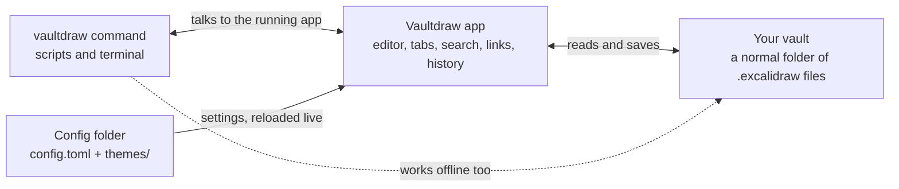

<h1 align="center">
  <picture>
    <source media="(prefers-color-scheme: dark)" srcset="docs/assets/brand/svg/lockup-dark.svg">
    
  </picture>
</h1>

<p align="center">Your Excalidraw drawings, in a folder you own.</p>

Vaultdraw is an offline desktop app for macOS that keeps your [Excalidraw](https://github.com/excalidraw/excalidraw) drawings as plain files in a folder on your computer, a bit like Obsidian for whiteboards. No account, no cloud, no telemetry.

[Website](https://vaultdraw.vercel.app) · [Download](https://github.com/Vaultdraw/vaultdraw/releases/latest) · [Changelog](CHANGELOG.md) · [Docs](https://vaultdraw.vercel.app/docs/)

[](https://vaultdraw.vercel.app)

## Features

The Excalidraw editor, plus what you need once you have more than one drawing:

| Feature | What it does |
| --- | --- |
| **Themes** | 123 palettes, light and dark, for the whole app and, if you like, the canvas. Drawings and exports keep standard colours. |
| **Tags** | Write `#ideas` in any text. A Tags panel lists them, search filters by them, and renaming a tag updates every drawing. |
| **Links** | Link drawings with `[[Name]]`, from text or a shape. Backlinks show what points here, and renaming a drawing fixes every link. |
| **Search** | Search inside every drawing in the vault (names, text, labels, formulas) and jump straight to the match. |
| **Command palette** | `Cmd+P` opens any drawing by name; `Cmd+Shift+P` runs any command. Every command can get its own key. |
| **Tool settings** | Each tool starts with its own style, pens are saved presets, and the laser is yours to tune, globally or per vault. |
| **History** | Earlier versions of every drawing, kept automatically. Scrub back, see what changed, restore in one click. |
| **Graph view** | Every drawing a dot, every link a line, plus a local graph of what sits near the open drawing. |
| **File import** | Drop images and PDFs from Finder onto the canvas. PDF pages become images you can write on, rendered offline. |
| **Templates** | Any drawing can become a template, for one vault or all of them. |

<table>
  <tr>
    <td width="50%"><picture><source media="(prefers-color-scheme: dark)" srcset="docs/assets/screenshots/search-dark.webp"></picture><br><b>Search</b> every drawing in the vault</td>
    <td width="50%"><picture><source media="(prefers-color-scheme: dark)" srcset="docs/assets/screenshots/graph-dark.webp"></picture><br><b>Graph view</b> of drawings and links</td>
  </tr>
  <tr>
    <td width="50%"><picture><source media="(prefers-color-scheme: dark)" srcset="docs/assets/screenshots/history-dark.webp"></picture><br><b>History</b> with previews and restore</td>
    <td width="50%"><picture><source media="(prefers-color-scheme: dark)" srcset="docs/assets/screenshots/palette-dark.webp"></picture><br><b>Command palette</b> for every drawing and command</td>
  </tr>
</table>

**Also**

- Your drawings are ordinary `.excalidraw` files in a folder you pick: back them up, sync them or open them anywhere.
- A file tree and tabs, autosave and crash recovery; changes made outside the app are picked up without losing your edits.
- Page mode (A4, Letter or custom pages) with PDF export, notebook paper, and PNG, SVG or clipboard export.
- Mermaid diagrams and LaTeX formulas, converted offline. Everything works offline; there is no account and no telemetry.
- A plain-text config folder you can edit by hand, and a `vaultdraw` command for the terminal.

**Coming next:** plugins (AI, a shape generator and more).

## How it fits together



Everything stays on your Mac. Back up, sync or version the vault folder with any tool you like.

## Install

1. **[Download Vaultdraw for macOS](https://github.com/Vaultdraw/vaultdraw/releases/download/v0.1.2/Vaultdraw_0.1.2_universal.dmg)** (DMG, 57 MB). Older and newer versions are on the [releases page](https://github.com/Vaultdraw/vaultdraw/releases).
2. Open it and drag Vaultdraw to Applications.

Or with Homebrew, which also installs the `vaultdraw` command:

```bash
brew install --cask vaultdraw/tap/vaultdraw
```

It runs on macOS, on Apple Silicon and on Intel.

Vaultdraw isn't signed with an Apple Developer certificate yet, so macOS may refuse to open it the first time. Try to open it once, then go to **System Settings → Privacy & Security** and click **Open Anyway**. If macOS says the app is "damaged", or the `vaultdraw` command stops with `Killed: 9`, run this and try again:

```bash
xattr -dr com.apple.quarantine /Applications/Vaultdraw.app
```

## Command line

Open the command palette and run **Install 'vaultdraw' command in PATH**. Then:

```bash
vaultdraw status                 # is the app running, which vault, which drawing
vaultdraw ls                     # list drawings and folders
vaultdraw search "meeting"       # search names, text and tags
vaultdraw open "Roadmap"         # open a drawing in the window
```

`vaultdraw --help` lists everything.

## Configuration

Settings live in a plain-text folder (`~/.config/vaultdraw/config.toml`, plus `themes/`). Edit it by hand or in Settings, and the app reloads it live. The full reference is in [docs/configuration.md](docs/configuration.md).

## Build from source

You need Node 18+, Yarn 1 and the [Tauri prerequisites](https://tauri.app/start/prerequisites/).

```bash
npx --yes yarn@1.22.22 install
npx --yes yarn@1.22.22 start     # run the app in dev mode
npx --yes yarn@1.22.22 desktop:build
```

## Contributing

Bug reports, ideas and pull requests are welcome. Open an [issue](https://github.com/Vaultdraw/vaultdraw/issues) to start. The [development notes](docs/development.md) cover the repo layout, tests and how to add a command; run `yarn test:typecheck` and `yarn test:app` before sending a PR.

## Credits

Vaultdraw is built on the [Excalidraw](https://github.com/excalidraw/excalidraw) editor (MIT). Themes use the [Noctalia](https://github.com/noctalia-dev/noctalia) palette format. The logo is drawn with [rough.js](https://roughjs.com) in Excalifont; logo files and usage are in [docs/brand.md](docs/brand.md). Vaultdraw is not affiliated with or endorsed by Excalidraw.

## License

MIT License. See [LICENSE](LICENSE).
