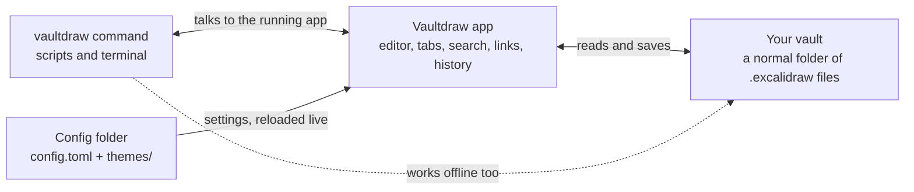

<h1 align="center">
  <picture>
    <source media="(prefers-color-scheme: dark)" srcset="docs/assets/brand/svg/lockup-dark.svg">
    
  </picture>
</h1>

<p align="center">Your Excalidraw drawings, in a folder you own.</p>

Vaultdraw is an offline desktop app for macOS that keeps your [Excalidraw](https://github.com/excalidraw/excalidraw) drawings as plain files in a folder on your computer, a bit like Obsidian for whiteboards. No account, no cloud, no telemetry.

[Website](https://vaultdraw.swarnim-114.workers.dev) · [Download](https://github.com/Vaultdraw/vaultdraw/releases/latest) · [Changelog](CHANGELOG.md) · [Docs](https://vaultdraw.swarnim-114.workers.dev/docs/)

[](https://vaultdraw.swarnim-114.workers.dev)

## Features

**Your files**

- Pick any folder as your vault. Drawings are ordinary `.excalidraw` files, so you can back them up, sync them or open them anywhere.
- A file tree next to the canvas, plus tabs for several open drawings.
- Autosave and crash recovery. Changes made outside the app are picked up without losing your edits.
- File history: earlier versions of every drawing, with previews and one-click restore.
- Everything works offline. Fonts and assets are bundled.

**Find and connect**

- Search inside your drawings, by name, text or tag.
- Link drawings with `[[links]]`, see backlinks, and explore the vault in a graph view.
- Tags, with a tag panel and filters.
- Templates for the drawings you start over and over.

**Draw and export**

- Page mode: draw on A4, Letter or custom pages and export them as a PDF.
- Import PDF pages and annotate them.
- Export PNG, SVG or PDF, or copy an image to the clipboard.
- Pens, a highlighter and a laser pointer.
- Insert Mermaid diagrams and LaTeX formulas, converted offline.

**Make it yours**

- Keyboard first: `Cmd+P` opens any drawing by name, `Cmd+Shift+P` runs any command, and you can rebind every hotkey.
- Colour themes in the Noctalia format, light and dark, with an option to sync the canvas with the theme.
- A plain-text config folder you can edit by hand. Changes reload live.
- A `vaultdraw` command-line tool.

**Coming next:** plugins (AI, a shape generator and more).

## How it fits together



Everything stays on your Mac. Back up, sync or version the vault folder with any tool you like.

## Install

1. **[Download Vaultdraw for macOS](https://github.com/Vaultdraw/vaultdraw/releases/download/v0.1.1/Vaultdraw_0.1.1_universal.dmg)** (DMG, 57 MB). Older and newer versions are on the [releases page](https://github.com/Vaultdraw/vaultdraw/releases).
2. Open it and drag Vaultdraw to Applications.

Or with Homebrew, which also installs the `vaultdraw` command:

```bash
brew install --cask vaultdraw/tap/vaultdraw
```

It runs on macOS, on Apple Silicon and on Intel.

Vaultdraw isn't signed with an Apple Developer certificate yet, so macOS may refuse to open it the first time. Try to open it once, then go to **System Settings → Privacy & Security** and click **Open Anyway**. If macOS says the app is "damaged", or the `vaultdraw` command stops with `Killed: 9`, run this and try again:

```bash
xattr -dr com.apple.quarantine /Applications/Vaultdraw.app
```

## Command line

Open the command palette and run **Install 'vaultdraw' command in PATH**. Then:

```bash
vaultdraw status                 # is the app running, which vault, which drawing
vaultdraw ls                     # list drawings and folders
vaultdraw search "meeting"       # search names, text and tags
vaultdraw open "Roadmap"         # open a drawing in the window
```

`vaultdraw --help` lists everything.

## Configuration

Settings live in a plain-text folder (`~/.config/vaultdraw/config.toml`, plus `themes/`). Edit it by hand or in Settings, and the app reloads it live. The full reference is in [docs/configuration.md](docs/configuration.md).

## Build from source

You need Node 18+, Yarn 1 and the [Tauri prerequisites](https://tauri.app/start/prerequisites/).

```bash
npx --yes yarn@1.22.22 install
npx --yes yarn@1.22.22 start     # run the app in dev mode
npx --yes yarn@1.22.22 desktop:build
```

## Contributing

Bug reports, ideas and pull requests are welcome. Open an [issue](https://github.com/Vaultdraw/vaultdraw/issues) to start. The [development notes](docs/development.md) cover the repo layout, tests and how to add a command; run `yarn test:typecheck` and `yarn test:app` before sending a PR.

## Credits

Vaultdraw is built on the [Excalidraw](https://github.com/excalidraw/excalidraw) editor (MIT). Themes use the [Noctalia](https://github.com/noctalia-dev/noctalia) palette format. The logo is drawn with [rough.js](https://roughjs.com) in Excalifont; logo files and usage are in [docs/brand.md](docs/brand.md). Vaultdraw is not affiliated with or endorsed by Excalidraw.

## License

MIT License. See [LICENSE](LICENSE).
