<h1 align="center">
  <picture>
    <source media="(prefers-color-scheme: dark)" srcset="docs/assets/brand/svg/lockup-dark.svg">
    
  </picture>
</h1>

<p align="center">Your Excalidraw drawings, in a folder you own.</p>

Vaultdraw is an offline desktop app for macOS that keeps your [Excalidraw](https://github.com/excalidraw/excalidraw) drawings as plain files in a folder on your computer, a bit like Obsidian for whiteboards. No account, no cloud, no telemetry.

[Website](https://vaultdraw.vercel.app) · [Download](https://github.com/Vaultdraw/vaultdraw/releases/latest) · [Changelog](CHANGELOG.md) · [Docs](https://vaultdraw.vercel.app/docs/)

[](https://vaultdraw.vercel.app)

## Features

The Excalidraw editor, plus what you need once you have more than one drawing:

<table>
  <tr>
    <td width="50%" valign="top">
      <picture><source media="(prefers-color-scheme: dark)" srcset="docs/assets/screenshots/themes-dark.webp">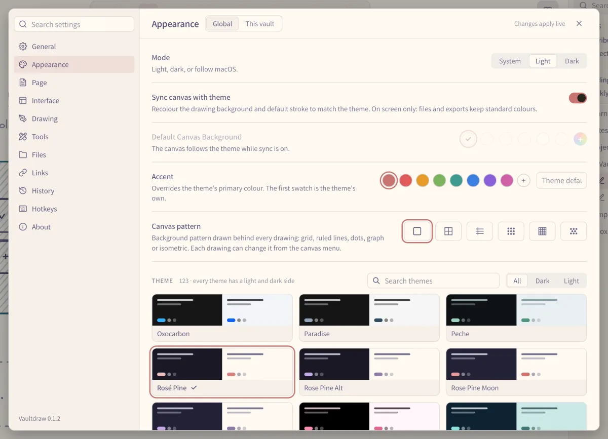</picture>
      <br><b>Themes</b><br>123 palettes, light and dark, for the whole app and, if you like, the canvas. Drawings and exports keep standard colours.
    </td>
    <td width="50%" valign="top">
      <picture><source media="(prefers-color-scheme: dark)" srcset="docs/assets/screenshots/tools-dark.webp">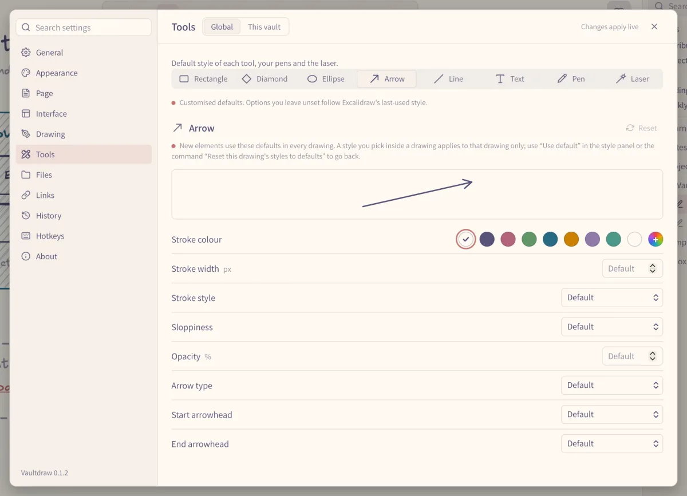</picture>
      <br><b>Tool settings</b><br>Each tool starts with its own style, pens are saved presets, and the laser is yours to tune, globally or per vault.
    </td>
  </tr>
  <tr>
    <td width="50%" valign="top">
      <picture><source media="(prefers-color-scheme: dark)" srcset="docs/assets/screenshots/tags-dark.webp">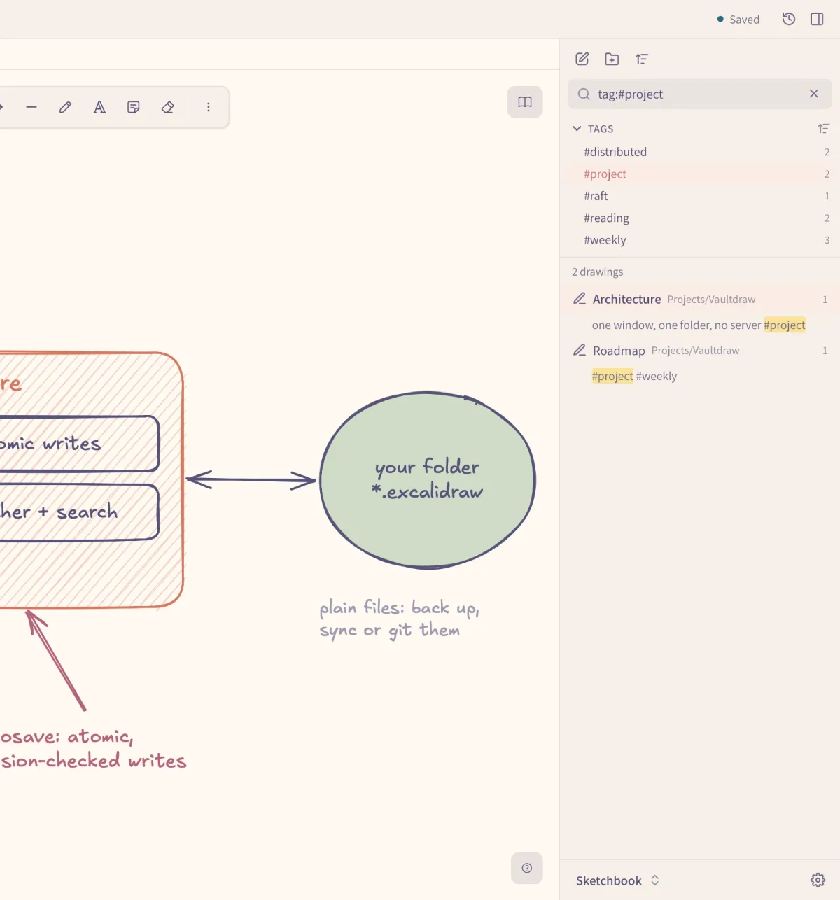</picture>
      <br><b>Tags</b><br>Write <code>#ideas</code> in any text. A Tags panel lists them, search filters by them, and renaming a tag updates every drawing.
    </td>
    <td width="50%" valign="top">
      <picture><source media="(prefers-color-scheme: dark)" srcset="docs/assets/screenshots/history-dark.webp">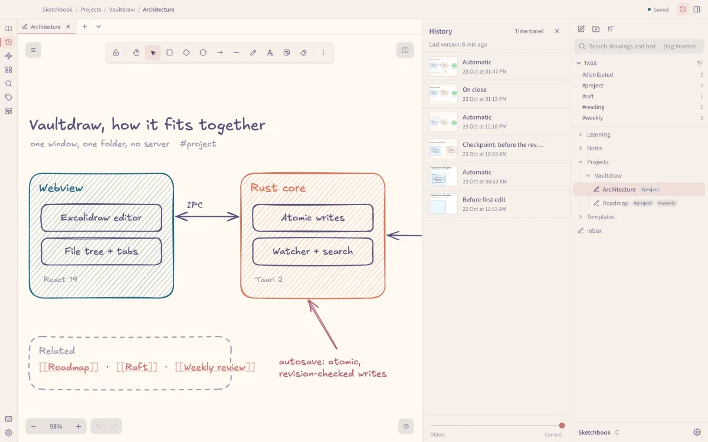</picture>
      <br><b>History</b><br>Earlier versions of every drawing, kept automatically. Scrub back, see what changed, restore in one click.
    </td>
  </tr>
  <tr>
    <td width="50%" valign="top">
      <picture><source media="(prefers-color-scheme: dark)" srcset="docs/assets/screenshots/links-dark.webp">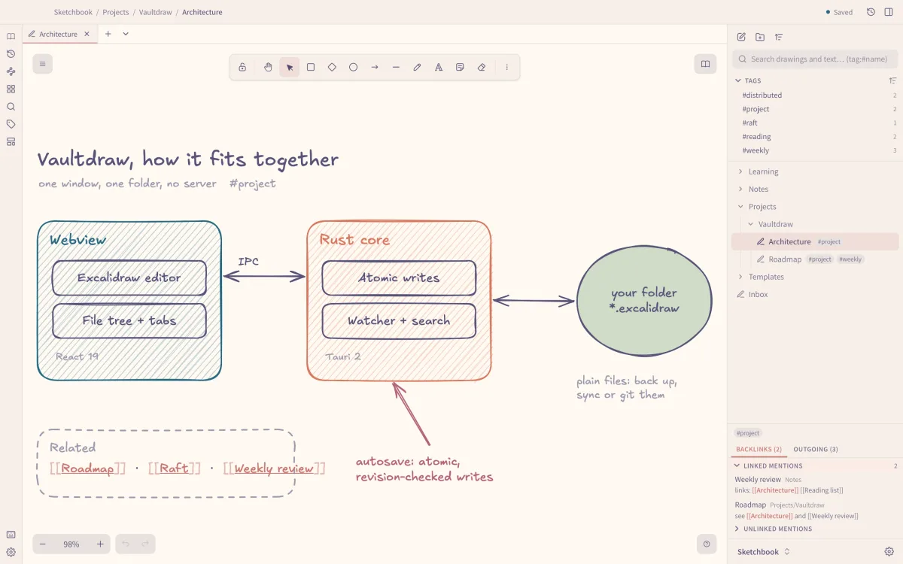</picture>
      <br><b>Links</b><br>Link drawings with <code>[[Name]]</code>, from text or a shape. Backlinks show what points here, and renaming a drawing fixes every link.
    </td>
    <td width="50%" valign="top">
      <picture><source media="(prefers-color-scheme: dark)" srcset="docs/assets/screenshots/search-dark.webp">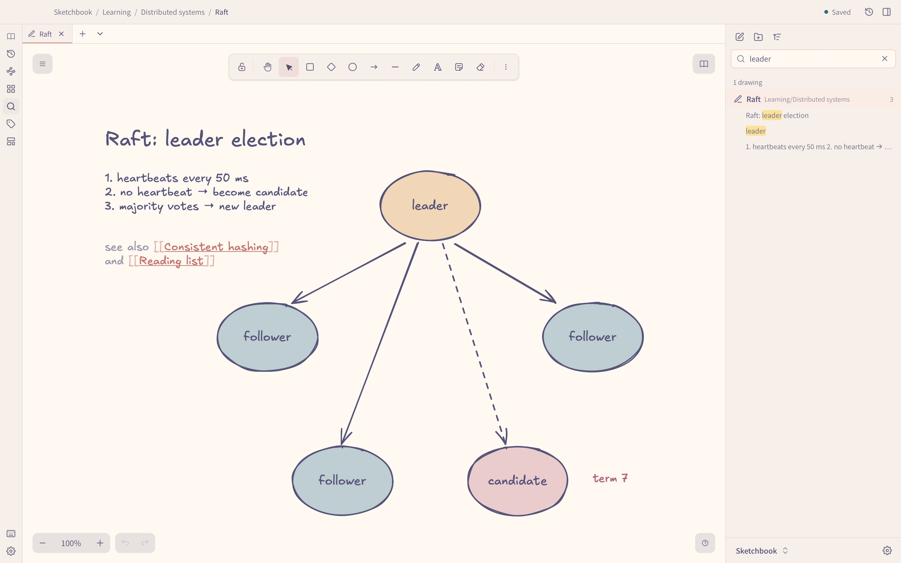</picture>
      <br><b>Search</b><br>Search inside every drawing in the vault (names, text, labels, formulas) and jump straight to the match.
    </td>
  </tr>
  <tr>
    <td width="50%" valign="top">
      <picture><source media="(prefers-color-scheme: dark)" srcset="docs/assets/screenshots/graph-dark.webp">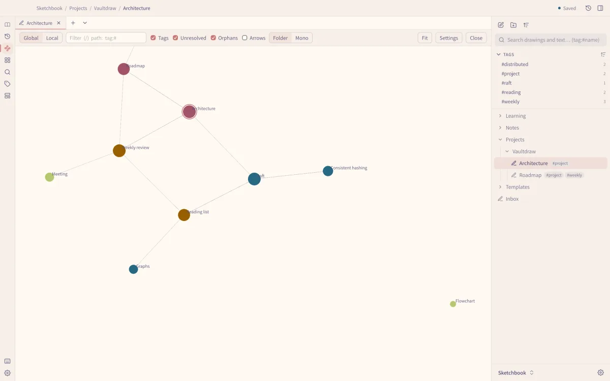</picture>
      <br><b>Graph view</b><br>Every drawing a dot, every link a line, plus a local graph of what sits near the open drawing.
    </td>
    <td width="50%" valign="top">
      <picture><source media="(prefers-color-scheme: dark)" srcset="docs/assets/screenshots/templates-dark.webp">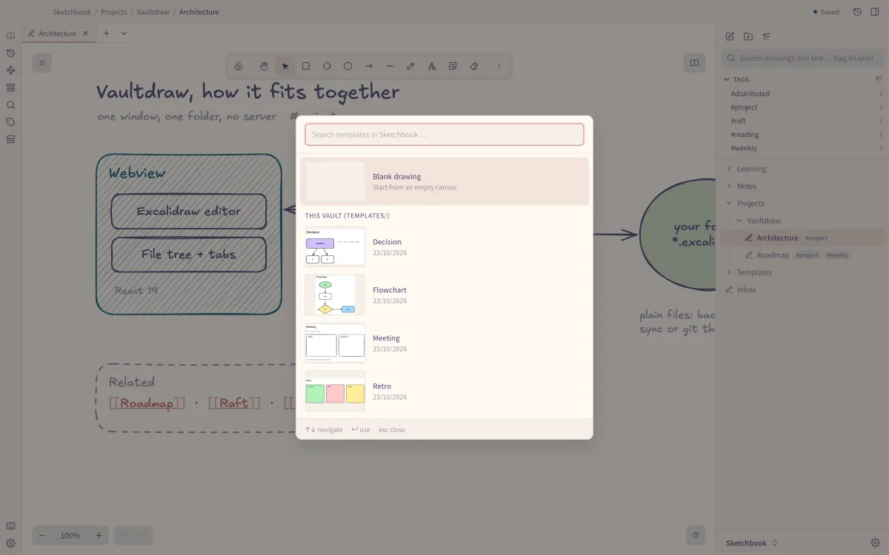</picture>
      <br><b>Templates</b><br>Any drawing can become a template, for one vault or all of them.
    </td>
  </tr>
  <tr>
    <td width="50%" valign="top">
      <picture><source media="(prefers-color-scheme: dark)" srcset="docs/assets/screenshots/palette-dark.webp">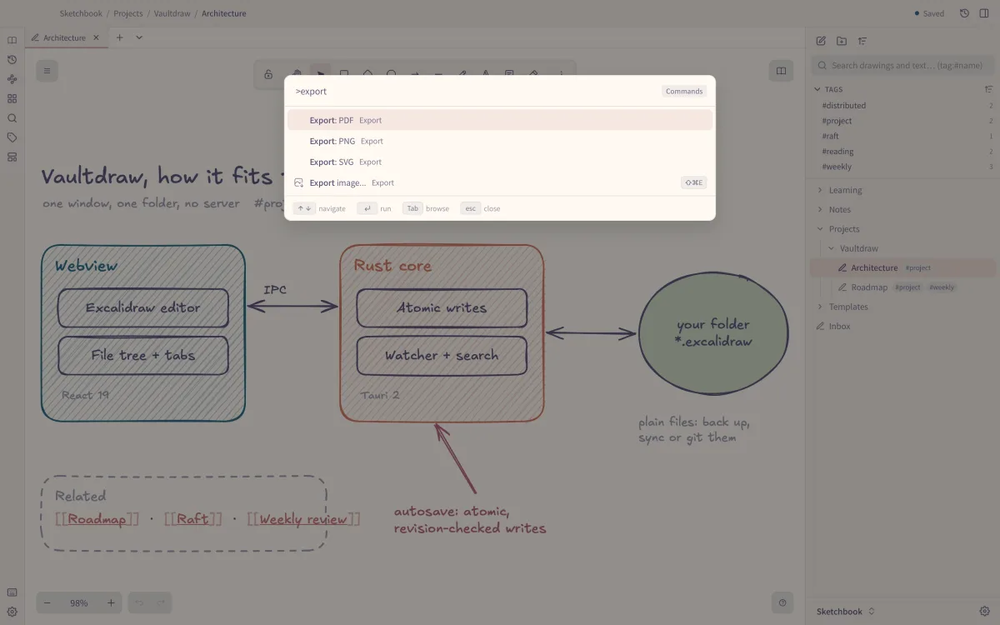</picture>
      <br><b>Command palette</b><br><code>Cmd+P</code> opens any drawing by name; <code>Cmd+Shift+P</code> runs any command. Every command can get its own key.
    </td>
    <td width="50%" valign="top">
      <picture><source media="(prefers-color-scheme: dark)" srcset="docs/assets/screenshots/import-dark.webp">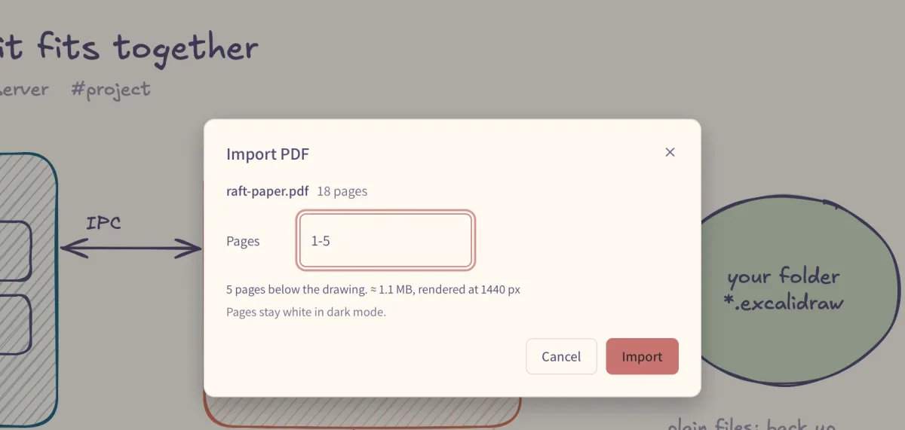</picture>
      <br><b>File import</b><br>Drop images and PDFs from Finder onto the canvas. PDF pages become images you can write on, rendered offline. A Markdown note becomes a page-mode drawing, and **Import Obsidian vault…** converts a whole Obsidian vault (links, images and Excalidraw drawings) into your vault; the original is never touched.
    </td>
  </tr>
</table>

**Also**

- Your drawings are ordinary `.excalidraw` files in a folder you pick: back them up, sync them or open them anywhere.
- A file tree and tabs, autosave and crash recovery; changes made outside the app are picked up without losing your edits.
- Page mode (A4, Letter or custom pages) with PDF export, notebook paper, and PNG, SVG or clipboard export.
- Mermaid diagrams and LaTeX formulas, converted offline. Everything works offline; there is no account and no telemetry.
- A plain-text config folder you can edit by hand, and a `vaultdraw` command for the terminal.
- Turn off any built-in feature you don't use (search, links, tags, graph, library, templates, formulas, Mermaid, PDF import): off means not loaded. A safe start (`vaultdraw launch --safe`) opens the app with all of them and every plugin off.
- `vaultdraw://` links that open a drawing, a search or a new drawing from a note, a web page or a script, asking first before anything writes. `.excalidraw` and `.excalidrawlib` files open from Finder's Open With, copied into a vault only if you say so ([details](docs/uri-scheme.md)).
- Vim-style key sequences (`g g`, `<leader> f f`) with a which-key popup, and every tool key rebindable; nothing is bound until you write it. A copyable preset is in `docs/presets/vim.toml`.

**Coming next:** plugins (AI, a shape generator and more).

Writing a plugin? See [sdk/docs/getting-started.md](sdk/docs/getting-started.md). Testing and packaging are in [testing.md](sdk/docs/testing.md) and [packaging.md](sdk/docs/packaging.md). What a plugin may declare, and what that does and does not protect, is in [permissions.md](sdk/docs/permissions.md).

## How it fits together

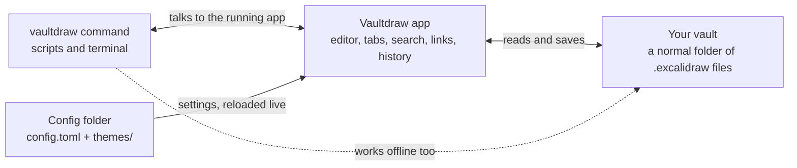

Everything stays on your Mac. Back up, sync or version the vault folder with any tool you like.

## Install

1. **[Download Vaultdraw for macOS](https://github.com/Vaultdraw/vaultdraw/releases/download/v0.2.0/Vaultdraw_0.2.0_universal.dmg)** (DMG, 57 MB). Older and newer versions are on the [releases page](https://github.com/Vaultdraw/vaultdraw/releases).
2. Open it and drag Vaultdraw to Applications.

Or with Homebrew, which also installs the `vaultdraw` command:

```bash
brew install --cask vaultdraw/tap/vaultdraw
```

It runs on macOS, on Apple Silicon and on Intel.

Vaultdraw isn't signed with an Apple Developer certificate yet, so macOS may refuse to open it the first time. Try to open it once, then go to **System Settings → Privacy & Security** and click **Open Anyway**. If macOS says the app is "damaged", or the `vaultdraw` command stops with `Killed: 9`, run this and try again:

```bash
xattr -dr com.apple.quarantine /Applications/Vaultdraw.app
```

## Command line

Open the command palette and run **Install 'vaultdraw' command in PATH**. Then:

```bash
vaultdraw status                 # is the app running, which vault, which drawing
vaultdraw ls                     # list drawings and folders
vaultdraw search "meeting"       # search names, text and tags
vaultdraw open "Roadmap"         # open a drawing in the window
vaultdraw new "Ideas/Sketch"     # new drawing with your paper and page defaults
vaultdraw export "Roadmap" -o roadmap.svg   # render a drawing to PNG, SVG or PDF
vaultdraw config check           # find typos and bad values in your config, with line numbers
vaultdraw doctor                 # one read-only report for bug reports
```

`vaultdraw --help` lists everything.

### Read and edit the drawing on screen

The `scene` commands work on the drawing on screen. The app must be running.

```bash
vaultdraw scene read --scope selection            # elements in the selection (scope: all, viewport, selection)
vaultdraw scene get 3fA9kLm2                      # elements by id (ids come from scene read)
vaultdraw scene selection                         # the selected elements
echo '[{"op":"add","element":{"type":"rectangle","width":120,"height":80}}]' | vaultdraw scene apply
```

- One `scene apply` is one undo step. Undo reverts the whole batch.
- `--if-version <v>` refuses with a conflict when the drawing changed since you read it. The `version` is in the `scene read` output.
- After a timeout, retry with `--if-version` so a late first call cannot apply twice.
- `--dry-run` checks the operations and changes nothing.
- Operations are `add`, `update` (id and props) and `delete` (id). One call takes up to 500.
- The `scene.*` methods are experimental. Their names and shapes may change before API level 2.
- AI apps will reach the same methods through the AI tools interface, which is refused unless you turn AI on in Settings → Control (off by default; see [AI](docs/configuration.md#ai)).

## Configuration

Settings live in a plain-text folder (`~/.config/vaultdraw/config.toml`, plus `themes/`). Edit it by hand or in Settings (Settings saves to its own `overrides.toml`, so your `config.toml` is never rewritten), and the app reloads it live. A chip beside each setting says which file its value comes from. The full reference is in [docs/configuration.md](docs/configuration.md).

## Build from source

You need Node 18+, Yarn 1 and the [Tauri prerequisites](https://tauri.app/start/prerequisites/).

```bash
npx --yes yarn@1.22.22 install
npx --yes yarn@1.22.22 start     # run the app in dev mode
npx --yes yarn@1.22.22 desktop:build
```

## Contributing

Bug reports, ideas and pull requests are welcome. Open an [issue](https://github.com/Vaultdraw/vaultdraw/issues) to start. The [development notes](docs/development.md) cover the repo layout, tests and how to add a command; run `yarn test:typecheck` and `yarn test:app` before sending a PR.

## Credits

Vaultdraw is built on the [Excalidraw](https://github.com/excalidraw/excalidraw) editor (MIT). Themes use the [Noctalia](https://github.com/noctalia-dev/noctalia) palette format. The logo is drawn with [rough.js](https://roughjs.com) in Excalifont; logo files and usage are in [docs/brand.md](docs/brand.md). Vaultdraw is not affiliated with or endorsed by Excalidraw.

## License

MIT License. See [LICENSE](LICENSE).
