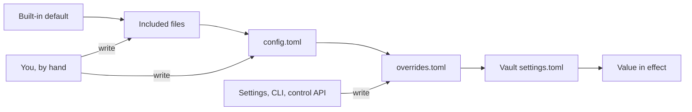
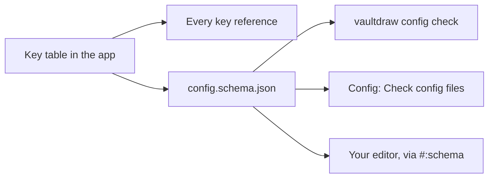
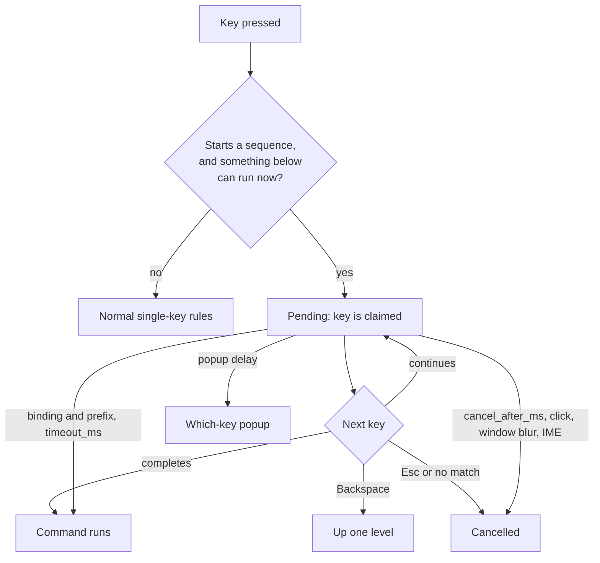

# Configuration

Everything you can change in Vaultdraw, in one place. Back to the [README](../README.md).

All settings live in one folder, like kitty, Ghostty or Zed:

| OS | Config folder | State folder (`state.json`, `overrides.toml`) |
| --- | --- | --- |
| macOS, Linux | `$XDG_CONFIG_HOME/vaultdraw`, else `~/.config/vaultdraw` | `$XDG_STATE_HOME/vaultdraw`, else `~/.local/state/vaultdraw` |
| Windows | `%APPDATA%\Vaultdraw` | `%LOCALAPPDATA%\Vaultdraw` |

```
config folder                 state folder
vaultdraw/                    vaultdraw/
├── config.toml   yours       ├── overrides.toml   what Settings saves
├── themes/       themes      └── state.json       machine state
└── snippets/     CSS snippets
```

`config.toml` is created on first launch, with every key listed and commented. The common keys and their defaults (the full list is [Every key](#every-key) below):

```toml
[appearance]
theme = "Default"            # a built-in theme or one in themes/
mode = "system"              # light | dark | system
sync_canvas = false          # canvas follows the theme's colours
canvas_background = "#ffffff" # for new drawings when sync_canvas is off
accent_color = ""            # "#rrggbb" replaces the theme's primary colour; "" = the theme's own
snippets = []                # CSS snippets to apply, by file name in snippets/, e.g. ["wide-sidebar"]

[network]
enabled = true               # master switch: false blocks every download
allow_themes = true          # theme downloads allowed; leave the line out to be asked

[themes]
max_install_kb = 64          # largest theme file Install from URL accepts (1 to 256)
index_url = "https://raw.githubusercontent.com/Vaultdraw/themes/main/index.json"  # community list, https only
index_ttl_hours = 24         # reuse the cached list this long (0 to 720; 0 = fetch on every open)
previews = true              # theme browser fetches preview images; false = colour swatches only

[editor]                     # defaults for new elements
font_family = 5              # 5 Excalifont, 6 Nunito, 8 Comic Shanns, 1 Virgil, 2 Helvetica, 3 Cascadia
font_size = 20
stroke_color = "#1e1e1e"
background_color = "transparent"
fill_style = "solid"         # solid | hachure | cross-hatch
stroke_width = 2
roughness = 1                # 0 architect, 1 artist, 2 cartoonist

[paper]
style = "plain"             # plain | grid | lines | dots | graph | isometric
spacing = 0                 # 5 to 200 (0 = the style's own)
color = ""                  # "#rrggbb"; "" = automatic
opacity = 1                 # 0.1 to 1
major_every = 0             # grid and graph: a stronger line every N, 1 to 20 (0 = the style's own)
margin_line = true          # ruled lines: draw the margin line

[page]                       # page mode for new drawings; see "Page mode"
mode = "normal"              # normal (infinite canvas) | page
layout = "separate"          # separate (sheets with a gap) | continuous (one long page)
size = "a4"                  # a3 | a4 | a5 | b5 | letter | legal | tablet | tabletLarge | phone | custom
orientation = "portrait"     # portrait | landscape
width = 0                    # custom size in px, 100 to 5000 (0 = unset)
height = 0
paper_theme = "normal"       # normal | old_school | match

[saving]
autosave_delay_ms = 500      # idle time before an edit is written to disk

[interface]
zoom = 100                   # whole-app zoom, 50 to 200 percent
thumbnail_max_elements = 8000 # biggest drawing that gets a thumbnail, 100 to 50000
defer_home_pane = true       # show the file tree first, the home pane one frame later

[navigator]
sort = "name_asc"            # name_asc | name_desc | modified_desc | modified_asc

[files]
confirm_delete = true        # ask before moving to Trash
new_drawing_folder = ""      # relative to the vault root; "" = next to the open drawing
templates_folder = "Templates" # vault folder holding templates, relative to the vault root

[memory]                     # see "Memory"
free_unused_images = true    # release image data of deleted images once no undo step can restore it
undo_steps = 1000            # undo steps kept per drawing, 10 to 10000

[tools.arrow]                # default style of one tool; see "Tool defaults"
stroke_color = "#f08c00"     # set only the keys you want; others keep the current style
stroke_width = 3
stroke_style = "dotted"
```

- **Two files, two owners.** `config.toml` is yours: the app creates it once and never writes to it again. What you change in Settings goes to `overrides.toml` in the state folder, and wins over `config.toml`. See [Layers](#layers).
- **Live reload.** Saved changes apply immediately, no restart needed. Delete a line to go back to its default.
- **Typos are safe.** If the file can't be parsed, the app keeps the last good settings and shows a banner such as `config.toml line 7: <error>`. A value of the wrong type falls back to its default and is reported the same way. A key the app doesn't know, such as `zom` for `zoom` (or `stroke_colour` inside `[tools.arrow]`), is a warning: only that key is ignored, the rest applies, and a notice names the closest real key: `config.toml: unknown key interface.zom (ignored; did you mean interface.zoom?)`. A vault's `settings.toml` is checked the same way. Errors stay in the banner until fixed; every current error and warning is listed under **Settings → General → Config file**.
- **Settings → General → Config files** lists both files with their paths and status, an **Open** button for each, **Open config folder**, **Reload**, and **Reset all Settings changes**. All of these are palette commands too: see [Where a value comes from](#where-a-value-comes-from).

`state.json` holds machine state (recent vaults, navigator width, expanded folders, last-used image export options). It is not meant for hand editing.

### Layers

A setting's value comes from the first of these that sets it, highest first:

| Layer | File | Written by |
| --- | --- | --- |
| Vault | `<vault>/.excalidraw-vault/settings.toml` | Settings, with **This vault** on (only the keys marked *per vault* in [Every key](#every-key)) |
| Overrides | `overrides.toml` in the state folder | Settings, `vaultdraw config set`, the control API |
| Your file | `config.toml` in the config folder | you, by hand |
| Included files | named by `[include]` in `config.toml` ([see below](#including-other-files)) | you, by hand |
| Built-in | the app | nobody |



- **Tables merge key by key.** A list or a value in a higher layer replaces the lower one. `[tools.<tool>]` and `[plugin.<id>]` are replaced as a whole, and `[hotkeys]` merges per command id.
- **Settings never edits `config.toml`.** Your comments, order and layout stay as you wrote them, and a dotfiles checkout or a read-only config folder works.
- **A Settings change that matches `config.toml` is not stored.** Changing a value back to what `config.toml` says removes it from `overrides.toml`. **Reset** (the default value) over a value that `config.toml` sets stores the default, so the default wins.
- **`overrides.toml` is safe to delete.** Values fall back to `config.toml` at once. It starts with a header comment, is plain TOML, and reloads live like `config.toml`, so you can read or edit it too.
- **Existing configs keep working.** Whatever Settings wrote to `config.toml` before stays there as the base layer; nothing is moved or rewritten. A newer Settings change to the same key goes to `overrides.toml` and wins.
- **A broken file never loses your settings.** If either file fails to parse on reload, the app keeps the last good settings and the banner names the file (`overrides.toml line 2: ...`). At startup the file that parses still applies. While either file is broken Settings refuses to save (it could not tell what your change means, and a good write must never overwrite a file you still have to fix): fix the file, or delete `overrides.toml`.
- **Removing a value that `config.toml` sets.** A value in `config.toml` can be replaced from Settings (Reset stores the default), but a key with no default, such as a `[keys.labels]` entry, can only be removed in `config.toml` itself: Settings shows a `config.toml` chip on that name and disables its remove button. `vaultdraw config set <key> null` drops what Settings or the CLI stored in `overrides.toml`; it does not edit `config.toml`. A key inside `[tools.<tool>]` or `[plugin.<id>]` set from the CLI rewrites that whole table in `overrides.toml`, starting from the table in effect, so its other keys keep their values.
- **Unknown keys** are reported with the name of the file that holds them.
- **Control switches.** `[control] enabled` is read through every layer (included files, `config.toml`, `overrides.toml`) before the app starts the control socket, so `vaultdraw config set control.enabled false` holds at the next launch. `uri_enabled` and `uri_allow` are read through the same layers at each link.
- **Older versions** ignore `overrides.toml`, so a downgrade shows `config.toml` values only.

### Including other files

Split `config.toml` into pieces, or share part of it between machines, with `[include]` (like Alacritty's `import`). It is written by hand and costs nothing when absent: no file is read unless `config.toml` has the table.

```toml
# config.toml
[include]
files = [
  "keys.toml",                         # next to config.toml
  "machine/",                          # every *.toml directly inside, sorted by name
  "~/dotfiles/vaultdraw/colors.toml",
]
```

| Rule | Behaviour |
| --- | --- |
| Entries | A file, or a folder: its `*.toml` files, sorted by name, not its sub-folders. |
| Paths | Relative to the folder of the file that lists them, or starting with `~` (your home folder). `${VAR}` and `~user` are not supported. |
| Order | Later entries win over earlier ones. The file that includes wins over the files it includes. `overrides.toml` and the vault's settings win over all of them. |
| Nesting | An included file can have its own `[include]`, up to 8 levels deep. Each file is read once, at its first place. |
| Cycles | `a.toml` including `b.toml` including `a.toml` is skipped with a warning (`include cycle: a.toml -> b.toml -> a.toml`). |
| Problems | A missing, unreadable, symlinked, oversize (over 1 MiB), non-UTF-8 or broken file is skipped with a warning that names it (and the line); everything else applies. Limits: 32 files and 4 MiB in all. |
| Where | Only `config.toml` and the files it includes. An `[include]` in `overrides.toml` or in a vault's `settings.toml` is ignored (a cloned vault must not pull in files by path). |
| Vaults | A path inside a vault (a folder with `.excalidraw-vault`) is refused. |
| Symlinks | Refused, like a symlinked `config.toml`. |

Nothing is loaded that you did not name: there is no automatic folder and no globbing. Vaultdraw never writes to an included file; Settings still saves to `overrides.toml`, and a change that matches what an include says is not stored. The chip beside a setting names the included file it comes from, **Settings → General → Config files** lists every included file with its status and an Open button, and `vaultdraw config get <key> --source` prints its path. Editing an included file, or creating a `*.toml` in an included folder, reloads live; if a folder cannot be watched, press **Reload**.

### Where a value comes from

Every setting with a config key shows a small chip beside its name when it is not the built-in default: `config.toml` or `overrides`. Click it for details, all computed from the files already loaded.

| Chip says | Meaning | Actions |
| --- | --- | --- |
| `config.toml` | Your file sets it. A change made in Settings is saved apart and wins. | **Use default** (stores the default), **Open config.toml** |
| the name of an included file, such as `colors.toml` | That included file sets it. | **Use default**, **Open** that file |
| `overrides` | Settings saved it. | **Reset to default** |
| `overrides ≠` | Settings saved it and hides a different `config.toml` value, which the note names (`config.toml says 14`). | **Reset to config.toml value**, **Open config.toml** |

**Reset to config.toml value** removes the key from `overrides.toml`; `config.toml` is never edited, by Settings, the CLI or a command.

**Commands** (palette, no default keys, rebindable in Settings → Hotkeys or `[hotkeys]`):

| Command | Does |
| --- | --- |
| `config.reload` | Re-read `config.toml`, the included files and `overrides.toml` now |
| `config.openFile` | Open `config.toml` with the default app |
| `config.openOverrides` | Show `overrides.toml` in the file manager (its folder if nothing was saved yet) |
| `config.openFolder` | Open the config folder |
| `config.resetOverrides` | Delete `overrides.toml` after a confirmation; values return to `config.toml` or the defaults |

**CLI** (works with or without the app):

```sh
vaultdraw config get editor.font_size --source
# 20  (overrides.toml; config.toml says 14)
vaultdraw config get interface.zoom --source
# null  (default)
vaultdraw config path --all          # config.toml, then overrides.toml
```

With `--json`, `get --source` adds `"source"` (`default`, `config.toml`, `overrides.toml` or the full path of an included file) and, when a higher file hides another value, `"hidden": {"file": ..., "value": ...}`. `--source` needs a key. A value shown as `null` with source `default` means no file sets the key.

A value that fails validation is reported with the file it came from (`overrides.toml: editor.font_size = "big" is not valid ...`).

### Checking your config

`vaultdraw config check` reads every layer (included files, `config.toml`, `overrides.toml`) and reports each problem with its file, line and column, the same way the app judges it. It needs no running app, reads only, and never touches the network.

```sh
vaultdraw config check
# config.toml:2:1: warning: unknown key interface.zom (ignored; did you mean interface.zoom?)
# config.toml:3:1: error: interface.zoom = "big" is not valid (expected a whole number between 50 and 200)
# 1 error, 1 warning in 1 config file.
```

| Exit code | When |
| --- | --- |
| 0 | No errors (warnings allowed) |
| 1 | At least one error (a parse error, wrong type, value out of range); with `--strict`, also any warning (such as an unknown key) |

`--json` prints the report as `{ok, errors, warnings, files, problems, text}`; each problem has `file`, `path`, `line`, `column`, `key`, `severity` and `message`. `--strict` suits a dotfiles check before you commit.

In the app, **Config: Check config files** (palette) or **Check** in **Settings → General → Config files** shows the same report, with Copy.

**Editor completion and checks.** The key table that drives the app also generates a JSON Schema of `config.toml`, so it can't drift from what the app accepts. Save it and point your editor at it:

```sh
vaultdraw config schema > ~/.config/vaultdraw/config.schema.json
```

Then put this first line in `config.toml` (read by taplo and the Even Better TOML extension; the app ignores it as a comment):

```toml
#:schema ./config.schema.json
```

The schema ships with the source as [`docs/config.schema.json`](config.schema.json). It has no URL to fetch: everything stays offline.



**Debug info for bug reports.** `vaultdraw doctor` (or **Config: Show debug info** in the palette) prints one read-only report: versions, the config, state and plugins folders, each config file's status, every key changed from its default and the file it comes from, installed and enabled extensions, the vault and its search index, and the control socket. It creates nothing, writes nothing, and works with the app closed; with the app running it asks the app for its version and vault (2-second limit). `--json` gives the same facts as JSON. Paste it into an issue; check it first, as it contains your folder paths.

**Commands** (palette, no default keys, rebindable):

| Command | Does |
| --- | --- |
| `config.check` | Check every config file and show the report |
| `config.debugInfo` | Show the debug info report (the same as `vaultdraw doctor`) |

### Settings reference

Everything here can be changed in **Settings** (Cmd/Ctrl+,) or by editing `config.toml` (a Settings change wins over the file; see [Layers](#layers)).

- **Accent colour** (Appearance, `appearance.accent_color`). Replaces the theme's primary colour in both light and dark mode, using a picker or a hex value. If the colour would be hard to read against the theme, it is nudged until it is, and Settings shows "Adjusted for contrast" with the colour actually used. **Reset** (or an empty value) goes back to the theme's own.
- **Interface zoom** (Interface, `interface.zoom`). Scales the whole window from 50 % to 200 %. **Cmd/Ctrl+Shift + `+`**, **`-`** and **`0`** step by 10 and reset to 100 %. Plain **Cmd/Ctrl + `+`**, **`-`** and **`0`** still zoom the canvas, as in Excalidraw.
- **Navigator sort order** (Interface, `navigator.sort`, also the sort button in the navigator toolbar). Four orders: name A to Z, name Z to A, modified new to old, modified old to new. Folders always come first; the order applies within folders and within drawings. Names compare ignoring case and by number, so "Drawing 2" comes before "Drawing 10".
- **Thumbnail size limit** (`config.toml` only, `interface.thumbnail_max_elements`, default 8000). Drawings with more elements than this keep a placeholder instead of a thumbnail (a small marker file records the failure). Thumbnails draw in short steps, so even 8,000 elements does not freeze the window: the longest single step measured 24 to 31 ms at 4x CPU slowdown and 29 to 52 ms at 6x. Raise it for big drawings, lower it on a slow machine; the change applies at once and only the drawings that had no thumbnail are retried. Lowering it does not remove thumbnails already cached; the palette command **Thumbnails: Clear cache for this vault** does. Drawings whose file is over 8 MB never get one.
- **Home pane after the tree** (`config.toml` only, `interface.defer_home_pane`, default true). When a vault opens, the file tree paints first and the home pane (recent drawings and actions) one frame later, in the same place, so nothing moves. The tree appears about 10 ms sooner at 4x CPU slowdown. Set it to `false` to draw both together. Applies at once to the next vault you open.
- **Confirm before delete** (Files, `files.confirm_delete`). On by default. Turn it off and "Move to Trash" acts immediately. It only affects moving to Trash, which can be undone from the OS trash.
- **Default folder for new drawings** (Files, `files.new_drawing_folder`). A path relative to the vault root, for example `Sketches/Inbox`. It is created if it doesn't exist. Empty (the default) puts a new drawing next to the open drawing.

#### Startup

Settings → General → **Startup** chooses when four background services start, so opening a vault does not pay for work you may not use. Each has three buttons: **On open**, **When idle** and **On first use**. All apply live.

| Key | Default | Starts |
| --- | --- | --- |
| `search.start` | `"idle"` | the search index |
| `links.start` | `"idle"` | the link index (backlinks, link lookup, graph) |
| `history.start` | `"open"` | file history (versions and checkpoints) |
| `files.list_start` | `"idle"` | the file list: a walk of every vault folder (the file tree itself always loads at open) |

Values for each key:

- `"open"`: when the vault opens.
- `"idle"`: after the first paint, once keyboard and mouse input has been quiet for about a second, and at most about 5 s after the vault opens.
- `"use"`: on the first thing that needs it.

```toml
[search]
start = "idle"     # open | idle | use

[links]
start = "idle"     # open | idle | use

[history]
start = "open"     # open | idle | use

[files]
list_start = "idle"  # open | idle | use
```

What `"use"` means for each service:

- **Search:** the first search (navigator search, quick switcher or CLI query). Until the index starts, the navigator's tag list is empty; it fills in once the index starts.
- **Links:** the first links action (backlinks dock, link lookup, graph, or a rename that updates links). That action waits for the index. Starting links also starts search, because the link index is built from it, and pre-builds the link index.
- **History:** the first edit or save of a drawing, a rename or move, or the first history action (panel or checkpoint). It starts with the vault's own history settings. Settings → History shows storage use once history has started.
- **File list:** the first thing that needs every drawing's name: the home page's Recent drawings, the file switcher or palette, a navigator search, `[[` link suggestions or a new link, the move dialog or a drag in the tree, a change made in the app (new, rename, move, duplicate, delete) or `vaultdraw open`. Until it starts, Recent and link suggestions are empty, and `vaultdraw open` tries the path as given.

Notes:

- With `"open"`, the app starts the service itself as the vault opens, before the window has loaded, so history records every save from the first one.
- With `history.start` set to `"idle"` or `"use"`, changes made outside the app before history starts have no version. Your own saves always start it first. This is why the default is `"open"`.
- A started service keeps running until the vault closes. Switching a setting to an earlier mode (for example `"use"` to `"open"`) starts it right away.
- File changes made while a service waits are picked up when it starts, because it rescans. Nothing is lost.

#### Per-vault settings

The colour theme, light or dark mode and the accent colour, navigator sort order, the default folder for new drawings, the templates folder, the paper style and each tool's default style can differ per vault. Hotkeys stay global. Those rows have a **This vault** switch:

- **On:** the value is saved in `<vault>/.excalidraw-vault/settings.toml`, starting from the value currently in effect. Edits go there.
- **Off:** the key is removed from that file and the global value applies again.

The file lives inside the vault, so it travels with it when you copy, sync or back up the folder. Precedence is per-vault value, then `overrides.toml`, then `config.toml`, then the default (see [Layers](#layers)). Like `config.toml` it is plain TOML, reloads live, keeps your comments, and a bad value is ignored with a notice while the rest still applies.

```toml
# <vault>/.excalidraw-vault/settings.toml
[navigator]
sort = "modified_desc"

[files]
new_drawing_folder = "Sketches/Inbox"
```

### Themes

A theme sets the colours of the whole app: the file tree, header, Settings and Excalidraw's toolbars, menus and dialogs. Every theme has a dark and a light variant, so theme and mode are chosen separately, in **Settings → Appearance** or in `config.toml`:

```toml
[appearance]
theme = "Tokyo Night"   # theme name, case-insensitive
mode = "system"         # light | dark | system (follows the OS)
sync_canvas = true      # canvas follows the theme too
```

**One theme per vault:** in Settings → Appearance, switch the scope to **This vault** and pick a theme, mode or accent; it is saved in that vault's `settings.toml` (`[appearance] theme`, `mode`, `accent_color`) and applies when the vault opens. **Appearance: Use the current theme for this vault only** and **Appearance: Use the global theme in this vault** do the same from the palette. Theme files stay in the config folder's `themes/`.

**Built-in themes (10):** Default, Dracula, Catppuccin, Solarized, Gruvbox, Tokyo Night, Nord, Kanagawa, Everforest and One Dark. If `theme` names a theme that doesn't exist, Vaultdraw uses Default and shows a warning. If it names one that used to be built in, the warning offers **Install it** (see below).

#### Browsing community themes

**Settings → Appearance → Install more themes…** (or `Themes: Browse community themes`) opens a browser for the [Vaultdraw/themes](https://github.com/Vaultdraw/themes) list. The dialog loads only when opened, so it costs nothing until then.

- **Cards** show a preview image or colour swatches, name, author, description, dark or light, credit and licence, and an **Installed** or **Update** badge.
- **Find:** the search box matches name, author, tag and description; tag and mode filters narrow it further.
- **Actions:** **Install**, **Update** (shown when the list has a newer file than the installed one), **Use** and **Remove**.
- **Keys:** search is focused on open. Arrows move between cards, **Enter** installs or uses, **Delete** removes (**Shift+Delete** in the search box), **/** jumps back to search, **Escape** closes. They are commands you can rebind on the Hotkeys page (below). Escape always closes, like every dialog; `themeBrowser.close` adds one more key for it.

| Command | What it does |
| --- | --- |
| `Themes: Browse community themes` (`theme.browse`) | Opens the browser. |
| `Themes: Refresh the community themes list` (`theme.browseRefresh`) | Fetches the list again, ignoring the cache. |

The two commands above have no default key; bind them on the Hotkeys page.

The keys inside the open browser are commands too. They exist only while the browser is open (context key `themeBrowser.open`), show in the palette and the Hotkeys page under **Themes**, and follow `[hotkeys]` in `config.toml`:

| Command | Default key |
| --- | --- |
| `themeBrowser.next`, `themeBrowser.prev` | Right, Left |
| `themeBrowser.down`, `themeBrowser.up` | Down, Up |
| `themeBrowser.activate` (install, update or use) | Enter |
| `themeBrowser.remove` | Delete, Shift+Delete |
| `themeBrowser.search` | / |
| `themeBrowser.close` | none (an extra close key; **Escape** always closes) |

In the search box plain keys are text, so only the movement keys and Enter work there, plus a Shift chord for remove.

Limits: the list needs network consent (see "Network"), and the CLI `vaultdraw theme install` does not exist yet (the CLI has no network client or consent step). The preview cache keeps the 300 most recently used images.

#### Installing more themes

Over a hundred more palettes, all credited to their authors, live in the [Vaultdraw/themes](https://github.com/Vaultdraw/themes) repo. Install one, or any theme file or repo you trust:

1. Open **Settings → Appearance → Install from URL…** (or run `Themes: Install from URL or GitHub repo` from the command palette).
2. Allow theme downloads the first time (see "Network" below).
3. Paste the address of a theme `.json`, or a GitHub repo (`owner/repo`, or a `github.com/owner/repo/tree/<branch>/<folder>` link), and pick a theme from the list. A web address needs its `https://`: `example.com/x.json` is refused, since `owner/repo` would read it as a GitHub repo. Host names that point to a private or local address are never contacted.
4. Confirm. The theme is saved in `themes/<Name>/` with a `source.json` that records where it came from, and **Use it** selects it.

| Command | What it does |
| --- | --- |
| `Themes: Install from URL or GitHub repo` | The steps above. |
| `Themes: Check installed themes for updates` | Re-downloads each installed theme's source and offers **Update** when the file changed. A theme from a repo updates from the branch, tag or commit you installed it from. Nothing changes without your click. |
| `Themes: Remove an installed theme` | Deletes a theme that was installed this way. Themes you added by hand are never listed or touched. |

None has a default key; bind them on the Hotkeys page.

- Only `https` addresses are accepted (plain `http` only for `localhost`). Downloads over `themes.max_install_kb` are refused, and the file is checked as a theme before anything is written.
- A theme with the same name as an installed one asks: **Replace** or **Keep both**. A theme you added by hand is never overwritten.
- In the browser build, only direct file addresses work and themes are kept in the browser.

#### Network

Vaultdraw never connects on its own: no update checks, no telemetry. Installing a theme, and browsing the community list, are the features that download, and they ask first.

| Key | Meaning |
| --- | --- |
| `network.enabled` | Master switch, default `true`. `false` blocks every download, whatever else is allowed. Turning it back on from Settings asks in a native dialog. **Settings → General → Network access.** |
| `network.allow_themes` | `true` allows theme downloads, `false` refuses them. Absent (the default) means "not asked yet": the first install shows a popup, **Allow** opens a second, native confirmation dialog, and **Yes** there writes `true`. **Settings → General → Allow downloading themes**; the reset arrow brings the question back. |
| `themes.max_install_kb` | Largest theme file to accept, 1 to 256, default 64. **Settings → Appearance → Largest theme file.** |
| `themes.index_url` | Where the community list comes from, default `https://raw.githubusercontent.com/Vaultdraw/themes/main/index.json`. `https` only. |
| `themes.index_ttl_hours` | Hours the cached list is reused, 0 to 720, default 24. `0` fetches on every open. **Settings → Appearance → Refresh the Themes List.** |
| `themes.previews` | Default `true`. `false` shows colour swatches only and fetches no images. **Settings → Appearance → Theme Preview Images.** |

How the browser uses the network:

1. Nothing is requested before you allow theme downloads, or before you open the browser.
2. One request fetches `index.json`. It is cached on disk with its SHA-256 and fetch time, and reused for `themes.index_ttl_hours`.
3. Offline, the browser shows the cached list with a notice.
4. Previews are fetched only for cards scrolled into view, cached on disk, PNG, JPEG or WebP only, at most 512 KiB each.
5. Each theme file is checked against the SHA-256 in the list before it is written.

All three keys reload live, like the others.

The desktop app checks these keys again in its Rust backend before every request, so a setting you turn off holds even if the interface is out of date.

#### Adding a theme

Themes use the [Noctalia](https://github.com/noctalia-dev/noctalia-colorschemes) palette format, so existing Noctalia palettes work unchanged. Put the `.json` file in `themes/` inside the config folder (`~/.config/vaultdraw/themes/` on macOS and Linux), in either layout:

```
themes/
├── Midnight.json          a single file
└── Paper/
    └── Paper.json         a folder, as Noctalia ships them
```

The file or folder name is the theme's name: `theme = "Midnight"` selects `Midnight.json`. A theme in `themes/` with the same name as a built-in one replaces it.

All ten built-in themes ship in the startup code, so the configured theme is applied before the window is first drawn. Old names still work: `One` selects One Dark and `Everforest Alt` selects Everforest.

A theme needs only three colours per variant (background, text, accent); everything else is derived:

```json
{
  "dark": {
    "mSurface": "#1b1d2b",
    "mOnSurface": "#d8dae8",
    "mPrimary": "#82aaff"
  },
  "light": {
    "mSurface": "#f6f6fa",
    "mOnSurface": "#2b2d3a",
    "mPrimary": "#3b6fd8"
  }
}
```

You can also leave out `light` or `dark` entirely; the missing variant is generated from the other one. Whatever colours a theme uses, Vaultdraw adjusts them where needed so text stays readable.

The full set of roles, all optional except the first three:

| Role | Colours in Vaultdraw |
| --- | --- |
| `mSurface` | Canvas and app background; base of the sidebar, header and menus |
| `mOnSurface` | Text and icons; black and grey strokes on a synced canvas |
| `mPrimary` | Accent: selected items and tools, buttons, links, focus rings, selection outline |
| `mOnPrimary` | Text and icons on accent-coloured buttons |
| `mSurfaceVariant` | Tint of the sidebar and header |
| `mOnSurfaceVariant` | Secondary (muted) text |
| `mError` | Errors and delete actions; red on a synced canvas |
| `mSecondary`, `mTertiary` | Extra accents, used for palette colours on a synced canvas |
| `mShadow` | Shadows under menus and dialogs |
| `mOnSecondary`, `mOnTertiary`, `mOnError`, `mOutline`, `mHover`, `mOnHover` | Accepted for Noctalia compatibility; derived if missing |
| `terminal` | Optional ANSI colours: green and yellow set success and warning; all of them feed the canvas palette when synced |

Optional top-level `name` and `author` fields are for display only.

#### Sync canvas with theme

With `sync_canvas = true` (**Sync canvas with theme** in Settings), the canvas is recoloured on screen: its background becomes the theme's background, and the pencil, stroke and fill colours from Excalidraw's palette become matching theme colours. This only changes what you see. Saved drawings and PNG/SVG exports keep Excalidraw's standard colours, so they look the same for anyone who opens them. With it off, the canvas renders as in regular Excalidraw.

Themes are data only: colour values, no code.

### CSS snippets

For anything a theme can't do (spacing, fonts, hiding a button, a wider sidebar), add your own CSS, the way Obsidian's snippets work. Put `.css` files in `snippets/` inside the config folder (`~/.config/vaultdraw/snippets/` on macOS and Linux) and turn each one on in **Settings → Appearance → CSS snippets** or in `config.toml`:

```toml
[appearance]
snippets = ["wide-sidebar", "big-tabs"]   # file names without .css, applied in this order
```

```css
/* snippets/wide-sidebar.css */
.vault-navigator { min-width: 320px; }
```

- **Applied after the theme**, so a snippet wins over it at equal specificity. Theme colours are set inline on `<html>`; to override a `--vault-*` token, add `!important`: `:root { --vault-primary: #e64980 !important; }`.
- **Live reload.** Saving a snippet file, adding or removing one, or editing `appearance.snippets` applies at once. **Reload** in Settings (or the `CSS snippets: Reload` command) re-reads the folder.
- **Your files, as written.** Nothing is stripped or rewritten. A snippet that fails to load (larger than 256 KiB, not UTF-8, a symbolic link) is skipped and its problem is shown in Settings; the app always starts. A name in `snippets` with no file is reported as not found.
- **On screen only.** Snippets style the app, not your drawings: saved files and PNG/SVG/PDF exports are unchanged.
- **Offline.** `@import` is ignored and remote `url(...)` references are blocked; embed images and fonts as `data:` URLs.
- **Commands:** `CSS snippets: Open folder` (`snippets.openFolder`), `CSS snippets: Reload` (`snippets.reload`) and one `CSS snippets: Toggle <name>` per file (`snippets.toggle:<name>`). Bind any of them in `[hotkeys]`, for example `"snippets.toggle:wide-sidebar" = ["Mod+Alt+W"]`.
- **No snippets, no cost.** With none enabled nothing is read before the first frame; the folder is listed once when the app is idle. With some enabled, the first frame waits at most 150 ms for them and they apply when they land.
- **Names.** A name matches a file exactly first, then ignoring case (macOS and Windows folders ignore case). If two files differ only in case (`Foo.css`, `foo.css`), both are listed and each is turned on by its own spelling.

The class names and `--vault-*` tokens are the stable surface; other internal class names can change between versions.

## Hotkeys

Every Vaultdraw command has a key you can change. Open **Settings → Hotkeys** (Cmd/Ctrl+,).

The page lists all commands with their keys as chips. Type in the filter to narrow by command name or key. The **⌨** button records keys: press a key combination and the list shows every command bound to it. The chips **All**, **Assigned**, **Customised**, **Unassigned** and **Conflicts** filter the list (Conflicts appears only when there is one).

- **+** records a new key for a command. A command can have several.
- **×** on a key removes it. **↺** resets the command to its defaults.
- While recording, **Backspace** clears the key and **Esc** cancels.
- Keys the system or the app menu owns (Cmd+Q, Cmd+W, Cmd+Tab, Cmd+C/X/V/Z/A and similar) are refused, with the reason shown.
- A key used by two commands, or by one of Excalidraw's own shortcuts, is shown in red with what it clashes with. It is allowed, and Vaultdraw's binding wins.

### Defaults

`Mod` is Cmd on macOS and Ctrl on Windows and Linux. A dash means no key by default.

| Command id | What it does | macOS | Windows / Linux |
| --- | --- | --- | --- |
| `file.save` | Save drawing | ⌘S, ⇧⌘S, ⌃S | Ctrl+S, Ctrl+Shift+S |
| `settings.open` | Open settings | ⌘,, ⌃, | Ctrl+, |
| `navigator.focusSearch` | Search vault | ⇧⌘F, ⌃⇧F | Ctrl+Shift+F |
| `view.zoomIn` | Zoom in (interface) | ⇧⌘=, ⇧⌘Num + | Ctrl+Shift+=, Ctrl+Shift+Num + |
| `view.zoomOut` | Zoom out (interface) | ⇧⌘-, ⇧⌘Num - | Ctrl+Shift+-, Ctrl+Shift+Num - |
| `view.zoomReset` | Reset interface zoom | ⇧⌘0, ⇧⌘Num 0 | Ctrl+Shift+0, Ctrl+Shift+Num 0 |
| `palette.files` | Go to drawing (palette, files mode) | ⌘P | Ctrl+P |
| `palette.commands` | Show all commands (palette, commands mode) | ⇧⌘P, ⌘/ | Ctrl+Shift+P, Ctrl+/ |
| `vault.newDrawing` | New drawing | ⌘N | Ctrl+N |
| `vault.newFromTemplate` | Templates: New drawing from template | ⌥⌘N, ⌃⌥N | Ctrl+Alt+N |
| `view.toggleNavigator` | Toggle navigator | ⌘\  | Ctrl+\  |
| `layout.preset.focus` | Layout: Focus mode | ⇧⌘↩ | Ctrl+Shift+Enter |
| `vault.switch` | Open another vault | — | — |
| `file.revealInFinder` | Reveal drawing in Finder | — | — |
| `file.duplicate` | Duplicate drawing | — | — |
| `appearance.toggleMode` | Toggle light/dark mode | — | — |
| `settings.openHotkeys` | Settings: Hotkeys | — | — |

Every other palette entry with a fixed name (Mode: Dark, Paper: Grid, Settings: Files, Export: PNG, Sort: …, Rename drawing, …) is listed on the Hotkeys page too, unassigned by default.

Canvas zoom is Excalidraw's own: **Cmd/Ctrl + `+`**, **`-`** and **`0`**. Interface zoom adds Shift.

### File tree and panel keys

The file tree, the Tags list, the Links panel and the Settings page list share one set of `list.*` commands. Their keys work only while that list has focus (click into it, or press **Mod+Alt+F** for the file tree), so on the canvas `r` is still the rectangle tool and in a text field `j` still types a `j`. A key a list has no use for (for example `r` in the Links panel) is left alone.

| Command id | What it does | Default keys |
| --- | --- | --- |
| `list.down` / `list.up` | Move down / up | `J`, `ArrowDown` / `K`, `ArrowUp` |
| `list.first` / `list.last` | First / last row | `G`, `Home` / `Shift+G`, `End` |
| `list.expand` | Open a folder, or step into an open one | `L`, `ArrowRight` |
| `list.collapse` | Close a folder, or go to its parent | `H`, `ArrowLeft` |
| `list.open` | Open a drawing, toggle a folder, apply a tag, enter a Settings page | `Enter`, `NumpadEnter`, `O` |
| `list.select` | Select the row (Settings: select the tab and stay; elsewhere like open) | `Space` |
| `list.openInNewTab` | Open a drawing in a new tab | `Mod+Enter`, `Mod+NumpadEnter` (also `Ctrl+Enter` on macOS) |
| `list.rename` | Rename the row (file tree, tags) | `R`, `F2` |
| `list.delete` | Move the row to the Trash | `D`, `Delete`, `Backspace` |
| `list.newItem` / `list.newFolder` | New drawing / folder in the focused folder | `A` / `Shift+A` |
| `list.move` | Move the row to another folder | `M` |
| `list.menu` | The row's menu | `Shift+F10`, `ContextMenu` |
| `list.nextView` | Switch Backlinks / Outgoing (Links panel) | `Tab` |
| `list.exit` | Leave the list (the tree goes back to the canvas) | `Escape` |
| `navigator.focusTree` | Focus the file tree; again goes back to the canvas | `Mod+Alt+F` |
| `navigator.clearSearch` | Clear the navigator's search box (offered while it has text) | none |

The file tree's row menu items are commands too, with no default key. They act on the focused row, appear only where the row menu shows them (a folder offers reveal and show as grid, a drawing the rest; duplicate needs a writable vault), and are listed in the palette as **List: …**:

| Command id | Action |
| --- | --- |
| `list.duplicate` | Duplicate the drawing |
| `list.saveAsTemplate` | Save the drawing as a template |
| `list.reveal` | Reveal the row in the file manager |
| `list.showAsGrid` | Show the folder as a grid |
| `list.localGraph` | Open the drawing's local graph |
| `list.history` | Show the drawing's history |
| `list.exportPng` / `list.exportSvg` / `list.exportPdf` | Export the drawing |
| `list.saveCopy` | Save a copy of the drawing |

Other buttons that are now commands (no default key; except the templates folder, each is offered only while its button is there):

| Command id | Action |
| --- | --- |
| `history.backToCurrent` | Leave a history preview, back to the current version |
| `history.dismissGitNotice` | Dismiss the "history inside a git repository" notice |
| `graph.toggleArrows` / `graph.toggleColourBy` | Graph view: arrows on or off / colour by folder or mono |
| `graph.toggleSettings` / `graph.resetDisplay` | Graph view: settings panel / reset display and forces |
| `tags.toggleSection` | Collapse or expand the Tags section |
| `templates.revealGlobal` | Open the global templates folder |
| `page.dismissNotice` | Dismiss the "content outside the page" notice |

Rename, delete, move and the row menu need a focused row: with none (even while a drawing is open) they do nothing and the key passes on. In the palette they appear under **List: …** once you have used a list, and act on the last list you used. Arrow-only or Emacs-style lists are one `[hotkeys]` edit away:

```toml
[hotkeys]
"list.down" = ["ArrowDown", "Ctrl+N"]
"list.up" = ["ArrowUp", "Ctrl+P"]
"list.delete" = ["Delete"]
```

### Gallery keys

The gallery is an official plugin (`gallery`, on by default). Turn it off in Settings, Extensions (it is then listed in `plugins.disabled`) and its activity bar button, commands and code go away. `gallery.toggle` (`Mod+Alt+E`) opens and closes it, and `gallery.show-folder` opens a folder (also "Show as grid" in a folder's menu). They replace `thumbnails.galleryToggle` and `thumbnails.galleryOpen`: rebind a key you had set on the old ids. The grid's keys are `gallery.*` commands that work only while the grid has focus. Rebind them like any command.

| Command id | Action | Default keys |
| --- | --- | --- |
| `gallery.left` / `right` / `up` / `down` | Move one tile or row | `H`, `L`, `K`, `J` and the arrows |
| `gallery.first` / `gallery.last` | First / last tile | `Home` / `End` |
| `gallery.pageUp` / `gallery.pageDown` | One page up / down | `PageUp` / `PageDown` |
| `gallery.open` | Open the tile (a folder is entered) | `Enter` |
| `gallery.parent` | Go to the parent folder | `Backspace` |
| `gallery.close` | Close the gallery | `Escape` |

### The `[hotkeys]` table

Settings writes to `config.toml`, and you can edit it by hand. Only your changes are stored, as a list of keys per command id:

```toml
[hotkeys]
# add a second key (list the default too, or it is replaced)
"file.save" = ["Mod+S", "Alt+S"]

# unassign: an empty list
"vault.newDrawing" = []

# change a key
"view.toggleNavigator" = ["Mod+B"]
```

Ids contain dots, so quote them. Delete a line to go back to the default. Edits apply as soon as the file is saved, with no restart.

Keys are modifiers plus one key, joined with `+`: `Mod`, `Ctrl`, `Alt`, `Shift`, `Meta`. `Mod` means Cmd on macOS and Ctrl elsewhere, so one file works on both. Plain letters (alone or with Shift) match the letter your layout types, so `J` is the key that types j on Dvorak or AZERTY too. With `Mod`, `Ctrl` or `Alt`, and for every other key, the key is the physical key (`KeyboardEvent.code`) without the `Key` or `Digit` prefix: `N`, `0`, `Comma`, `Equal`, `Backslash`, `F2`, `ArrowUp`, `Numpad0`. These aliases are accepted too: `Cmd`, `CmdOrCtrl`, `Option`, `Esc`, `Plus`, `=`, `,`, `Digit0`, `KeyN`.

Mistakes never break the app. They show as a warning banner in Settings and the rest of the file still applies:

- An unknown command id is kept in the file and reported (it may belong to a newer version).
- A key that can't be parsed is ignored.
- A value that isn't a list keeps the command's defaults.
- An older `"palette.quickSwitcher"` entry still works: it sets the Cmd+P (files) key, unless `"palette.files"` is set too. Cmd+Shift+P and Cmd+/ in it are ignored, because they now open commands mode. Changing the key in Settings replaces the old line.

### Key sequences, leader and which-key

A key can be a sequence of chords, like Vim's `gg` or `<leader> f f`. Sequences are plain text in `[hotkeys]`, so nothing changes until you write one. With none configured, Vaultdraw does no extra work per key and starts no timers.

```toml
[keys]                          # options only
leader = "Backslash"            # what <leader> means in a sequence
timeout_ms = 1000
cancel_after_ms = 5000
which_key = true
which_key_delay_ms = 400
which_key_position = "bottom"   # bottom | center

[keys.labels]                   # names for groups in the popup
"<leader> f" = "file"

[hotkeys]                       # values may be sequences
"list.first" = ["g g", "Home"]
"palette.files" = ["<leader> f f", "Mod+P"]
```

#### Writing a sequence

A sequence is chords separated by spaces. Each chord uses the notation above (`Mod+Shift+Equal`, `Shift+G`, `Alt+N`). Examples: `"g g"`, `"Mod+Alt+K Mod+S"`, `"<leader> f f"`.

| Written | Means |
| --- | --- |
| `<leader>` | The `[keys] leader` key. Change the leader and every sequence follows. |
| `<C-x>`, `<A-x>`, `<S-x>` | Ctrl+X, Alt+X, Shift+X (Vim style; they combine: `<C-S-x>`). |
| `<CR>`, `<Esc>`, `<Space>`, `<Tab>`, `<BS>`, `<Del>` | Enter, Escape, Space, Tab, Backspace, Delete. |
| `"Mod + S"` | Still one chord. A value is read as a single chord first, then split into a sequence. |

Keys are stored in a canonical form: `<C-x>` becomes `Ctrl+X` and letters are upper case (`g g` is kept as `G G`, and still means the plain letter, not Shift). Settings writes that form when it saves `[hotkeys]`; `<leader>` stays as typed. Bad values are ignored with a warning, like any other key.

#### The `[keys]` table

| Key | Type | Default | Meaning |
| --- | --- | --- | --- |
| `leader` | one key | `"Backslash"` | The key `<leader>` stands for: one chord such as `"Backslash"`, `"Space"` or `"Alt+K"`. It cannot be `<leader>` or a sequence. |
| `timeout_ms` | whole number, 0 to 3600000 | `1000` | When a key is both a binding and the start of a longer one (`g` and `g g`), how long to wait before running the shorter one. `0` waits for the next key, with no timeout. |
| `cancel_after_ms` | whole number, 0 to 3600000 | `5000` | Drops a half-typed sequence after this idle time. `0` never drops it. |
| `which_key` | `true` or `false` | `true` | Show the popup while a sequence is half typed. |
| `which_key_delay_ms` | whole number, 0 to 3600000 | `400` | How long a sequence waits before the popup shows. |
| `which_key_position` | `"bottom"` or `"center"` | `"bottom"` | A bar at the bottom or a card in the middle. |

All six reload live: save the file and the next key uses the new values. A half-typed sequence is dropped on reload. A bad value uses its default and shows a warning; an unknown key in `[keys]` is ignored with a warning.

`[keys.labels]` maps a sequence to a group name for the popup, for example `"<leader> f" = "file"`. Without a label a group shows `+N more`. Edit it by hand or in Settings → Hotkeys → Key group names (add, rename, remove; **Settings: Hotkeys** in the palette opens it). Settings changes only the lines you edit and keeps your comments and order. A label with an invalid sequence or an empty text is ignored with a warning.

#### How keys behave



- **Only live sequences claim a key.** The first key is taken only when some command under it can run right now (its `when` holds). Otherwise the key goes on as usual, so `g g` does not stop `g` working on the canvas.
- **Text boxes.** A sequence may start while you type only with Mod, Ctrl or Alt (`Mod+Alt+K Mod+S`). A sequence that starts with a plain key never starts in a text box. AltGr (Ctrl+Alt without Cmd) counts as typing, so `@` on a German keyboard is never taken.
- **A key that doesn't match** cancels the sequence. On the canvas and in lists it is swallowed (like Vim and VS Code). In a text box it is typed, so you never lose a letter.
- **Escape** cancels. **Backspace** goes up one level (at the first key it cancels). Held-down keys are ignored while pending.
- **Ambiguity.** If `g` and `g g` are both bound, `g` waits `timeout_ms`. Press `g` again for the long one. Wait, and the short one runs. A longer sequence is never blocked by a shorter one.
- **Cancelled by** a click, the window losing focus, IME composition, a settings reload, and `cancel_after_ms`.

#### Which-key popup

After `which_key_delay_ms` the popup lists the keys that can follow, with the command title or the group label. Only entries that can run now are shown.

- Keep typing to continue; **Backspace** goes up, **Esc** cancels.
- **Up/Down** move a highlight and **Enter** runs it or steps into it. The popup never takes focus.
- It loads on first use, in a separate chunk, so it costs nothing at startup. With `which_key = false` it never loads on its own.

Two commands, both unbound by default and in the palette under **Keys: …**:

| Command id | What it does |
| --- | --- |
| `keys.whichKey` | Show the popup with the first keys of every sequence (works with `which_key = false`; needs a vault open). |
| `keys.cancel` | Cancel a half-typed sequence. |

#### Keyboard layouts

Letters follow your layout: `g` is the key that types g on Dvorak or AZERTY. Punctuation and digits are physical keys (`KeyboardEvent.code`), so `Backslash` is the key at the US position, which can be awkward to reach or sit elsewhere on other layouts. On a non-US keyboard, pick a leader that is easy to press, such as `"Alt+K"`. `"Space"` is valid but is a poor choice: Space pans the canvas and selects list rows.

#### Recording a sequence

In **Settings → Hotkeys**, the **Sequence** button next to **+** records one:

1. Click **Sequence** on a command.
2. Type the chords, one after another. The page shows them as you go.
3. **Enter** saves. **Backspace** removes the last chord, **Esc** cancels.

The recorder saves the physical keys you pressed and adds the sequence to the command's keys. Enter and Escape control the recorder, so they cannot be part of a recorded sequence; write those by hand (`<CR>`, `<Esc>`). The `<leader>` key is hand-edited; group names have their own section on the same page.

A sequence that is the start of another key of a different command (`g` and `g g`) is flagged as a `prefix` conflict: a warning in red, never a refusal. The longer sequence wins. A sequence that begins with a key Excalidraw uses is flagged the same way as a single chord.

#### Tool keys

The tool letters and digits of the toolbar are now ordinary commands, so they can be rebound, removed or turned into sequences like any other. Their defaults are unchanged. They work while a drawing is open, and not while you type, with a list, gallery or graph focused or with a dialog open.

| Command id | Tool | Default keys |
| --- | --- | --- |
| `tool.selection` | Tool: Selection | `V`, `1` |
| `tool.rectangle` | Tool: Rectangle | `R`, `2` |
| `tool.diamond` | Tool: Diamond | `D`, `3` |
| `tool.ellipse` | Tool: Ellipse | `O`, `4` |
| `tool.arrow` | Tool: Arrow | `A`, `5` |
| `tool.line` | Tool: Line | `L`, `6` |
| `tool.freedraw` | Tool: Draw | `P`, `X`, `7` |
| `tool.text` | Tool: Text | `T`, `8` |
| `tool.stickynote` | Tool: Sticky note | `N` |
| `tool.image` | Tool: Image | `9` |
| `tool.eraser` | Tool: Eraser | `E`, `0` |
| `tool.hand` | Tool: Hand | `H` |
| `tool.frame` | Tool: Frame | `F` |
| `tool.autoshape` | Tool: Shape recognition | `Shift+X` |
| `tool.laser` | Tool: Laser pointer | `K` |
| `tool.bucketfill` | Tool: Bucket fill | `B` |
| `tool.lock` | Tool: Keep tool active | `Q` |

Unassign a tool with an empty list (`"tool.laser" = []`) and its letter does nothing. Rebinding keeps Excalidraw's own rules: a tool that is disabled or refused while you draw stays refused.

#### Canvas action keys

Excalidraw's action shortcuts (align, distribute, layer order, flip, group, lock and more) are `canvas.*` commands with the same defaults, in the same scope as the tool keys. Rebind or remove them in `[hotkeys]`; an empty list (`"canvas.flipHorizontal" = []`) leaves the key doing nothing. The palette shows them under Excalidraw's own names with your key. On Windows and Linux, `Mod` is Ctrl and send to back / bring to front use `Mod+Shift` instead of `Mod+Alt`.

| Command id | Action | Default keys |
| --- | --- | --- |
| `canvas.alignTop` / `alignBottom` / `alignLeft` / `alignRight` | Align the selection | `Mod+Shift+ArrowUp` / `ArrowDown` / `ArrowLeft` / `ArrowRight` |
| `canvas.alignVerticallyCentered` / `alignHorizontallyCentered` | Center the selection | none |
| `canvas.distributeHorizontally` / `distributeVertically` | Distribute the selection | `Alt+H` / `Alt+V` |
| `canvas.sendBackward` / `bringForward` | One layer down / up | `Mod+BracketLeft` / `Mod+BracketRight` |
| `canvas.sendToBack` / `bringToFront` | To the bottom / top | `Mod+Alt+BracketLeft` / `Mod+Alt+BracketRight` |
| `canvas.flipHorizontal` / `flipVertical` | Flip the selection | `Shift+H` / `Shift+V` |
| `canvas.group` / `ungroup` | Group / ungroup | `Mod+G` / `Mod+Shift+G` |
| `canvas.toggleElementLock` / `unlockAllElements` | Lock or unlock the selection / unlock all | `Mod+Shift+L` / none |
| `canvas.duplicateSelection` | Duplicate the selection | `Mod+D` |
| `canvas.copyStyles` / `pasteStyles` | Copy / paste styles | `Mod+Alt+C` / `Mod+Alt+V` |
| `canvas.decreaseFontSize` / `increaseFontSize` | Text size down / up | `Mod+Shift+Comma` / `Mod+Shift+Period` |
| `canvas.hyperlink` | Edit the element's link | `Mod+K` |
| `canvas.gridMode` / `objectsSnapMode` | Toggle grid / snap to objects | `Mod+Quote` / `Alt+S` |
| `canvas.zenMode` / `viewMode` / `stats` | Toggle zen mode / view mode / stats | `Alt+Z` / `Alt+R` / `Alt+Slash` |
| `canvas.zoomToFit` / `zoomToFitSelectionInViewport` / `zoomToFitSelection` | Zoom to fit all / the selection / zoom to the selection | `Shift+1` / `Shift+2` / `Shift+3` |

Still Excalidraw's own and not rebindable: cut, copy, paste, undo, redo, delete, arrow-key nudges, Escape, Enter, Tab, canvas zoom in, out and reset, and select all (`Mod+A`, which text fields need).

#### Vim-style example

A starting point to copy into `config.toml`. It is plain text: change anything, or delete what you don't want. Nothing is on by default, and Vaultdraw ships no Vim mode. Keys you list replace that command's defaults, so the block repeats the defaults it keeps.

<!-- keys-docs-example -->
```toml
[keys]
leader = "Backslash"

[keys.labels]
"<leader> f" = "file"
"<leader> s" = "shape"

[hotkeys]
# lists (file tree, tags, links): gg, dd
"list.first" = ["g g", "Home"]
"list.delete" = ["d d", "Delete"]

# leader groups
"palette.files" = ["<leader> f f", "Mod+P"]
"palette.commands" = ["<leader> p", "Mod+Shift+P"]
"file.save" = ["<leader> f s", "Mod+S", "Mod+Shift+S"]
"vault.newDrawing" = ["<leader> f n", "Mod+N"]
"view.toggleNavigator" = ["<leader> e", "Mod+Backslash"]

# tools: keep the letters, add leader picks
"tool.rectangle" = ["<leader> s r", "R", "2"]
"tool.ellipse" = ["<leader> s e", "O", "4"]
"tool.arrow" = ["<leader> s a", "A", "5"]
"tool.text" = ["<leader> s t", "T", "8"]
```
<!-- /keys-docs-example -->

After `\` the popup lists `f` (file), `s` (shape), `p` and `e`; after `\ f` it lists `f`, `s` and `n`.

#### Full Vim-style preset

For a bigger block, copy [`docs/presets/vim.toml`](presets/vim.toml). It adds `gg` and `dd` in lists, `<leader>` groups for files, tabs, links, graph and tools, and names for each group.

1. Open `config.toml` in your editor (Settings → **Open config folder** shows where it is).
2. Copy the lines you want from `vim.toml` into it. Keep one `[keys]`, one `[keys.labels]` and one `[hotkeys]` table: merge lines into a table you already have, don't repeat the header.
3. Save. Keys reload live; press `\` and the which-key popup lists the groups.

Vaultdraw never reads the preset file, so it costs nothing and nothing changes until you copy lines. It has no modes; modal keys stay off. A key you list replaces that command's defaults, so each line repeats the defaults it keeps. A unit test parses the file with the app's own key parser and checks every command id, so it stays in step with the commands.

#### Not in this version

| Not included | Why |
| --- | --- |
| Key-first tables (`[keymap.canvas]` and the like) | `[hotkeys]` already maps a command to its sequences, and Settings edits it. Two tables would show two truths. They can be added later without breaking this file. |
| Modes (a sticky Normal or Insert layer) | A mode with no visible state at rest is easy to get stuck in. Each command's own conditions already decide where a key works. |
| A Vim preset that loads itself (`keys.preset`) | You decide: a copied block is plain text you own and edit, not a setting you have to undo. The copyable file is `docs/presets/vim.toml`. |
| Counts, macros, operators, registers | Out of scope for a minimal core. |
| Excalidraw's other shortcuts as commands | Only the tool keys moved. The rest may follow. |

### Command palette

One palette with two modes, as in VS Code:

- **Cmd/Ctrl+P** goes to a drawing: it lists drawings only, recent ones first.
- **Cmd/Ctrl+Shift+P** (also **Cmd/Ctrl+/**, Excalidraw's palette key) runs a command. The input starts with `>` and lists commands only, recent ones first.
- Typing `>` at the start switches to commands, and deleting it switches back to drawings. Pressing the shortcut of the mode you are in closes the palette; pressing the other one switches mode.

Type a few letters, in order and not necessarily next to each other (`vdg` finds `vault-design`). Commands whose name starts with what you typed come first, then things you used recently, then the best fuzzy matches.

- **Up/Down** move, **Enter** opens or runs and puts focus back on the canvas, **Esc** closes.
- **Cmd/Ctrl+Enter** runs a command and keeps the palette open (handy for toggles such as Toggle grid).
- **Tab** (or **→** at the end of the text) narrows to a family: on "Theme: Dracula" it shows every `Theme: …` entry.
- With nothing typed, each mode lists what you used recently first (drawings and commands keep separate lists).

Commands mode lists Excalidraw's editor actions (tools, align, group, layers, flip, lock, grid, zen mode, canvas background, export image, clear canvas, …) with their shortcuts, and every Vaultdraw feature as a direct entry: `Theme: <name>`, `Mode: Light/Dark/System`, `Sync canvas with theme: On/Off`, `Paper: <style>`, `Pen: <name>`, `Insert: <library item>`, `Settings: <page>`, `Export: PNG/SVG`, `Save a copy`, `Templates: …`, `Sort: …`, new drawing or folder, rename, move, trash and more. Entries that can't run right now (nothing selected, read-only vault, no drawing open) are hidden.

Excalidraw's separate command palette is not used.

### User commands

A user command gives a name to a list of existing commands, like Neovim's `:command` or a Helix key bound to several commands. Each `[commands.<name>]` table becomes the palette command `user.<name>`:

```toml
[commands.export-and-reveal]
title = "Export PNG and reveal"            # palette label; the name if unset
run = ["export.png", "file.revealInFinder"]  # command ids, run in order

[hotkeys]
"user.export-and-reveal" = ["Mod+Shift+E"]  # bind it like any command
```

- The steps run in order, and each one finishes before the next starts. If a step can't run right now (nothing open, read-only vault) or its id doesn't exist, the run stops there with a notice naming the step.
- Any command id works, including a plugin's and another `user.` command. A command that ends up running itself is refused with a warning.
- Names use letters, digits, `-` and `_`. At most 32 steps per command and 200 commands. A bad entry is reported and skipped; the others still apply. Edits apply live.
- No arguments, conditions or scripts: for logic, write a plugin.
- User commands are listed on the Hotkeys page under **User commands**. Links from outside (`vaultdraw://`) can't run them.

## Layout and focus mode

Hide the parts of the window you don't need, by hand or with a named preset. Focus mode is one preset.

| Part | Its usual switch |
| --- | --- |
| `header` | `layout.header` (Settings → Interface → Header) |
| `footer` | `layout.footer`: Excalidraw's zoom, undo and help bar (Settings → Interface → Editor footer) |
| `activity_bar` | `interface.activity_bar` |
| `tab_strip` | `tabs.show_strip` |
| `navigator` | the navigator's collapse button and **Toggle navigator** |

A preset lists only the parts it changes; the rest keep their usual switch:

```toml
[layout]
preset = ""            # a preset to start with, e.g. "focus"; "" = none

[layout.presets.focus]  # built in: hides all five parts. Your table replaces it.
header = false
navigator = false
activity_bar = false
tab_strip = false
footer = false

[layout.presets.reading]
navigator = false
footer = false
```

- **Layout: Focus mode** (**Cmd/Ctrl+Shift+Enter**) turns focus mode on and off. Every preset has a command, `layout.preset.<name>` ("Layout: reading"), which works the same way. **Layout: Default layout** leaves any preset.
- While a preset is on, the usual toggles (Toggle navigator, Toggle activity bar, Show or hide tab strip, **Layout: Toggle header**, **Layout: Toggle editor footer**) show or hide that part for this session only, without changing your config. Searching or revealing a drawing in the file tree shows the navigator. With no preset on, the toggles change the usual switch as before.
- The active preset is per window and not saved; `layout.preset` says which one a window starts with, and changing it in the file applies at once.
- A save problem (a conflict or a failed save) brings the header back while it lasts, so you are always told.
- A bad preset entry, such as a typo in a part name, is reported and only that preset is skipped.
- Hiding parts costs nothing: they are simply not drawn.

## Notebook backgrounds

A drawing can sit on paper: plain, grid, ruled lines (optionally with a margin line), dots, graph paper (minor and major lines) or isometric dots. The pattern is saved with the drawing and is anchored to it, so it zooms and scrolls with the content. Lines that would be too close together to read are hidden.

- **Default for new drawings.** **Settings → Appearance → Background Pattern** sets the style and its tuning (spacing, colour, opacity, major lines, margin line), with a live preview. The style can be stored per vault. In `config.toml` the same settings are the `[paper]` table (see Configuration).
- **From the terminal.** `vaultdraw new <path>` gives a blank drawing the same `[paper]` and `[page]` defaults (and the vault's paper style), with or without the app running. Without the app it reads `config.toml` and the vault's `settings.toml` itself; the canvas colour is `appearance.canvas_background`. A drawing made with `--from` keeps its own scene.
- **Per drawing.** Choose **Paper** in the canvas main menu to change the open drawing's style, or **Paper settings…** to tune it. **Use app default** returns the drawing to the app default. **Make app default** uses the drawing's pattern for new drawings. Changing the default does not change existing drawings.
- **In the file.** The pattern is stored as `appState.viewBackgroundPattern`. Drawings without it, such as older files, open plain. excalidraw.com opens these files with a plain background, and saving there drops the pattern.
- **Display and export.** On screen the pattern follows dark mode and **Sync canvas with theme**. Exports use Excalidraw's standard colours. The export dialog has a **Background pattern** switch, shown only for drawings with a pattern; it needs **Background** on.

## Page mode

A drawing can be an infinite canvas (Normal) or simulated paper (Page), like a notes app: the pages are a fixed width, you scroll vertically, and the view always fits the page width.

- **Layouts.** **Separate pages** are fixed-size sheets stacked with a gap; drawing near the end of the last page adds a new one. **Continuous** is one long page of fixed width that grows downward as you fill it.
- **Sizes.** A3, A4, A5, B5, Letter, Legal, iPad 11-inch and 13-inch, Phone, or a custom width and height in pixels; portrait or landscape.
- **Outside the page is off limits.** You can't start a stroke, drag, resize or paste outside the pages, and with separate pages a shape stays on its page. Sideways panning is locked; PageUp/PageDown jump between pages. A drawing switched to page mode keeps everything it had: content outside the pages stays visible but can't be edited there, and **Fit content to page** moves it in.
- **Paper themes.** **Normal** is clean white paper, **Old school** is warm cream paper with blue ruled lines and a red margin (a plain drawing becomes ruled; pick another paper style afterwards if you prefer), and **Match current theme** follows the app theme on screen, like **Sync canvas with theme**. The paper style itself (lines, grid, dots, ...) is the drawing's background pattern (see Notebook backgrounds).
- **Export.** **Export: PDF** (command palette, or **Export as PDF…** in a drawing's navigator menu) writes one PDF page per page, fully offline; a continuous page is split at the page size. PNG and SVG export the content as before; the export dialog's **Page shape** switch exports whole pages instead.
- **Defaults and per drawing.** **Settings → Page** sets the mode, layout, size, orientation and paper theme of new drawings (the `[page]` table in `config.toml`). The canvas main menu's **Page** row opens the drawing's page setup, with **Make app default**. The setup is saved in the drawing (`appState.pageSetup`), so it reopens the same; other Excalidraw apps open the file as a normal canvas.
- **Keyboard.** Every action is a palette command and can get a key on the Hotkeys page: `Page mode: On/Off/Toggle`, `Page layout: Continuous/Separate pages`, `Page size: A4` (every size), `Page orientation: Portrait/Landscape`, `Paper theme: Normal/Old school/Match current theme`, `Page setup…`, `Fit content to page`, `Next page`/`Previous page` (PageDown/PageUp) and `Export: PDF`.

## Tool defaults

Each drawing tool can start with its own style, so a dotted, orange, 3 px arrow is always one keypress away. Tools: rectangle, diamond, ellipse, arrow, line and text. The pen keeps its own saved presets (`[pens]`) and the laser its own look (`[laser]`); all of them are edited on one page, **Settings → Tools**.

- **Picking the tool applies its default.** Only the keys you set apply; everything else keeps the editor's current style. Every tool also remembers the style you last used it with until you quit (across drawings and vaults), like FigJam: set the arrow to dashed red, draw a rectangle, and the arrow is dashed red again. Saved defaults are where every launch starts, and saving or resetting a tool's default (or changing it in Settings) clears that tool's memory. Leaving a tool puts the shared style back, so an arrow's orange never leaks into the next rectangle.
- **Text is styled however you create it.** The Text tool's style (the one it last used, else its default) also applies to text you create without picking it: double-clicking the canvas, Enter on a selected shape or arrow (labels stay centred), and pasted text. Editing existing text never restyles it, and sticky notes keep their own look. With no Text default set, such text uses the editor's current style as before.
- **Settings → Tools** has a tab per tool (rectangle, diamond, ellipse, arrow, line, text, pen, laser), and a dot marks the tools you have customised. Each tab shows a live preview and one row per value. Every value has a **Default** choice that unsets it, **Reset** removes the tool's defaults, and **This vault** stores the tool's style in the vault (the vault's table replaces the global one; an empty vault table means "no defaults for this tool here"). The **Pen** tab picks a saved pen and edits it (add, remove, reset to the built-in pens); the **Laser** tab sets its colour, size, fade time and tail length. The palette commands `Settings: Tools` and `Settings: Pens & laser` (which opens the Pen tab) open the page.
- **From the canvas.** In the command palette (Cmd/Ctrl+Shift+P): `Tool defaults: Save current style for Arrow` takes the style of a selected arrow, or the current style when none is selected. `Tool defaults: Save current style for this tool` does the same for the active tool or the selected shape, and `Tool defaults: Reset Arrow` removes them. Both act on this vault when the tool has a vault style (turn **This vault** off to inherit the global one again), otherwise on `config.toml`. Each command can get a key on the Hotkeys page.
- **In the files.** One table per tool in `config.toml` or `<vault>/.excalidraw-vault/settings.toml`:

  ```toml
  [tools.arrow]
  stroke_color = "#f08c00"
  stroke_width = 3            # px, 0.5 to 40
  stroke_style = "dotted"     # solid | dashed | dotted
  end_arrowhead = "triangle"  # none | arrow | bar | circle | triangle | diamond | ... (and _outline variants)
  ```

  | Key | Tools | Values |
  | --- | --- | --- |
  | `stroke_color`, `background_color` | all (background: not arrow or text) | a colour like `"#f08c00"` or `"transparent"` |
  | `fill_style` | rectangle, diamond, ellipse, line | `hachure`, `cross-hatch`, `solid`, `zigzag` |
  | `stroke_width` | all but text | px, 0.5 to 40 |
  | `stroke_style` | all but text | `solid`, `dashed`, `dotted` |
  | `roughness` | all but text | 0 architect, 1 artist, 2 cartoonist |
  | `roundness` | rectangle, diamond, line | `sharp`, `round` |
  | `opacity` | all | 1 to 100 |
  | `arrow_type`, `start_arrowhead`, `end_arrowhead` | arrow | `sharp`/`round`/`elbow`; an arrowhead name or `none` |
  | `font_family`, `font_size`, `text_align` | text | a font id (as `[editor]`), 4 to 400, `left`/`center`/`right` |

  An unknown key or bad value turns that tool's defaults off and shows a notice naming the key. Nothing is written into your drawings: new elements simply get the style.

## Search

Search finds text inside every drawing in the vault. Type in the search box at the top of the navigator, or press Cmd+Shift+F (Ctrl+Shift+F on Windows and Linux) to move there.

It searches drawing names and folder paths, text elements, labels inside shapes and arrows, and frame names. Text inside library items is not searched.

Results are grouped by drawing, with up to five highlighted snippets under each one. Use Up and Down to move, Enter to open the selected row, and Escape to clear the search. Clicking a snippet opens the drawing, zooms to that element and selects it. For a label, the shape or arrow it belongs to is selected.

Matching rules:

- Case, accents and character width are ignored: `cafe` finds `Café`, and full-width letters find ASCII.
- A term can match inside a word, so `graph` finds `Dijkstra graphs`.
- Every word you type must appear in the drawing, but the words can be in different elements.
- Chinese, Japanese and Korean text is searched as written, without spaces between words.

The index is stored outside the vault, in the state folder (`~/.local/state/vaultdraw/index/` by default; `VAULTDRAW_STATE_DIR` changes the folder). Nothing is written into your vault. The index is rebuilt automatically when it is missing or damaged, and it is safe to delete. When a large vault is indexed for the first time, the status line shows progress, such as "Indexing 1,234 of 5,000 drawings…", and results cover only the drawings indexed so far. The index starts according to `search.start` (default: once the app is idle); see [Startup](#startup).

### Markdown notes in search

With `search.notes = true`, search also reads the Markdown notes (`.md`) of the vault: their lines (code blocks included), `#tags`, frontmatter `tags:`, headings and links. Tags inside code blocks and inline code are not tags. The folders `.obsidian`, `.trash` and `.git` are skipped, and so are `.excalidraw.md` files. A note's name is searched without `.md`.

Note text is kept in memory for speed. Without the cap, 20,000 notes of about 2.5 KB use about 120 MB and answer a search in about 10 ms (measured 2026-10-27); 800 notes of 100 KB at the old 48 MB default added 145 MB to the app (2026-10-28), so the default is 16. `search.note_text_mb` (default 16) caps it; past the cap the newest notes keep their full text and older ones keep their name, headings, tags and links. `search.notes = true` turns it on (it is off until notes can be opened from the search results). Both are read when the index starts, so reopen the vault after changing them.

## Links and backlinks

Link drawings to each other, as in a wiki. A link is plain text in the drawing, so it stays readable in any editor, and the drawing keeps working when you copy it elsewhere.

### Writing links

Type `[[Name]]` in any text: free text, shape labels or arrow labels. Use `[[Name|label]]` to show a different label. Matching ignores case and accents. When two drawings share a name, use the path: `[[Graphs/BFS]]`.

Typing `[[` in a text element opens a list of drawings that narrows as you type:

| Key                     | Action           |
| ----------------------- | ---------------- |
| ↑ ↓, or Ctrl+N / Ctrl+P | Choose a drawing |
| Enter or Tab            | Insert the link  |
| `\|`                    | Start a label    |
| Esc                     | Close the list   |

The last row, **Create 'x'**, makes a new drawing in the default folder for new drawings. Cmd+clicking an unresolved link offers the same. Set `links.autocomplete = false` to turn the list off.


### Links in Markdown notes

A link resolves by the kind of file it is written in, and a written extension always wins.

| Written in | Link | Opens |
| --- | --- | --- |
| a note | `[[X]]`, `[[X\|alias]]`, `[[X#Heading]]`, `[[X#^block]]` | the note `X.md` |
| a note | `[[X.excalidraw]]` | the drawing `X.excalidraw` |
| a note | `![[image.png]]`, `[[paper.pdf]]` | that file, found by path, then folder, then name |
| a note | `[text](Folder/X.md)`, `[text](../X.md)` | the note, relative to the note's folder |
| a drawing | `[[X]]` | the drawing `X.excalidraw`, as before |
| a drawing | `[[X.md]]` | the note `X.md` |

When several files share a name, the one in the link's own folder wins for attachments and the shortest path wins for notes; a folder in the link (`[[Folder/X]]`) narrows it. Matching ignores case and accents. Links inside code blocks and inline code are not links. Renaming or moving a note or a drawing rewrites the links in notes that point at it, the same as for drawings; each note is replaced through a guarded write that keeps a copy of the previous text in `.excalidraw-vault/note-history` (the last 20 per note) and refuses to overwrite a note that changed elsewhere meanwhile. A tag rename does not edit notes.

### How links look

On the canvas, a `[[link]]` is drawn in the link colour and underlined, still in the drawing's font. The brackets stay, dimmed, so the text keeps exactly the size and wrapping it has on excalidraw.com. In `[[Name|label]]`, the label is emphasised and `Name|` is dimmed. A link to a drawing that doesn't exist yet is fainter, with a dashed underline, like the hollow dots in the graph view. The file still stores plain `[[Name]]` text, and exports (PNG, SVG, clipboard, PDF) show the plain text, as excalidraw.com does.

The colour is the theme's accent by default. Set `links.color` to a hex colour such as `"#1971c2"` to choose your own; it follows dark mode and canvas sync like any other colour. `links.style_links = false` draws links as plain text.

Hover over a link for a moment to see a preview of the linked drawing: its name, folder and a thumbnail. It disappears when you move away, click or scroll. Set `links.hover_preview` to `"modifier"` to show it only while the open modifier (Cmd) is held, as in Obsidian's editing view, or to `"off"`.

### Shape links

Select a shape and press ⌥⌘K (**Links: Link selection to drawing…**) to pick a drawing. The shape stores `[[Name]]` in its link field, and Cmd+clicking the shape opens the drawing. Set `links.shape_link_format = "vaultdraw-url"` to store a `vaultdraw://open?file=…` link instead. Vaultdraw also reads relative paths such as `./x.excalidraw`, so drawings made with the Obsidian Excalidraw plugin work.

### Opening links

- **Cmd+click** a `[[link]]` or a linked shape. Holding the modifier underlines every link. The modifier is set by `links.open_modifier`: `mod` (default), `alt`, `ctrl` or `shift`.
- **Keyboard:** ⌥⌘↵ opens the link of the selected element. ⌥⌘← and ⌥⌘→ go back and forward.
- **Link hints:** Shift+F shows a letter on every visible link. Type the letters to open one, as in Vimium. The letters come from `links.hint_chars`.

### Backlinks panel

⌥⌘B shows or hides the backlinks panel at the bottom of the navigator. It has two tabs:

- **Backlinks** lists the drawings that link to the open drawing, with a snippet of each link.
- **Outgoing** lists the links in the open drawing. Links to drawings that don't exist yet have a **Create** button.

A collapsed **Unlinked mentions** section finds text that matches the drawing's name but isn't linked. It is computed only when you expand it.

| Key          | Action                                  |
| ------------ | --------------------------------------- |
| j / k or ↑ ↓ | Move                                    |
| Enter or o   | Open the drawing at the linking element |
| Tab          | Switch tabs                             |
| h / l        | Collapse / expand                       |
| g / G        | First / last row                        |

### Renaming and moving

Renaming or moving a drawing or folder inside Vaultdraw also updates the links that point to it, in every drawing. A toast reports the result, for example "Updated 3 links in 2 drawings". The `links.update_on_rename` setting controls this:

| Value | Behaviour |
| --- | --- |
| `true` (default) | Update links automatically |
| `false` | Leave links unchanged |
| `"ask"` | Ask first. Vaultdraw also asks when a rename would make other links point to a different drawing |

Files changed on disk during the update are skipped, never overwritten.

### Link format

`links.new_link_format` sets the form Vaultdraw writes for new links: `"shortest"` (default), `"relative"` or `"absolute"`. With `"shortest"`, a bare name is used when it is unique in the vault, and the path from the vault root otherwise.

### Drawing shortcuts

Give a drawing its own key with **Assign hotkey to this drawing**, or in **Settings → Hotkeys → Drawing shortcuts → Add drawing shortcut…**. The key is stored in `[hotkeys]`:

```toml
[hotkeys]
"drawing.open:Folder/Name.excalidraw" = ["Mod+Alt+1"]
```

### Commands

All of these are in the Cmd+Shift+P palette, and each can be rebound on the Hotkeys page or in `[hotkeys]`:

| Command                              | macOS   | Windows / Linux |
| ------------------------------------ | ------- | --------------- |
| Links: Link selection to drawing…    | ⌥⌘K     | Ctrl+Alt+K      |
| Links: Insert link…                  | —       | —               |
| Links: Open link under selection     | ⌥⌘↵     | Ctrl+Alt+Enter  |
| Links: Toggle backlinks panel        | ⌥⌘B     | Ctrl+Alt+B      |
| Links: Go back                       | ⌥⌘←     | Ctrl+Alt+←      |
| Links: Go forward                    | ⌥⌘→     | Ctrl+Alt+→      |
| Links: Copy link to this drawing     | —       | —               |
| Links: Show link hints               | Shift+F | Shift+F         |
| Links: Assign hotkey to this drawing | —       | —               |
| Links: Toggle link styling           | —       | —               |
| Links: Toggle link hover preview     | —       | —               |

### Settings

All of these can be set in **Settings → Links** or in `config.toml`. The values shown are the defaults:

```toml
[links]
new_link_format = "shortest"       # shortest | relative | absolute
shape_link_format = "wikilink"     # wikilink ([[Name]]) | vaultdraw-url
open_modifier = "mod"              # mod | alt | ctrl | shift
update_on_rename = true            # true | false | "ask"
autocomplete = true                # the list that opens on [[
hint_chars = "asdfghjkl"           # letters used by Shift+F hints
style_links = true                 # draw [[links]] in the link colour, underlined
color = "accent"                   # accent (theme) | "#rrggbb"
hover_preview = "always"           # always | modifier | off
start = "idle"                     # when the link index starts: open | idle | use (see Startup)
```

### Notes

- **excalidraw.com** reads `[[links]]` as plain text, and shape links show the normal link icon. Nothing is lost when a file is saved there.
- **Speed.** Links cost nothing until you use them. The link index is built on first use, off the UI thread. Link styling is painted into the same cached bitmap Excalidraw already keeps for each text element, so panning and zooming cost the same with or without it.

## Graph view

⌘⌥G (**Graph: Open graph view**) shows every drawing as a dot and every link as a line, over the canvas. Esc, or ⌘⌥G again, returns to the drawing you left, at the same zoom and position. ⌘⌥L opens the **local graph**: the open drawing and the drawings within 1–3 links of it.

You can also open it with the mouse: the **Graph view** button in the navigator toolbar (its tooltip shows the current key), **Graph view** in the canvas main menu, or **Open local graph** in a drawing's ⋯ menu in the navigator, which opens that drawing and shows its local graph. All three run the same commands as the keys, so they follow your rebinding.

Each dot is labelled with the drawing's name, and dots with more links are bigger. Drawings in the same top-level folder share a colour. Tags are dots too (turn them off with **Graph: Toggle tags**), and links to drawings that don't exist yet are hollow dots. Hover a dot to light up its links and neighbours and fade the rest. A card shows its name, folder, link counts and the shortcut assigned to it.

The graph is alive: it spreads out when it opens and settles within a few seconds. Drag a dot and its neighbours follow on springs. Let go and it rejoins the layout. Scroll or pinch to zoom around the pointer. Drag the background to pan, and flick to let it glide.

| Key | Action |
| --- | --- |
| h j k l or ← ↓ ↑ → | Move to the nearest dot in that direction |
| Enter, or click | Open the drawing and close the graph |
| F | Show a letter on every visible dot. Type the letters to open one |
| / | Filter by name. `path:Folder` and `tag:#x` also work. Dots that don't match are dimmed |
| Shift+L | Switch between global and local |
| 1 2 3 | Local graph depth |
| 0, + and - | Fit, zoom in, zoom out |
| Esc | Close |

Each key above is a command that applies only while focus is in the graph (not in its filter box), so it never fires on the canvas. Rebind them in Settings → Hotkeys or `[hotkeys]`:

| Command id | Action | Default keys |
| --- | --- | --- |
| `graph.moveLeft` / `moveRight` / `moveUp` / `moveDown` | Move to the nearest dot | `H`, `L`, `K`, `J` and the arrows |
| `graph.openNode` | Open the focused dot | `Enter` |
| `graph.hints` | Show hint letters | `F`, `Shift+F` |
| `graph.focusFilter` | Focus the filter | `Slash` |
| `graph.toggleLocal` | Global / local | `Shift+L` |
| `graph.depth1` / `depth2` / `depth3` | Local depth | `1`, `2`, `3` |
| `graph.fit` | Fit to view | `0` |
| `graph.zoomIn` / `graph.zoomOut` | Zoom | `=`, `Shift+=` / `-` |
| `graph.close` | Close | `Escape` |

```toml
[hotkeys]
"graph.close" = ["Escape", "Q"]
```

**Graph: Toggle orphans**, **Toggle tags** and **Toggle unresolved links** have no default key. While hint letters show, every key is a hint letter.

The settings button in the graph's toolbar opens colour groups, display (arrows, label fade, dot size, line thickness) and forces (centre, repel, link strength, link distance). They are stored per vault in `<vault>/.excalidraw-vault/settings.toml` under `[graph]`, and only values that differ from the default are written:

```toml
# <vault>/.excalidraw-vault/settings.toml
[graph]
show_orphans = false
colour_by = "mono"
local_depth = 3
```

The layout runs in the background, off the main thread, and is saved, so the graph reopens in the same shape. It blooms out of its saved shape each time. Once the layout settles, the graph uses no CPU. The saved layout lives in Vaultdraw's own state folder, never inside your vault, and the graph costs nothing until you first open it.

## PDF import

**Import: PDF…** (command palette, or **Import PDF…** in the canvas main menu) turns PDF pages into image elements in the open drawing, so you can annotate them. Dropping a `.pdf` on the canvas opens the same dialog.

- **Dialog.** Shows the file name, page count and a page range (`all`, `1-5, 8, 10-`), and warns when a large import won't fully fit. Enter imports, Escape cancels. Progress reads "Rendering page n of N"; cancelling leaves the drawing untouched.
- **Result.** One undo step. Pages are locked so annotating doesn't drag them (unlock with **Unlock all**). In a normal drawing they go in a column below the existing content; in page mode each PDF page goes on its own drawing page after the last page with content.
- **Offline and plain.** Pages are rendered natively, one at a time (CoreGraphics on macOS; poppler on Linux, loaded only when you first import), and stored as ordinary image files in the drawing, so it still opens on excalidraw.com. The PDF itself isn't copied into the vault. On Linux the `.deb` depends on `libpoppler-glib8`; for an AppImage or a copied binary install your distribution's poppler-glib package (`libpoppler-glib8` on Debian and Ubuntu, `poppler-glib` on Fedora), or the import says it needs poppler.
- **Size limits.** Drawings are capped at 32 MiB. Large PDFs get a lower resolution (a decoded-pixel budget keeps memory low), and when a drawing would get too big the import stops and says how many pages it imported. Password-protected PDFs are refused with a message.
- **Settings.** **Settings → Files** (PDF Import rows), or the `[pdf_import]` table in `config.toml`: `max_side` (longest side in pixels, default 1440), `format` (`jpeg` or `png`), `quality` (JPEG, default 0.85), `lock_pages` (default true), `warn_pages` (default 50) and `pixel_budget_mp` (default 60).

## Templates

A template is an ordinary `.excalidraw` file, so any drawing can become one, and a template can be opened and edited like any other drawing.

- **Vault templates** live in `Templates/` at the vault root. Change the folder in **Settings → Files → Templates Folder** (`files.templates_folder`). Like the other per-vault settings, it is stored in `<vault>/.excalidraw-vault/settings.toml` when set for that vault.
- **Global templates** live in `templates/` inside the config folder (`~/.config/vaultdraw/templates/` on macOS and Linux). All vaults share them.

To start a drawing from a template, use **New from template…** in the header, the button in an empty vault, or Cmd+Option+N (Ctrl+Alt+N on Windows and Linux). The picker has a search box with thumbnails for each template. Use the arrow keys to move and Enter to create the drawing. A new drawing gets fresh element ids, so it never shares ids with its template, and it keeps the template's canvas background.

To make a template, choose **Save as template…** in a drawing's ⋯ menu, then pick **This vault** or **All vaults**.

Templates are left out of the Recent list. They still appear in the navigator, where you can open and edit them.

## Memory

Big images are the largest thing a drawing keeps in memory. Vaultdraw releases an image's data as soon as nothing can bring it back, so deleting images actually gives the memory back.

| Key | Settings | Default | What it does |
| --- | --- | --- | --- |
| `memory.free_unused_images` | Interface → Memory | `true` | Releases image data that no element and no undo or redo step can restore. `false` keeps it until the drawing closes. |
| `memory.undo_steps` | Interface → Memory | `1000` | Undo steps kept per drawing, 10 to 10000. Older steps are dropped, and with them the images only they could restore. |

- **When it runs.** About 20 seconds after you stop editing, in idle time. Typing and drawing never wait for it. A drawing without images does nothing.
- **What is safe.** An image stays while an element shows it, or while any undo or redo step could bring a deleted one back. Saved drawings never change: a deleted image is already left out of the file when it saves.
- **After the undo horizon.** Once a deletion is older than `undo_steps` steps, Cmd+Z can no longer restore it, and its image data is released. Restoring an older version from History still works: it brings its images back.
- **Command.** `Memory: Free unused images` (in the command palette, rebindable) does it now, without the wait, and shows how much it freed.
- Changes apply live: edit `config.toml` or Settings and the next idle pass uses the new values.
- **When caches are freed.** `memory.hidden_purge_s` (default 120) is how long the window stays hidden before every cache is freed; `memory.idle_purge_s` (default 180) is how long without input before off-screen caches are freed. 0 turns a trigger off. Shorter values suit a 4 GB Mac.

## Extensions

Built-in features you can turn off. Off means not loaded: the feature registers no command, starts no service and uses no memory. Turn them on or off in **Settings → Extensions**, with the palette ("Extensions: Toggle Graph view", one command per extension, rebindable in `[hotkeys]`), or in `config.toml`. Changes apply at once.

```toml
[extensions]
graph = false
pdf-import = false
```

| Key | What turns off |
| --- | --- |
| `extensions.search` | Search inside drawings. The file tree and the palette still find drawings by name. |
| `extensions.links` | The links dock, `[[` autocomplete, link styling, hints, back and forward. Renaming still updates links while `links.update_on_rename` is on, and drawing hotkeys (`drawing.open:`) still work. |
| `extensions.tags` | The tags pane, tag chips, tag search and tag rename. |
| `extensions.graph` | Graph view. |
| `extensions.library` | The library sidebar and inserting library items. |
| `extensions.templates` | New from template and Save as template. |
| `extensions.formula` | Inserting and editing LaTeX formulas. Existing formulas stay as images. |
| `extensions.mermaid` | Mermaid to Excalidraw. |
| `extensions.pdf-import` | PDF import. |

- Every extension is on by default.
- History and thumbnails keep their own keys: `history.enabled` and `interface.thumbnails`. The Extensions page shows them too.
- The vault index starts only when an extension that needs it is on (search, tags, links or graph view). Turning one off stops its use at once; an index that is already running stops when the vault is reopened.
- "Extensions: Restore defaults" turns every extension back on.

## Notes

Markdown notes (`.md`) open in a tab, in a reading view or an editor. The `notes` extension (`[extensions] notes`, on by default) adds them; off, nothing of it loads. The reading view and the editor are separate lazy chunks, and the Vim keys, formulas and images load only when a note uses them.

- **Reading view:** CommonMark with tables, task lists and code blocks coloured by language, plus Obsidian's `[[links]]` (a link to a missing note creates it), `![[embeds]]` of notes (a heading or `^block` too) and images, callouts (`> [!note]`, foldable with `+` or `-`), `#tags`, `==highlights==`, `$math$` and front matter shown as properties. The HTML is sanitised: no scripts, styles or frames. Images from the web are not loaded unless `notes.remote_images` is on, so a note never makes a request by itself.
- **Editor:** CodeMirror 6 with Markdown colouring. Notes are written only through the guarded save: it checks the revision it read, so a note changed outside the app is never overwritten. A conflict shows a banner with **Reload from disk** and **Keep mine**; every replaced version is kept in `.excalidraw-vault/note-history/`.
- **Links to a place:** `[[Note#Heading]]` opens the note and scrolls to that heading; `[[Note#^block]]` scrolls to the paragraph or list item ending in `^block`. `[[#Heading]]` scrolls within the note.
- **Tasks:** click a `- [ ]` checkbox in the reading view to tick it. The line is rewritten through the guarded save (revision checked, so a conflict shows the usual banner). Turn it off with `notes.toggle_tasks`.
- **Tags:** click a tag chip to search the vault for that tag (`tag:#name`).
- **Tabs off:** with `tabs.enabled = false` a note opens in the main pane in place of the home screen; opening a drawing brings the editor back.
- **Vim keys:** `notes.vim` (or **Notes: Toggle Vim keys**) turns on the Vim mode of the editor; `:w` saves.

| Command | Default key | Does |
| --- | --- | --- |
| `notes.toggleEdit` | Cmd/Ctrl+E | Switch between reading and editing |
| `notes.save` | Cmd/Ctrl+S | Save now |
| `notes.reload` | | Re-read the note from disk |
| `notes.toggleVim` | | Vim keys on or off |
| `notes.toggleLineWrap` | | Line wrap on or off |
| `notes.toggleLineNumbers` | | Line numbers on or off |

They are offered only while a note tab is shown. Keys are in [`[notes]`](#notes-1) below.

## Safe start


A safe start opens Vaultdraw with every built-in extension off and no plugins loaded. Use it when something you turned on breaks the app. It changes nothing on disk: your `config.toml` and your settings stay as they are, and a normal restart brings everything back.

A banner at the top says "Safe start" and why. It has two buttons: "Restart normally" and "Open config folder".

**Ways to start in safe start (all manual)**

| Way | How |
| --- | --- |
| Command palette | "Restart in safe start (core only)" (command `app.restartSafe`). It saves your open drawings first. |
| Command line | `vaultdraw launch --safe`. If Vaultdraw is already running, it asks you to confirm and then restarts. |
| App argument | Start the app with `--safe` (macOS: `open -a Vaultdraw --args --safe`). |
| Environment | Set `VAULTDRAW_SAFE=1` before the app starts. |

To leave safe start, run "Restart normally" (command `app.restartNormally`) from the palette or the banner. Neither command has a default key; bind one in `[hotkeys]` if you want.

**Plugin safe mode is separate and unchanged.** After two crashed launches with plugins on, or with Option held at launch, only plugins stay off; built-in extensions keep running. "Restart in safe mode" (command `plugins.restartSafeMode`) does the same by hand. The banner for a core safe start shows only for the core kind.

**Environment variables**

| Variable | Effect |
| --- | --- |
| `VAULTDRAW_SAFE=1` | Start in safe start (core only). Empty, `0` and `false` mean off. |
| `VAULTDRAW_NO_AUTO_SAFE=1` | Turn the crash counter off. Use it when a script kills the app on purpose, so it never counts as a crash. |

### Finding the extension that causes a problem (bisect)

Safe start tells you whether an extension is to blame; bisect tells you which one, the way VS Code does. It works on the built-in extensions that are on and your enabled plugins.

1. **Settings → Extensions → Find a problem extension** (or the palette: **Extensions: Find the extension causing a problem (bisect)**). Vaultdraw saves your drawings and restarts with half of them off.
2. Try what went wrong, then answer in the banner: **It still happens** or **It's gone**. Each answer restarts with half of the remaining suspects off.
3. After at most log2(n) + 1 answers (5 for 9 extensions) the banner names the culprit and offers **Turn it off and restart**, or says the problem is not an extension.

- Nothing in `config.toml` changes until you choose to turn the culprit off. **Stop** (or **Extensions bisect: Stop**) ends it at any step and restarts with everything as configured.
- The state is kept in the state folder's launch file, so it survives restarts and crashes. Turned-off extensions start no service either.
- Only what runs counts: built-in extensions that are on, and enabled plugins that are installed, compatible and not waiting for a permission review.
- The answers are palette commands too (`extensions.bisect.still`, `extensions.bisect.gone`, `extensions.bisect.stop`), offered only while a bisect runs. Bisect is not offered in a safe start or plugin safe mode; if one happens during a bisect (for example after two crashes), the banner pauses the questions until the next normal start.

### `vaultdraw launch`

```
vaultdraw launch [--safe]
```

Starts Vaultdraw, or brings the running one to the front. It is the only command that starts the app. With `--safe` it starts in safe start; a running app asks you to confirm first. On macOS it uses `open -a Vaultdraw`; on Linux it runs `excalidraw-vault`. Set `VAULTDRAW_APP` to the app's path (or, on macOS, its bundle name) to use another one.

## Speed trade-offs

Keys for people who tune speed against detail. Defaults are what the app always did; they are config-only (no Settings page) and apply live.

| Key | Default | What it does |
| --- | --- | --- |
| `search.debounce_ms` | `60` | Wait after the last keystroke before a search runs, 0 to 2000. |
| `search.max_drawings` | `50` | Drawings listed in results, 1 to 200. |
| `search.max_snippets` | `5` | Matching elements shown per drawing, 1 to 5 (the index keeps 5). |
| `search.notes` | `false` | Index the Markdown notes (`.md`) of the vault: their text, `#tags`, frontmatter tags, links and headings. Read when the index starts, so reopen the vault after changing it. |
| `search.note_text_mb` | `16` | Megabytes of note text the index keeps in memory, 0 to 4096; 16 holds about 6,500 notes. Past it a note keeps its name, headings, tags and links, and the newest notes keep their full text. Read when the index starts. |
| `interface.thumbnail_cache_mb` | `128` | Disk cap of a vault's thumbnail cache, 8 to 8192. Applies at the next thumbnail saved. |
| `files.speculative_open` | `true` | Press on a drawing in the file tree, a tab or the switcher (mouse down) and the app reads and parses it before you release, so the switch lands sooner. Holds one drawing for about 2 seconds; a drag cancels it; nothing runs when it is off or you do not click. Applies live; also in Settings > Files. |

## Control and links

Other programs reach a running Vaultdraw in two ways: the local control socket (the `vaultdraw` command) and `vaultdraw://` links, plus `.excalidraw` and `.excalidrawlib` files opened from the system. All are settings in `[control]`. See [Links and files from outside](uri-scheme.md) for what they can do.

```toml
[control]
enabled = true        # the local control socket, which the vaultdraw command uses
uri_enabled = true    # false: ignore vaultdraw:// links and files opened from outside
uri_allow = []        # run without asking: "new", "switch-vault", or command ids
notify_edits = true   # show a notice when a script or AI tool edits the drawing on screen
```

| Key | Default | What it does |
| --- | --- | --- |
| `control.enabled` | `true` | Starts the control socket when Vaultdraw launches. `false` turns off the `vaultdraw` command and forwarding of a second launch to the running app. Takes effect at the next launch. |
| `control.uri_enabled` | `true` | `false` makes Vaultdraw ignore every `vaultdraw://` link and every `.excalidraw` or `.excalidrawlib` file opened from outside (the system, Finder, a web page, a script). Each one shows a notice instead, including one typed in **Links: Open a vaultdraw:// link…**. A value that is not `true` or `false`, or a `control` that is not a table, counts as off, and so does a `config.toml` or `overrides.toml` that cannot be read or parsed. The macOS registration stays; the app just does nothing with it. |
| `control.uri_allow` | `[]` | Things a link may do without asking (files from outside always ask before they are copied or imported). `"new"` creates drawings, `"switch-vault"` switches vault, and an entry with a dot (such as `"appearance.toggleMode"`) runs that command. Anything not listed asks first. A command listed here also overrides the block list, and it is the only way a link can run a plugin's command. |
| `control.notify_edits` | `true` | Shows a notice when a script or AI tool edits the drawing on screen, for example "A script made 3 changes to Ideas. Undo reverts them." `false` hides the notice; the edit still happens. Read at each edit, so a change applies at once. Anything that is not `false` counts as `true`. |

- **Live, through every layer.** Both link keys are read each time a link arrives, from included files, `config.toml` and `overrides.toml` (the higher layer wins; a `uri_allow` list replaces a lower one whole), so edits and `vaultdraw config set control.uri_enabled false` apply at once. There is no watcher and no cost until a link comes in.
- **What always asks.** Switching vault, `new` and `cmd` ask unless listed in `uri_allow`. Opening a drawing and searching never write, so they run at once.
- **Blocked commands.** A link can run only built-in commands, and never ones that delete, move, rename, import, export, install or quit, or the link commands themselves, or the `control.` and `ai.` commands, unless you list that exact id in `uri_allow`.
- **Limit.** At most 5 links per 10 seconds are handled for each source (the system, scripts, the palette); the rest are dropped with one notice.

## AI

AI is off by default, and while it is off Vaultdraw is fully offline. Turning it on lets an AI app you connect (a desktop assistant or a coding agent) read and edit your drawings through the running app. Vaultdraw itself sends nothing: what the AI app reads, it sends to its own AI provider under its own terms.

```toml
[ai]
enabled = false       # the AI master switch
mcp_enabled = true    # the AI tools interface (MCP), used only while enabled is true
```

| Key | Default | What it does |
| --- | --- | --- |
| `ai.enabled` | `false` | The master switch. Turning it on in Settings or with **AI: Toggle AI** first shows a warning: what is sent, where, and how to turn it off. Setting it by hand in `config.toml` shows no warning. Anything but `true` counts as off. |
| `ai.mcp_enabled` | `true` | The AI tools interface: the `mcp` role of the control socket. It opens only while both keys are `true`, so you can keep AI on with this interface off. A missing key counts as `true`; a value that is not `true` or `false` counts as off. |

- **Where.** Settings → Control has the AI switch, with the AI tools interface as a sub-switch under it, and **Edit notices** (`control.notify_edits`). The palette commands **AI: Toggle AI** (`ai.toggle`) and **AI: Toggle AI tools interface (MCP)** (`ai.toggleMcp`) have no default keys, and **AI: Copy the AI app setup (MCP server config)** (`ai.copyMcpSetup`) copies the `mcpServers` entry for `vaultdraw mcp` to the clipboard (no setting changes); bind them in Settings → Hotkeys or `[hotkeys]`.
- **Live.** The app reads both keys at every AI request, from `config.toml` and, when it exists, `overrides.toml` in the state folder (a higher layer that wins key by key). Turning AI off refuses the next request at once; there is no restart, no watcher and no cost while it is off.
- **Fails closed.** If `config.toml` or `overrides.toml` exists but cannot be read or parsed, AI counts as off until the file is fixed.
- **Rate limit.** An AI connection may send 20 requests per second (bursts of 40) and run one edit in the app at a time. This guards against a runaway loop; it is not a security boundary.
- **Honest limit.** A program declares the `mcp` role itself when it connects. The switch stops AI apps that use the AI tools interface, but an AI app that can run shell commands as you can call the `vaultdraw` command like any other program you run. Only give such an app access you would give a script.
- **The command.** AI apps connect through `vaultdraw mcp`: see [AI tools (MCP)](mcp.md). It reads both keys before every tool call, so a switch change applies at once and the disk reads (Vaultdraw closed) obey it too.

## Hang watchdog

When the page stops answering, Vaultdraw shows a native **Wait** or **Quit** dialog instead of leaving you with a frozen window.

- **Where it works.** macOS and Linux (WebKitGTK 2.34 or newer).
- **When it appears.** About 3 s (WebKit's own check) plus `watchdog.grace_ms` (default 5 s) after the first ignored input. It never triggers while you are idle: WebKit starts its timer on input.
- **Wait** (Return, Escape or a click) keeps the app open and asks again if the page is still stuck: after 3, 6, then 12 times the grace (15, 30, then 60 s by default; never more than 60 s).
- **Quit** (Cmd+Q on macOS, Ctrl+Q on Linux, or a click) closes the app at once. Edits since the last autosave are lost. A plain `q` does nothing, so typing into the frozen page can't quit by accident.
- **It closes itself** as soon as the page answers again. No dialog while the window is hidden or minimised, and the time the machine sleeps doesn't count.
- **Nothing runs while the app is healthy:** no timer, no thread. A hang that reached the dialog is written to `last-hang.json` in the state folder (time, length, choice); it never leaves your machine.
- **Live.** The app reads the keys when a hang happens, from `config.toml`, its includes and `overrides.toml`. A change to `grace_ms` applies from the next hang.
- **Off.** `[watchdog] enabled = false`, or Settings → Interface → **Hang watchdog**, or the palette command **Hang watchdog: Turn on or off** (`watchdog.toggle`).
- **Last hang.** **Hang watchdog: Show the last hang** (`watchdog.showLastHang`) shows when it happened, how long the page was stuck and what you chose. Both commands have no default keys; bind them in Settings → Hotkeys or `[hotkeys]`.

```toml
[watchdog]
enabled = true     # show the Wait / Quit dialog
grace_ms = 5000    # 1000 to 60000
```

## Window title bar (Linux)

On Linux the system title bar used to sit above Vaultdraw's own header, two bars in a row. Now there is one.

- **`custom` (default).** The window is created without the system title bar. The app header is the title bar: drag it to move the window, double-click it to maximize or restore, and use the minimize, maximize and close buttons at its right end. The buttons are focusable and have labels. Resizing works from the window edges. The palette commands **Window: Minimize** (`window.minimize`) and **Window: Maximize or restore** (`window.toggleMaximize`) have no default keys; bind them in Settings → Hotkeys or `[hotkeys]`.
- **`native`.** The system title bar, as before.
- **Restart required.** The window is built once at launch, so a change takes effect the next time Vaultdraw starts. Settings → Interface → **Window title bar** writes the same key.
- **Header hidden.** With `[layout] header = false` the header, and so the title bar, is gone; keep `native` if you hide the header.
- **Cost.** One small read of the config at startup, on Linux only.
- **Other systems.** macOS keeps its overlay title bar and the key is ignored; the two commands do nothing outside the custom title bar.

```toml
[window]
decorations = "custom"   # or "native"
```

## Plugins (experimental)

Plugins are folders in `plugins/` inside the config folder (`~/.config/vaultdraw/plugins/`). Only the ones listed in `config.toml` run:

```toml
[plugins]
enabled = ["my-plugin"]
```

- **Settings → Plugins** edits this list. It also installs a plugin from a folder (copied into `plugins/`, not enabled), reloads or uninstalls a plugin, and edits the settings each plugin declares. A plugin that isn't bundled asks for consent the first time you enable it, because it runs with full access.
- **Zero cost when unused:** with an empty `enabled` list, no plugin code loads at startup.
- **Safe mode:** after two crashed launches in a row with plugins enabled, the next launch loads no plugins and shows a banner. Holding Option at launch does the same. Use **Plugins: Restart in safe mode** (`plugins.restartSafeMode`) and **Plugins: Restart normally** (`plugins.restartNormally`) to switch.
- **Dev reload:** with `dev = true` in a plugin's `plugin.toml`, saving its `main.js` or `plugin.toml` reloads it.
- **Saved plugin data:** a plugin's `ctx.storage` lives in the state folder (`plugin-data/<id>/data.json`), not in `config.toml` and never in a vault. `storage_limit_kb` caps each plugin's data (it is read on every write, so edits apply at once):

  | Key | Default | Meaning |
  | --- | --- | --- |
  | `plugins.storage_limit_kb` | `1024` | Most data one plugin may save, in KiB (64 to 16384). A save past it is refused. |

  Uninstalling a plugin keeps its data; **Delete data** on its Settings → Plugins row removes it.
- **Scene writes:** `plugins.scene_max_ops` caps the number of ops in one plugin `scene.batch` call (read on every batch, so edits apply at once):

  | Key | Default | Meaning |
  | --- | --- | --- |
  | `plugins.scene_max_ops` | `500` | Most ops in one plugin `scene.batch` call, an integer from 1 to 1000. A batch past it is refused with `INVALID_ARGUMENT`. |

  ```toml
  [plugins]
  scene_max_ops = 1000
  ```

- **Importers:** `plugins.importers` picks which plugin imports a file extension when two plugins claim it. Without a key, the plugin whose id comes first in plain text order wins. It reloads when you edit it.

  | Key | Default | Meaning |
  | --- | --- | --- |
  | `plugins.importers` | empty | A table of extension → plugin id, for example `txt = "text-import"`. `""` as the id turns plugin handling off for that extension, and the app's own behaviour returns. A plugin name that does not claim the extension is ignored. |

  ```toml
  [plugins.importers]
  txt = "text-import"   # this plugin imports .txt files
  md = ""               # no plugin imports .md files
  ```

  Settings → Plugins lists each extension that two plugins claim. See [importers.md](../sdk/docs/importers.md).
- **Commands:** `plugins.openSettings`, `plugins.installFolder`, `plugins.reloadList`, `plugins.openFolder` (shows the plugins folder) and `plugins.deleteData` ("Delete data of a plugin…": opens Settings → Plugins at the first **Delete data** button). Like every command, you can rebind them in `[hotkeys]`.
- **Writing a plugin:** the `vaultdraw-plugin` tool (`check`, `init`, `dev`) is described in `sdk/docs/getting-started.md`. It adds no config key.

## Markdown import

The official `markdown-import` plugin (bundled, on by default, loads only when you import) turns a `.md` note into a page-mode drawing and an Obsidian vault into drawings in your vault. Settings live in `[plugin.markdown-import]` and are read at each import, so a change applies to the next one.

```toml
[plugin.markdown-import]
font = "default"             # "default" (your drawing font) or "document" (plain sans)
font_size = 16               # 8 to 72
page_size = "a4"             # a3, a4, a5, b5, letter or legal
part_elements = 1000         # 200 to 20000: a longer note is split into parts
obsidian_attachments = true  # copy images and other files of an Obsidian vault
obsidian_links = "drawing"   # "drawing": [[links]] point at the converted drawings; "text": keep as written
obsidian_excalidraw = true   # convert .excalidraw.md drawings
obsidian_report = true       # write "Import report" when files fail or images stay boxes
```

| Key | Default | Meaning |
| --- | --- | --- |
| `font` | `"default"` | Body font of imported notes. |
| `font_size` | `16` | Body text size, between 8 and 72. |
| `page_size` | `"a4"` | Page size of the drawing. |
| `part_elements` | `1000` | Elements per drawing; a longer note continues in `Note (part 2).excalidraw`. |
| `obsidian_attachments` | `true` | Copy every other file of the vault (images, PDFs) next to the drawings. |
| `obsidian_links` | `"drawing"` | Rewrite `[[Note]]` and `[[Note\|alias]]` to the converted drawing's path, `![[image.png]]` embeds the image (up to 4 MB). `"text"` leaves them as written. |
| `obsidian_excalidraw` | `true` | Convert `Name.excalidraw.md` (plain or compressed) to `Name.excalidraw`. |
| `obsidian_report` | `true` | When a file fails or an image stays a box, write `Import report` (a drawing at the root of the target) listing each file or image and the reason. Nothing is written for a clean import. |

**Import Obsidian vault…** (main menu, palette command `markdown-import.obsidian`) asks for the vault folder and imports into a folder of the open vault named like it; **Import Obsidian vault into a new vault…** (`markdown-import.obsidian-new-vault`) creates a new vault. The folder structure is kept, `.obsidian`, `.trash` and `.git` are skipped, and the source is only read. Nothing is overwritten: a name that exists gets `Name 2`. Images (`![[pic.png]]`, `![[pic.png|300]]`, ``, relative `./` and `../` paths, folders with spaces or accents, PNG, JPEG, GIF, WebP and SVG) are embedded in the drawing, looked up next to the note, then by path, then by name anywhere in the vault; an image over 4 MB, of another type or missing stays a box, and the final message says how many. Images inside `.excalidraw.md` files are embedded the same way. **Import: Cancel Obsidian import** stops after the current file. Turn the plugin off with `[plugins] enabled`.

<!-- BEGIN GENERATED: config keys (edit excalidraw-desktop/src/vault/configReference.ts, then run yarn docs:config in excalidraw-desktop) -->

## Every key

Every `config.toml` key, generated from the app's key table, so this list is always complete. **Per vault** keys can also be set in `<vault>/.excalidraw-vault/settings.toml` (see [Per-vault settings](#per-vault-settings)). A key not listed here is reported as unknown and ignored.

### `[appearance]`

Theme, light or dark mode, and canvas colours.

| Key | Default | Accepts | Per vault | What it does |
| --- | --- | --- | --- | --- |
| `theme` | `"Default"` | a theme name | yes | Colour theme: a built-in name or a theme in `themes/`. |
| `mode` | `"system"` | "light", "dark" or "system" | yes | Light, dark, or follow the system. |
| `sync_canvas` | `false` | true or false |  | The canvas background, pencil and palette colours follow the theme. |
| `canvas_background` | `"#ffffff"` | a colour like "#ffffff" |  | Canvas background for new drawings when `sync_canvas` is off. |
| `accent_color` | `""` | a colour like "#6965db", or "" for the theme's own | yes | Replaces the theme's primary colour, nudged for contrast; empty uses the theme's own. |
| `snippets` | `[]` | a list of snippet names like ["wide-sidebar"] |  | CSS snippets to apply, by file name in `snippets/` without `.css`, in this order. See [CSS snippets](#css-snippets). |

### `[editor]`

Defaults for new elements.

| Key | Default | Accepts | Per vault | What it does |
| --- | --- | --- | --- | --- |
| `font_family` | `5` | one of 1, 2, 3, 5, 6, 7, 8, 9, 10 |  | Font of new text: 1 Virgil, 2 Helvetica, 3 Cascadia, 5 Excalifont, 6 Nunito, 7 Lilita One, 8 Comic Shanns, 9 Liberation Sans, 10 Assistant. |
| `font_size` | `20` | a positive number |  | Font size of new text. |
| `stroke_color` | `"#1e1e1e"` | a colour like "#1e1e1e" |  | Stroke colour of new elements. |
| `background_color` | `"transparent"` | a colour like "transparent" |  | Fill colour of new elements. |
| `fill_style` | `"solid"` | "solid", "hachure", "cross-hatch" |  | Fill pattern of new elements. |
| `stroke_width` | `2` | a positive number |  | Stroke width of new elements. |
| `roughness` | `1` | 0, 1 or 2 |  | 0 architect, 1 artist, 2 cartoonist. |

### `[paper]`

Paper for new drawings; each drawing can change it from the canvas menu. See [Notebook backgrounds](#notebook-backgrounds).

| Key | Default | Accepts | Per vault | What it does |
| --- | --- | --- | --- | --- |
| `style` | `"plain"` | "plain", "grid", "lines", "dots", "graph", "isometric" | yes | Background pattern. |
| `spacing` | `0` | 0 (the style's preset) or a number between 5 and 200 |  | Distance between lines or dots. |
| `color` | `""` | a colour like "#8899aa", or "" for automatic |  | Pattern colour. |
| `opacity` | `1` | a number between 0.1 and 1 |  | Pattern opacity. |
| `major_every` | `0` | 0 (the style's preset) or a whole number between 1 and 20 |  | Grid and graph: a stronger line every N lines. |
| `margin_line` | `true` | true or false |  | Ruled lines: draw the margin line. |

### `[page]`

Page mode for new drawings: simulated pages instead of the infinite canvas. See [Page mode](#page-mode).

| Key | Default | Accepts | Per vault | What it does |
| --- | --- | --- | --- | --- |
| `mode` | `"normal"` | "normal" (infinite canvas) or "page" |  | Infinite canvas or pages. |
| `layout` | `"separate"` | "continuous" or "separate" |  | Separate sheets with a gap, or one long continuous page. |
| `size` | `"a4"` | "a3", "a4", "a5", "b5", "letter", "legal", "tablet", "tabletLarge", "phone", "custom" |  | Page size; `custom` uses `width` and `height`. |
| `orientation` | `"portrait"` | "portrait" or "landscape" |  | Page orientation. |
| `width` | `0` | 0 (unset) or a whole number of pixels between 100 and 5000 |  | Custom page width in pixels. |
| `height` | `0` | 0 (unset) or a whole number of pixels between 100 and 5000 |  | Custom page height in pixels. |
| `paper_theme` | `"normal"` | "normal", "old_school" or "match" |  | Page colours: normal, old school, or match the current theme. |

### `[pdf_import]`

Importing PDF pages as images. See [PDF import](#pdf-import).

| Key | Default | Accepts | Per vault | What it does |
| --- | --- | --- | --- | --- |
| `max_side` | `1440` | a whole number of pixels between 600 and 3000 |  | Longest side of each page image in pixels. |
| `format` | `"jpeg"` | "jpeg" or "png" |  | Image format of imported pages. |
| `quality` | `0.85` | a number between 0.5 and 1 |  | JPEG quality. |
| `lock_pages` | `true` | true or false |  | Lock imported pages so annotating does not drag them. |
| `warn_pages` | `50` | a whole number between 1 and 500 |  | Ask before importing more pages than this. |
| `pixel_budget_mp` | `60` | a number of megapixels between 10 and 400 |  | Decoded-pixel budget per import; large PDFs get a lower resolution. |

### `[saving]`

Writing drawings to disk.

| Key | Default | Accepts | Per vault | What it does |
| --- | --- | --- | --- | --- |
| `autosave_delay_ms` | `500` | an integer between 0 and 600000 |  | Idle time in milliseconds before an edit is written to disk. |

### `[interface]`

The app window around the canvas.

| Key | Default | Accepts | Per vault | What it does |
| --- | --- | --- | --- | --- |
| `zoom` | `100` | a whole number between 50 and 200 (percent) |  | Whole-app zoom in percent (Cmd/Ctrl+Shift `+`, `-`, `0`). |
| `show_tag_chips` | `true` | true or false |  | Show a drawing's tags as chips in the file navigator. |
| `thumbnails` | `true` | true or false |  | Show drawing thumbnails (home, search, palette, gallery). |
| `thumbnail_max_elements` | `8000` | an integer between 100 and 50000 |  | Biggest drawing (in elements) that gets a thumbnail. |
| `thumbnail_cache_mb` | `128` | an integer between 8 and 8192 (megabytes) |  | Size cap of a vault's thumbnail cache on disk, in megabytes; the oldest thumbnails go first. Applies at the next thumbnail saved. |
| `defer_home_pane` | `true` | true or false |  | When a vault opens, paint the file tree first and the home pane one frame later, in the same place; `false` draws both together. |
| `activity_bar` | `true` | true or false | yes | Show the activity bar. |
| `activity_bar_order` | `[]` | a list of entry ids like ["library", "history"] | yes | Activity bar entry order: `library`, `history`, `graph`, `gallery`, `search`, `tags`, `templates`, `hotkeys`, `settings`; unlisted entries follow in their default order. |
| `activity_bar_hidden` | `[]` | a list of entry ids like ["tags"] | yes | Activity bar entries to hide. |

### `[navigator]`

The file tree.

| Key | Default | Accepts | Per vault | What it does |
| --- | --- | --- | --- | --- |
| `sort` | `"name_asc"` | "name_asc", "name_desc", "modified_desc", "modified_asc" | yes | Sort order; folders always come first, names compare by number. |

### `[files]`

Creating and deleting drawings.

| Key | Default | Accepts | Per vault | What it does |
| --- | --- | --- | --- | --- |
| `confirm_delete` | `true` | true or false |  | Ask before moving a drawing to the Trash. |
| `new_drawing_folder` | `""` | a folder path inside the vault like "Sketches/Inbox", or "" | yes | Folder for new drawings, relative to the vault root; empty puts them next to the open drawing. |
| `templates_folder` | `"Templates"` | a non-empty folder path inside the vault like "Templates" | yes | Vault folder holding your templates. See [Templates](#templates). |
| `list_start` | `"idle"` | "open", "idle" or "use" |  | When every vault folder is listed for recent drawings, the file switcher, link suggestions and the move dialog: `open`, `idle` or `use` (the first of those). The file tree loads at open either way. See [Startup](#startup). |
| `speculative_open` | `true` | true or false |  | Read and parse a drawing when you press on it in the file tree, a tab or the switcher, before the click lands, so it opens sooner. Holds one drawing for a moment; costs nothing when off or unused. See [Speed trade-offs](#speed-trade-offs). |

### `[links]`

`[[links]]` between drawings. See [Links and backlinks](#links-and-backlinks).

| Key | Default | Accepts | Per vault | What it does |
| --- | --- | --- | --- | --- |
| `new_link_format` | `"shortest"` | "shortest", "relative" or "absolute" |  | How new `[[links]]` are written. |
| `shape_link_format` | `"wikilink"` | "wikilink" or "vaultdraw-url" |  | Link stored on a shape. |
| `open_modifier` | `"mod"` | "mod", "alt", "ctrl" or "shift" |  | Modifier that opens a link on click. |
| `update_on_rename` | `true` | true, false or "ask" |  | Rewrite links when a drawing is renamed or moved; `"ask"` asks each time. |
| `autocomplete` | `true` | true or false |  | Suggest drawings while typing `[[`. |
| `hint_chars` | `"asdfghjkl"` | at least 2 different lowercase characters with no spaces, like "asdfghjkl" |  | Letters used by link hint mode. |
| `style_links` | `true` | true or false |  | Draw `[[links]]` in text with the link colour and an underline. |
| `color` | `"accent"` | "accent" or a hex colour like "#6965db" |  | Link colour; `accent` uses the theme accent. |
| `hover_preview` | `"always"` | "always", "modifier" or "off" |  | When the hover preview card shows. |
| `start` | `"idle"` | "open", "idle" or "use" |  | When the link index starts: `open` (vault open), `idle` (once the app is idle) or `use` (first links action). Starting links also starts search. See [Startup](#startup). |

### `[tags]`

`#tags` in drawing text.

| Key | Default | Accepts | Per vault | What it does |
| --- | --- | --- | --- | --- |
| `autocomplete` | `true` | true or false |  | Suggest existing tags while typing `#`. |
| `pane_sort` | `"name"` | "name" or "count" |  | Order of the Tags pane: by name or by use count. |

### `[pens]`

Saved pens of the freedraw tool (Alt+1 to Alt+9 by default).

| Key | Default | Accepts | Per vault | What it does |
| --- | --- | --- | --- | --- |
| `presets` | the built-in pens | a list of tables like `{ name = "Fine liner", color = "#1e1e1e", width = 0.5, opacity = 100, pressure = false, smoothing = 0.3, highlighter = false }` |  | The saved pens, in order. `width` 0.5 thin, 1 medium, 2 bold, about 10 highlighter; `smoothing` 0 (raw) to 1; `highlighter` draws behind everything. |

### `[laser]`

The laser pointer trail.

| Key | Default | Accepts | Per vault | What it does |
| --- | --- | --- | --- | --- |
| `color` | `"red"` | a colour like "red" or "#e03131" |  | Trail colour. |
| `size` | `2` | a number between 1 and 24 (pixels) |  | Trail thickness in pixels. |
| `decay_ms` | `1000` | a number between 200 and 5000 (milliseconds) |  | Time until the trail fades, in milliseconds. |
| `length` | `50` | a number between 5 and 200 (trail points) |  | Tail length in points. |

### `[tools]`

Default style per drawing tool, one `[tools.<tool>]` table each. See [Tool defaults](#tool-defaults).

| Key | Default | Accepts | Per vault | What it does |
| --- | --- | --- | --- | --- |
| `rectangle` | unset | a table with any of `stroke_color`, `background_color`, `fill_style`, `stroke_width`, `stroke_style`, `roughness`, `opacity`, `roundness` | yes | Default style of the rectangle tool. Only the keys you set apply; the others keep the editor's current style. |
| `diamond` | unset | a table with any of `stroke_color`, `background_color`, `fill_style`, `stroke_width`, `stroke_style`, `roughness`, `opacity`, `roundness` | yes | Default style of the diamond tool. Only the keys you set apply; the others keep the editor's current style. |
| `ellipse` | unset | a table with any of `stroke_color`, `background_color`, `fill_style`, `stroke_width`, `stroke_style`, `roughness`, `opacity` | yes | Default style of the ellipse tool. Only the keys you set apply; the others keep the editor's current style. |
| `arrow` | unset | a table with any of `stroke_color`, `stroke_width`, `stroke_style`, `roughness`, `opacity`, `arrow_type`, `start_arrowhead`, `end_arrowhead` | yes | Default style of the arrow tool. Only the keys you set apply; the others keep the editor's current style. |
| `line` | unset | a table with any of `stroke_color`, `background_color`, `fill_style`, `stroke_width`, `stroke_style`, `roughness`, `opacity`, `roundness` | yes | Default style of the line tool. Only the keys you set apply; the others keep the editor's current style. |
| `text` | unset | a table with any of `stroke_color`, `opacity`, `font_family`, `font_size`, `text_align` | yes | Default style of the text tool. Only the keys you set apply; the others keep the editor's current style. |

### `[tabs]`

Several drawings open at once.

| Key | Default | Accepts | Per vault | What it does |
| --- | --- | --- | --- | --- |
| `enabled` | `true` | true or false |  | Open several drawings at once; `false` is one drawing at a time. |
| `show_strip` | `"always"` | "always" or "never" |  | Show the tab strip; `never` switches tabs with the keyboard only. |
| `open_from_navigator` | `"current"` | "current" or "new" | yes | Opening from the file tree replaces the open drawing (`current`) or opens a new tab. |
| `focus_new` | `true` | true or false |  | Switch to a drawing opened in a new tab. |
| `new_tab_position` | `"after_active"` | "after_active" or "end" |  | Where a new tab goes. |
| `ctrl_tab` | `"mru"` | "mru" or "order" |  | Ctrl+Tab order: last used (`mru`) or strip order. |
| `close_pinned` | `false` | true or false |  | Allow Cmd/Ctrl+W to close pinned tabs. |
| `restore` | `true` | true or false | yes | Reopen the open tabs when a vault opens. |
| `undo_budget_mb` | `32` | a whole number from 0 to 1024 (megabytes, 0 = no undo kept for background tabs) |  | Undo history kept for background tabs, in megabytes. |

### `[notes]`

Markdown notes: the reading view and the editor. See [Notes](#notes).

| Key | Default | Accepts | Per vault | What it does |
| --- | --- | --- | --- | --- |
| `open_in` | `"reading"` | "reading" or "editing" |  | What a note shows when it opens: the reading view or the editor. |
| `vim` | `false` | true or false |  | Vim keys in the note editor. |
| `line_wrap` | `true` | true or false |  | Wrap long lines in the editor. |
| `line_numbers` | `false` | true or false |  | Show line numbers in the editor. |
| `font_size` | `16` | a whole number from 10 to 32 (pixels) |  | Text size of notes, in pixels. |
| `readable_width` | `760` | a whole number from 0 to 2000 (pixels, 0 = the whole pane) |  | Widest the reading text gets, in pixels; 0 uses the whole pane. |
| `autosave_ms` | `800` | a whole number from 0 to 60000 (milliseconds, 0 = save only with the save command) |  | Save this long after the last keystroke; 0 saves only with `Notes: Save`. |
| `highlight_code` | `true` | true or false |  | Colour code blocks in the reading view. |
| `math` | `true` | true or false |  | Render `$…$` and `$$…$$` as formulas in the reading view. |
| `remote_images` | `false` | true or false |  | Load images from `http(s)` addresses. Off keeps notes fully offline: the image shows its alt text instead. |
| `toggle_tasks` | `true` | true or false |  | Tick `- [ ]` task checkboxes by clicking them in the reading view. The change is saved through the guarded save; off leaves them read-only. |

### `[layout]`

Which parts of the window show, and presets such as focus mode. See [Layout and focus mode](#layout-and-focus-mode).

| Key | Default | Accepts | Per vault | What it does |
| --- | --- | --- | --- | --- |
| `header` | `true` | true or false |  | Show the vault header (title, save status, History and Graph buttons). |
| `footer` | `true` | true or false |  | Show Excalidraw's footer (zoom, undo and redo, help). |
| `preset` | `""` | a preset name like "focus", or "" for none (text) |  | A preset to apply at launch and whenever this value changes; `""` = none. |
| `presets` | `focus` hides every part | tables of `part = true \| false` |  | Named presets, `[layout.presets.<name>]`, each listing the parts it shows or hides: `header`, `navigator`, `activity_bar`, `tab_strip`, `footer`. `focus` is built in. |

### `[memory]`

Memory kept by open drawings. See [Memory](#memory).

| Key | Default | Accepts | Per vault | What it does |
| --- | --- | --- | --- | --- |
| `free_unused_images` | `true` | true or false |  | Release image data that no element and no undo or redo step can restore. |
| `undo_steps` | `1000` | a whole number from 10 to 10000 (undo steps kept per drawing) |  | Undo steps kept per drawing; older steps go, with the images only they could restore. |
| `hidden_purge_s` | `120` | a whole number from 0 to 86400 (seconds, 0 = never) |  | Seconds the window stays hidden before the app frees its caches; 0 never does. |
| `idle_purge_s` | `180` | a whole number from 0 to 86400 (seconds, 0 = never) |  | Seconds without input, while visible, before off-screen caches are freed; 0 never does. |

### `[search]`

Search speed trade-offs. Lower counts and a longer wait cost less on a slow machine.

| Key | Default | Accepts | Per vault | What it does |
| --- | --- | --- | --- | --- |
| `debounce_ms` | `60` | a whole number from 0 to 2000 (milliseconds) |  | Wait this long after the last keystroke before a search runs. |
| `max_drawings` | `50` | a whole number from 1 to 200 |  | Most drawings listed in the search results. |
| `max_snippets` | `5` | a whole number from 1 to 5 |  | Most matching elements shown under each drawing; the index keeps 5 per drawing, so 5 is the top. |
| `notes` | `true` | true or false |  | Search the Markdown notes (`.md`) of the vault, with their `#tags`, links and headings. Read when the index starts (reopen the vault). |
| `note_text_mb` | `16` | a whole number from 0 to 4096 |  | Megabytes of note text the index keeps in memory (16 holds about 6,500 notes). Past it a note keeps its name, headings, tags and links. Read when the index starts; 0 keeps only those. |
| `start` | `"idle"` | "open", "idle" or "use" |  | When the search index starts: `open` (vault open), `idle` (once the app is idle) or `use` (first search). Tags show once it has started. See [Startup](#startup). |

### `[extensions]`

Built-in extensions, on (`true`) or off (`false`). Off means not loaded: no memory, no work, no commands. Changes apply live. See [Extensions](#extensions).

| Key | Default | Accepts | Per vault | What it does |
| --- | --- | --- | --- | --- |
| `search` | `true` | true or false |  | Search inside drawings from the file tree and the palette; off searches file names only. |
| `links` | `true` | true or false |  | Links between drawings: the links dock, `[[` autocomplete, link styling, hints, back and forward. Renaming still updates links per `links.update_on_rename`. |
| `tags` | `true` | true or false |  | Tags: the tags pane, tag chips, tag search and rename. |
| `graph` | `true` | true or false |  | Graph view. |
| `library` | `true` | true or false |  | The library sidebar and inserting library items. |
| `templates` | `true` | true or false |  | New drawing from a template, and saving a drawing as one. |
| `formula` | `true` | true or false |  | Insert and edit LaTeX formulas. |
| `mermaid` | `true` | true or false |  | Mermaid to Excalidraw. |
| `pdf-import` | `true` | true or false |  | Import PDF pages into a drawing. |
| `notes` | `true` | true or false |  | Markdown notes: open a `.md` file in a tab with a reading view and an editor. See [Notes](#notes). |

### `[keys]`

Key sequences and the which-key popup. `[keys.labels]` names sequence groups (`"<leader> f" = "files"`); its entries are free text and are not checked. See [Key sequences, leader and which-key](#key-sequences-leader-and-which-key).

| Key | Default | Accepts | Per vault | What it does |
| --- | --- | --- | --- | --- |
| `leader` | `"Backslash"` | one key like "Backslash", "Space" or "Alt+K" |  | The key `<leader>` stands for in a sequence. |
| `timeout_ms` | `1000` | a whole number from 0 to 3600000 (0 = wait for a key) |  | Time allowed between the keys of a sequence; 0 waits for the next key. |
| `cancel_after_ms` | `5000` | a whole number from 0 to 3600000 (0 = never) |  | Drop a half-typed sequence after this long; 0 never does. |
| `which_key` | `true` | true or false |  | Show the which-key popup while a sequence is half typed. |
| `which_key_delay_ms` | `400` | a whole number from 0 to 3600000 (milliseconds) |  | Wait this long before the popup appears. |
| `which_key_position` | `"bottom"` | "bottom" or "center" |  | Where the popup shows. |

### `[history]`

Version history of each drawing, kept in the vault. Older versions thin out: every version, then hourly, daily and weekly ones.

| Key | Default | Accepts | Per vault | What it does |
| --- | --- | --- | --- | --- |
| `enabled` | `true` | true or false | yes | Make versions at all; `false` turns history off. |
| `interval_minutes` | `5` | a whole number from 0 to 1440 (0 = no timed versions) | yes | Minutes between timed versions. |
| `keep_all_hours` | `1` | a whole number from 0 to 720 (hours) | yes | Keep every version for this many hours. |
| `keep_hourly_hours` | `24` | a whole number from 0 to 8760 (hours) | yes | Then keep one version per hour for this many hours. |
| `keep_daily_days` | `30` | a whole number from 0 to 3650 (days) | yes | Then keep one version per day for this many days. |
| `keep_weekly_weeks` | `0` | a whole number from 0 to 5200 (0 = keep weekly versions forever) | yes | Then keep one version per week for this many weeks. |
| `size_cap_mb` | `500` | a whole number from 0 to 1000000 (megabytes, 0 = no cap) | yes | Size cap of a vault's history in megabytes; the oldest versions go first. |
| `highlight_changes` | `true` | true or false | yes | Highlight what changed in the History preview. |
| `start` | `"open"` | "open", "idle" or "use" |  | When file history starts: `open` (vault open), `idle` or `use` (first edit or history action). Edits made before it starts are not versioned. See [Startup](#startup). |

### `[plugins]`

Plugins in the `plugins/` folder of the config folder.

| Key | Default | Accepts | Per vault | What it does |
| --- | --- | --- | --- | --- |
| `enabled` | `["markdown-import", "gallery"]` | a list of plugin ids like ["hello-command"] |  | Ids of the plugins to load: your own plugins and official ones that are on. Official plugins (markdown-import, gallery) are on unless listed in `disabled`. |
| `disabled` | `[]` | a list of official plugin ids you turned off, like ["gallery"] |  | Official plugins you turned off, like `["gallery"]`. Settings writes it; a new official plugin is on until you list it here. |
| `importers` | `[object Object]` | a table like { txt = "text-import" } (extension = plugin id, "" for none) |  | Which plugin imports a file extension when two plugins claim it; `""` turns plugin handling off for that extension. |
| `storage_limit_kb` | `1024` | an integer between 64 and 16384 |  | Most data one plugin may save with `ctx.storage`, in KiB; a save past it is refused. |
| `scene_max_ops` | `500` | an integer between 1 and 1000 |  | Most ops in one plugin `scene.batch` call; a batch past it is refused. |
| `toolbar` | `true` | true or false |  | Show the strip of buttons plugins declare with `[[contributes.toolbar]]`. It appears only while a plugin declares a button. |
| `status_bar` | `true` | true or false |  | Show the status bar plugins fill with `ctx.statusBar`. It appears only while a plugin item has text. |

### `[ai]`

AI features, off until you turn them on. See [AI](#ai).

| Key | Default | Accepts | Per vault | What it does |
| --- | --- | --- | --- | --- |
| `enabled` | `false` | true or false |  | The master switch; turning it on in Settings or with **AI: Toggle AI** first shows a warning. |
| `mcp_enabled` | `true` | true or false |  | The AI tools interface (the `mcp` role of the control socket); it opens only while both keys are `true`. |

### `[control]`

Scripts and links from outside. The socket and link keys are read by the native side; see [Control and links](#control-and-links).

| Key | Default | Accepts | Per vault | What it does |
| --- | --- | --- | --- | --- |
| `notify_edits` | `true` | true or false |  | Show a notice when a script or AI tool edits the drawing on screen. |

### `[window]`

The window's title bar on Linux. The native side reads it at launch, so a change needs a restart. See [Window title bar (Linux)](#window-title-bar-linux).

| Key | Default | Accepts | Per vault | What it does |
| --- | --- | --- | --- | --- |
| `decorations` | `"custom"` | "custom" or "native" |  | Linux only: `custom` hides the system title bar and the app header carries minimize, maximize and close; `native` keeps the system title bar. Needs a restart; ignored on macOS and Windows. |

### `[watchdog]`

The hang watchdog: a Wait / Quit dialog when the page stops answering. See [Hang watchdog](#hang-watchdog).

| Key | Default | Accepts | Per vault | What it does |
| --- | --- | --- | --- | --- |
| `enabled` | `true` | true or false |  | Show a Wait / Quit dialog when the page stops answering (macOS; Linux later). |
| `grace_ms` | `5000` | a whole number of milliseconds between 1000 and 60000 |  | How long the page must stay unresponsive (after WebKit's own 3 s) before the dialog appears, in milliseconds. Applies from the next hang. |

### `[network]`

The internet is used only for features you allow, and only when you use them. See [Network](#network).

| Key | Default | Accepts | Per vault | What it does |
| --- | --- | --- | --- | --- |
| `enabled` | `true` | true or false |  | Master switch: `false` blocks every download, whatever else is allowed. Turning it on from Settings asks in a native dialog. |
| `allow_themes` | unset (ask) | true or false (leave it out to be asked) |  | Allow theme downloads. Absent means ask on first use; `true` allows, `false` refuses. Turning it on asks in a native dialog. |

### `[themes]`

Installing themes from the internet. See [Installing more themes](#installing-more-themes).

| Key | Default | Accepts | Per vault | What it does |
| --- | --- | --- | --- | --- |
| `max_install_kb` | `64` | a whole number of KiB between 1 and 256 |  | Largest theme file to accept, in KB (1 to 256). |
| `index_url` | `"https://raw.githubusercontent.com/Vaultdraw/themes/main/index.json"` | an https address |  | The community themes index the theme browser lists (an https address). Needs the themes consent. |
| `index_ttl_hours` | `24` | a whole number of hours between 0 and 720 |  | Hours before the browser fetches the index again; 0 fetches every time it opens. |
| `previews` | `true` | true or false |  | Download preview images in the browser; `false` shows colour swatches only. |

### `[hotkeys]` and `[plugin.<id>]`

Open tables: `[hotkeys]` takes one entry per command id (see [The `[hotkeys]` table](#the-hotkeys-table)), and `[plugin.<id>]` holds the settings a plugin declares. Their keys are not checked against this list.

<!-- END GENERATED: config keys -->
