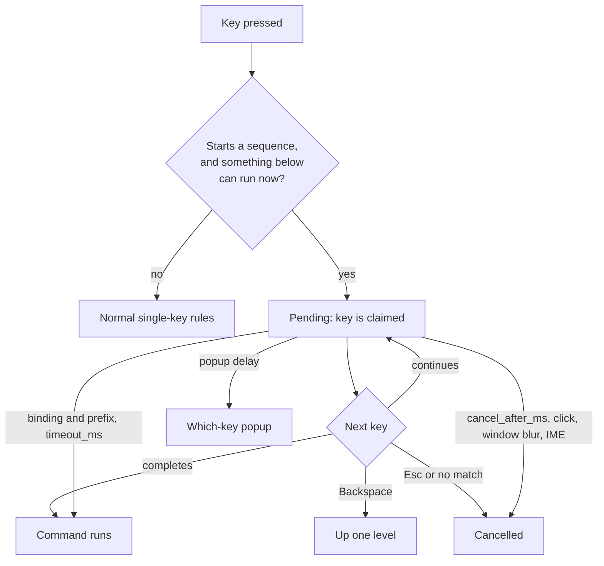

# Configuration

Everything you can change in Vaultdraw, in one place. Back to the [README](../README.md).

All settings live in one folder, like kitty, Ghostty or Zed:

| OS | Config folder | Machine state |
| --- | --- | --- |
| macOS, Linux | `$XDG_CONFIG_HOME/vaultdraw`, else `~/.config/vaultdraw` | `$XDG_STATE_HOME/vaultdraw/state.json`, else `~/.local/state/vaultdraw/state.json` |
| Windows | `%APPDATA%\Vaultdraw` | `%LOCALAPPDATA%\Vaultdraw\state.json` |

```
vaultdraw/
├── config.toml   your settings
└── themes/       colour themes
```

`config.toml` is created on first launch, with every key listed and commented. The common keys and their defaults (the full list is [Every key](#every-key) below):

```toml
[appearance]
theme = "Default"            # a built-in theme or one in themes/
mode = "system"              # light | dark | system
sync_canvas = false          # canvas follows the theme's colours
canvas_background = "#ffffff" # for new drawings when sync_canvas is off
accent_color = ""            # "#rrggbb" replaces the theme's primary colour; "" = the theme's own

[editor]                     # defaults for new elements
font_family = 5              # 5 Excalifont, 6 Nunito, 8 Comic Shanns, 1 Virgil, 2 Helvetica, 3 Cascadia
font_size = 20
stroke_color = "#1e1e1e"
background_color = "transparent"
fill_style = "solid"         # solid | hachure | cross-hatch
stroke_width = 2
roughness = 1                # 0 architect, 1 artist, 2 cartoonist

[paper]
style = "plain"             # plain | grid | lines | dots | graph | isometric
spacing = 0                 # 5 to 200 (0 = the style's own)
color = ""                  # "#rrggbb"; "" = automatic
opacity = 1                 # 0.1 to 1
major_every = 0             # grid and graph: a stronger line every N, 1 to 20 (0 = the style's own)
margin_line = true          # ruled lines: draw the margin line

[page]                       # page mode for new drawings; see "Page mode"
mode = "normal"              # normal (infinite canvas) | page
layout = "separate"          # separate (sheets with a gap) | continuous (one long page)
size = "a4"                  # a3 | a4 | a5 | b5 | letter | legal | tablet | tabletLarge | phone | custom
orientation = "portrait"     # portrait | landscape
width = 0                    # custom size in px, 100 to 5000 (0 = unset)
height = 0
paper_theme = "normal"       # normal | old_school | match

[saving]
autosave_delay_ms = 500      # idle time before an edit is written to disk

[interface]
zoom = 100                   # whole-app zoom, 50 to 200 percent
thumbnail_max_elements = 8000 # biggest drawing that gets a thumbnail, 100 to 50000
defer_home_pane = true       # show the file tree first, the home pane one frame later

[navigator]
sort = "name_asc"            # name_asc | name_desc | modified_desc | modified_asc

[files]
confirm_delete = true        # ask before moving to Trash
new_drawing_folder = ""      # relative to the vault root; "" = next to the open drawing
templates_folder = "Templates" # vault folder holding templates, relative to the vault root

[memory]                     # see "Memory"
free_unused_images = true    # release image data of deleted images once no undo step can restore it
undo_steps = 1000            # undo steps kept per drawing, 10 to 10000

[tools.arrow]                # default style of one tool; see "Tool defaults"
stroke_color = "#f08c00"     # set only the keys you want; others keep the current style
stroke_width = 3
stroke_style = "dotted"
```

- **Settings and the file stay in sync.** Changing something in Settings updates `config.toml` and keeps your comments and layout. Editing the file updates the app.
- **Live reload.** Saved changes apply immediately, no restart needed. Delete a line to go back to its default.
- **Typos are safe.** If the file can't be parsed, the app keeps the last good settings and shows a banner such as `config.toml line 7: <error>`. A value of the wrong type falls back to its default and is reported the same way. A key the app doesn't know, such as `zom` for `zoom` (or `stroke_colour` inside `[tools.arrow]`), is a warning: only that key is ignored, the rest applies, and a notice names the closest real key: `config.toml: unknown key interface.zom (ignored; did you mean interface.zoom?)`. A vault's `settings.toml` is checked the same way. Errors stay in the banner until fixed; every current error and warning is listed under **Settings → General → Config file**.
- **Settings → Open config folder** opens the folder; **Reload** re-reads it.

`state.json` holds machine state (recent vaults, navigator width, expanded folders, last-used image export options). It is not meant for hand editing.

### Settings reference

Everything here can be changed in **Settings** (Cmd/Ctrl+,) or by editing `config.toml`.

- **Accent colour** (Appearance, `appearance.accent_color`). Replaces the theme's primary colour in both light and dark mode, using a picker or a hex value. If the colour would be hard to read against the theme, it is nudged until it is, and Settings shows "Adjusted for contrast" with the colour actually used. **Reset** (or an empty value) goes back to the theme's own.
- **Interface zoom** (Interface, `interface.zoom`). Scales the whole window from 50 % to 200 %. **Cmd/Ctrl+Shift + `+`**, **`-`** and **`0`** step by 10 and reset to 100 %. Plain **Cmd/Ctrl + `+`**, **`-`** and **`0`** still zoom the canvas, as in Excalidraw.
- **Navigator sort order** (Interface, `navigator.sort`, also the sort button in the navigator toolbar). Four orders: name A to Z, name Z to A, modified new to old, modified old to new. Folders always come first; the order applies within folders and within drawings. Names compare ignoring case and by number, so "Drawing 2" comes before "Drawing 10".
- **Thumbnail size limit** (`config.toml` only, `interface.thumbnail_max_elements`, default 8000). Drawings with more elements than this keep a placeholder instead of a thumbnail (a small marker file records the failure). Thumbnails draw in short steps, so even 8,000 elements does not freeze the window: the longest single step measured 24 to 31 ms at 4x CPU slowdown and 29 to 52 ms at 6x. Raise it for big drawings, lower it on a slow machine; the change applies at once and only the drawings that had no thumbnail are retried. Lowering it does not remove thumbnails already cached; the palette command **Thumbnails: Clear cache for this vault** does. Drawings whose file is over 8 MB never get one.
- **Home pane after the tree** (`config.toml` only, `interface.defer_home_pane`, default true). When a vault opens, the file tree paints first and the home pane (recent drawings and actions) one frame later, in the same place, so nothing moves. The tree appears about 10 ms sooner at 4x CPU slowdown. Set it to `false` to draw both together. Applies at once to the next vault you open.
- **Confirm before delete** (Files, `files.confirm_delete`). On by default. Turn it off and "Move to Trash" acts immediately. It only affects moving to Trash, which can be undone from the OS trash.
- **Default folder for new drawings** (Files, `files.new_drawing_folder`). A path relative to the vault root, for example `Sketches/Inbox`. It is created if it doesn't exist. Empty (the default) puts a new drawing next to the open drawing.

#### Per-vault settings

Navigator sort order, the default folder for new drawings, the templates folder, the paper style and each tool's default style can differ per vault. Those rows have a **This vault** switch:

- **On:** the value is saved in `<vault>/.excalidraw-vault/settings.toml`, starting from the value currently in effect. Edits go there.
- **Off:** the key is removed from that file and the global value applies again.

The file lives inside the vault, so it travels with it when you copy, sync or back up the folder. Precedence is per-vault value, then `config.toml`, then the default. Like `config.toml` it is plain TOML, reloads live, keeps your comments, and a bad value is ignored with a notice while the rest still applies.

```toml
# <vault>/.excalidraw-vault/settings.toml
[navigator]
sort = "modified_desc"

[files]
new_drawing_folder = "Sketches/Inbox"
```

### Themes

A theme sets the colours of the whole app: the file tree, header, Settings and Excalidraw's toolbars, menus and dialogs. Every theme has a dark and a light variant, so theme and mode are chosen separately, in **Settings → Appearance** or in `config.toml`:

```toml
[appearance]
theme = "Tokyo Night"   # theme name, case-insensitive
mode = "system"         # light | dark | system (follows the OS)
sync_canvas = true      # canvas follows the theme too
```

**Built-in themes:** Default, Dracula, Tokyo Night, Catppuccin, Everforest, Gruvbox, Nord, Rosé Pine, Solarized. If `theme` names a theme that doesn't exist, Vaultdraw uses Default and shows a warning.

#### Adding a theme

Themes use the [Noctalia](https://github.com/noctalia-dev/noctalia-colorschemes) palette format, so existing Noctalia palettes work unchanged. Put the `.json` file in `themes/` inside the config folder (`~/.config/vaultdraw/themes/` on macOS and Linux), in either layout:

```
themes/
├── Midnight.json          a single file
└── Paper/
    └── Paper.json         a folder, as Noctalia ships them
```

The file or folder name is the theme's name: `theme = "Midnight"` selects `Midnight.json`. A theme in `themes/` with the same name as a built-in one replaces it.

A theme needs only three colours per variant (background, text, accent); everything else is derived:

```json
{
  "dark": {
    "mSurface": "#1b1d2b",
    "mOnSurface": "#d8dae8",
    "mPrimary": "#82aaff"
  },
  "light": {
    "mSurface": "#f6f6fa",
    "mOnSurface": "#2b2d3a",
    "mPrimary": "#3b6fd8"
  }
}
```

You can also leave out `light` or `dark` entirely; the missing variant is generated from the other one. Whatever colours a theme uses, Vaultdraw adjusts them where needed so text stays readable.

The full set of roles, all optional except the first three:

| Role | Colours in Vaultdraw |
| --- | --- |
| `mSurface` | Canvas and app background; base of the sidebar, header and menus |
| `mOnSurface` | Text and icons; black and grey strokes on a synced canvas |
| `mPrimary` | Accent: selected items and tools, buttons, links, focus rings, selection outline |
| `mOnPrimary` | Text and icons on accent-coloured buttons |
| `mSurfaceVariant` | Tint of the sidebar and header |
| `mOnSurfaceVariant` | Secondary (muted) text |
| `mError` | Errors and delete actions; red on a synced canvas |
| `mSecondary`, `mTertiary` | Extra accents, used for palette colours on a synced canvas |
| `mShadow` | Shadows under menus and dialogs |
| `mOnSecondary`, `mOnTertiary`, `mOnError`, `mOutline`, `mHover`, `mOnHover` | Accepted for Noctalia compatibility; derived if missing |
| `terminal` | Optional ANSI colours: green and yellow set success and warning; all of them feed the canvas palette when synced |

Optional top-level `name` and `author` fields are for display only.

#### Sync canvas with theme

With `sync_canvas = true` (**Sync canvas with theme** in Settings), the canvas is recoloured on screen: its background becomes the theme's background, and the pencil, stroke and fill colours from Excalidraw's palette become matching theme colours. This only changes what you see. Saved drawings and PNG/SVG exports keep Excalidraw's standard colours, so they look the same for anyone who opens them. With it off, the canvas renders as in regular Excalidraw.

Themes are data only: colour values, no code.

## Hotkeys

Every Vaultdraw command has a key you can change. Open **Settings → Hotkeys** (Cmd/Ctrl+,).

The page lists all commands with their keys as chips. Type in the filter to narrow by command name or key. The **⌨** button records keys: press a key combination and the list shows every command bound to it. The chips **All**, **Assigned**, **Customised**, **Unassigned** and **Conflicts** filter the list (Conflicts appears only when there is one).

- **+** records a new key for a command. A command can have several.
- **×** on a key removes it. **↺** resets the command to its defaults.
- While recording, **Backspace** clears the key and **Esc** cancels.
- Keys the system or the app menu owns (Cmd+Q, Cmd+W, Cmd+Tab, Cmd+C/X/V/Z/A and similar) are refused, with the reason shown.
- A key used by two commands, or by one of Excalidraw's own shortcuts, is shown in red with what it clashes with. It is allowed, and Vaultdraw's binding wins.

### Defaults

`Mod` is Cmd on macOS and Ctrl on Windows and Linux. A dash means no key by default.

| Command id | What it does | macOS | Windows / Linux |
| --- | --- | --- | --- |
| `file.save` | Save drawing | ⌘S, ⇧⌘S, ⌃S | Ctrl+S, Ctrl+Shift+S |
| `settings.open` | Open settings | ⌘,, ⌃, | Ctrl+, |
| `navigator.focusSearch` | Search vault | ⇧⌘F, ⌃⇧F | Ctrl+Shift+F |
| `view.zoomIn` | Zoom in (interface) | ⇧⌘=, ⇧⌘Num + | Ctrl+Shift+=, Ctrl+Shift+Num + |
| `view.zoomOut` | Zoom out (interface) | ⇧⌘-, ⇧⌘Num - | Ctrl+Shift+-, Ctrl+Shift+Num - |
| `view.zoomReset` | Reset interface zoom | ⇧⌘0, ⇧⌘Num 0 | Ctrl+Shift+0, Ctrl+Shift+Num 0 |
| `palette.files` | Go to drawing (palette, files mode) | ⌘P | Ctrl+P |
| `palette.commands` | Show all commands (palette, commands mode) | ⇧⌘P, ⌘/ | Ctrl+Shift+P, Ctrl+/ |
| `vault.newDrawing` | New drawing | ⌘N | Ctrl+N |
| `vault.newFromTemplate` | Templates: New drawing from template | ⌥⌘N, ⌃⌥N | Ctrl+Alt+N |
| `view.toggleNavigator` | Toggle navigator | ⌘\  | Ctrl+\  |
| `vault.switch` | Open another vault | — | — |
| `file.revealInFinder` | Reveal drawing in Finder | — | — |
| `file.duplicate` | Duplicate drawing | — | — |
| `appearance.toggleMode` | Toggle light/dark mode | — | — |
| `settings.openHotkeys` | Settings: Hotkeys | — | — |

Every other palette entry with a fixed name (Mode: Dark, Paper: Grid, Settings: Files, Export: PNG, Sort: …, Rename drawing, …) is listed on the Hotkeys page too, unassigned by default.

Canvas zoom is Excalidraw's own: **Cmd/Ctrl + `+`**, **`-`** and **`0`**. Interface zoom adds Shift.

### File tree and panel keys

The file tree, the Tags list, the Links panel and the Settings page list share one set of `list.*` commands. Their keys work only while that list has focus (click into it, or press **Mod+Alt+F** for the file tree), so on the canvas `r` is still the rectangle tool and in a text field `j` still types a `j`. A key a list has no use for (for example `r` in the Links panel) is left alone.

| Command id | What it does | Default keys |
| --- | --- | --- |
| `list.down` / `list.up` | Move down / up | `J`, `ArrowDown` / `K`, `ArrowUp` |
| `list.first` / `list.last` | First / last row | `G`, `Home` / `Shift+G`, `End` |
| `list.expand` | Open a folder, or step into an open one | `L`, `ArrowRight` |
| `list.collapse` | Close a folder, or go to its parent | `H`, `ArrowLeft` |
| `list.open` | Open a drawing, toggle a folder, apply a tag, enter a Settings page | `Enter`, `NumpadEnter`, `O` |
| `list.select` | Select the row (Settings: select the tab and stay; elsewhere like open) | `Space` |
| `list.openInNewTab` | Open a drawing in a new tab | `Mod+Enter`, `Mod+NumpadEnter` (also `Ctrl+Enter` on macOS) |
| `list.rename` | Rename the row (file tree, tags) | `R`, `F2` |
| `list.delete` | Move the row to the Trash | `D`, `Delete`, `Backspace` |
| `list.newItem` / `list.newFolder` | New drawing / folder in the focused folder | `A` / `Shift+A` |
| `list.move` | Move the row to another folder | `M` |
| `list.menu` | The row's menu | `Shift+F10`, `ContextMenu` |
| `list.nextView` | Switch Backlinks / Outgoing (Links panel) | `Tab` |
| `list.exit` | Leave the list (the tree goes back to the canvas) | `Escape` |
| `navigator.focusTree` | Focus the file tree; again goes back to the canvas | `Mod+Alt+F` |

Rename, delete, move and the row menu need a focused row: with none (even while a drawing is open) they do nothing and the key passes on. In the palette they appear under **List: …** once you have used a list, and act on the last list you used. Arrow-only or Emacs-style lists are one `[hotkeys]` edit away:

```toml
[hotkeys]
"list.down" = ["ArrowDown", "Ctrl+N"]
"list.up" = ["ArrowUp", "Ctrl+P"]
"list.delete" = ["Delete"]
```

### Gallery keys

The gallery grid's keys are `gallery.*` commands. They work only while the grid has focus. Rebind them like any command.

| Command id | Action | Default keys |
| --- | --- | --- |
| `gallery.left` / `right` / `up` / `down` | Move one tile or row | `H`, `L`, `K`, `J` and the arrows |
| `gallery.first` / `gallery.last` | First / last tile | `Home` / `End` |
| `gallery.pageUp` / `gallery.pageDown` | One page up / down | `PageUp` / `PageDown` |
| `gallery.open` | Open the tile (a folder is entered) | `Enter` |
| `gallery.parent` | Go to the parent folder | `Backspace` |
| `gallery.close` | Close the gallery | `Escape` |

### The `[hotkeys]` table

Settings writes to `config.toml`, and you can edit it by hand. Only your changes are stored, as a list of keys per command id:

```toml
[hotkeys]
# add a second key (list the default too, or it is replaced)
"file.save" = ["Mod+S", "Alt+S"]

# unassign: an empty list
"vault.newDrawing" = []

# change a key
"view.toggleNavigator" = ["Mod+B"]
```

Ids contain dots, so quote them. Delete a line to go back to the default. Edits apply as soon as the file is saved, with no restart.

Keys are modifiers plus one key, joined with `+`: `Mod`, `Ctrl`, `Alt`, `Shift`, `Meta`. `Mod` means Cmd on macOS and Ctrl elsewhere, so one file works on both. Plain letters (alone or with Shift) match the letter your layout types, so `J` is the key that types j on Dvorak or AZERTY too. With `Mod`, `Ctrl` or `Alt`, and for every other key, the key is the physical key (`KeyboardEvent.code`) without the `Key` or `Digit` prefix: `N`, `0`, `Comma`, `Equal`, `Backslash`, `F2`, `ArrowUp`, `Numpad0`. These aliases are accepted too: `Cmd`, `CmdOrCtrl`, `Option`, `Esc`, `Plus`, `=`, `,`, `Digit0`, `KeyN`.

Mistakes never break the app. They show as a warning banner in Settings and the rest of the file still applies:

- An unknown command id is kept in the file and reported (it may belong to a newer version).
- A key that can't be parsed is ignored.
- A value that isn't a list keeps the command's defaults.
- An older `"palette.quickSwitcher"` entry still works: it sets the Cmd+P (files) key, unless `"palette.files"` is set too. Cmd+Shift+P and Cmd+/ in it are ignored, because they now open commands mode. Changing the key in Settings replaces the old line.

### Key sequences, leader and which-key

A key can be a sequence of chords, like Vim's `gg` or `<leader> f f`. Sequences are plain text in `[hotkeys]`, so nothing changes until you write one. With none configured, Vaultdraw does no extra work per key and starts no timers.

```toml
[keys]                          # options only
leader = "Backslash"            # what <leader> means in a sequence
timeout_ms = 1000
cancel_after_ms = 5000
which_key = true
which_key_delay_ms = 400
which_key_position = "bottom"   # bottom | center

[keys.labels]                   # names for groups in the popup
"<leader> f" = "file"

[hotkeys]                       # values may be sequences
"list.first" = ["g g", "Home"]
"palette.files" = ["<leader> f f", "Mod+P"]
```

#### Writing a sequence

A sequence is chords separated by spaces. Each chord uses the notation above (`Mod+Shift+Equal`, `Shift+G`, `Alt+N`). Examples: `"g g"`, `"Mod+Alt+K Mod+S"`, `"<leader> f f"`.

| Written | Means |
| --- | --- |
| `<leader>` | The `[keys] leader` key. Change the leader and every sequence follows. |
| `<C-x>`, `<A-x>`, `<S-x>` | Ctrl+X, Alt+X, Shift+X (Vim style; they combine: `<C-S-x>`). |
| `<CR>`, `<Esc>`, `<Space>`, `<Tab>`, `<BS>`, `<Del>` | Enter, Escape, Space, Tab, Backspace, Delete. |
| `"Mod + S"` | Still one chord. A value is read as a single chord first, then split into a sequence. |

Keys are stored in a canonical form: `<C-x>` becomes `Ctrl+X` and letters are upper case (`g g` is kept as `G G`, and still means the plain letter, not Shift). Settings writes that form when it saves `[hotkeys]`; `<leader>` stays as typed. Bad values are ignored with a warning, like any other key.

#### The `[keys]` table

| Key | Type | Default | Meaning |
| --- | --- | --- | --- |
| `leader` | one key | `"Backslash"` | The key `<leader>` stands for: one chord such as `"Backslash"`, `"Space"` or `"Alt+K"`. It cannot be `<leader>` or a sequence. |
| `timeout_ms` | whole number, 0 to 3600000 | `1000` | When a key is both a binding and the start of a longer one (`g` and `g g`), how long to wait before running the shorter one. `0` waits for the next key, with no timeout. |
| `cancel_after_ms` | whole number, 0 to 3600000 | `5000` | Drops a half-typed sequence after this idle time. `0` never drops it. |
| `which_key` | `true` or `false` | `true` | Show the popup while a sequence is half typed. |
| `which_key_delay_ms` | whole number, 0 to 3600000 | `400` | How long a sequence waits before the popup shows. |
| `which_key_position` | `"bottom"` or `"center"` | `"bottom"` | A bar at the bottom or a card in the middle. |

All six reload live: save the file and the next key uses the new values. A half-typed sequence is dropped on reload. A bad value uses its default and shows a warning; an unknown key in `[keys]` is ignored with a warning.

`[keys.labels]` maps a sequence to a group name for the popup, for example `"<leader> f" = "file"`. Without a label a group shows `+N more`. Edit it by hand or in Settings → Hotkeys → Key group names (add, rename, remove; **Settings: Hotkeys** in the palette opens it). Settings changes only the lines you edit and keeps your comments and order. A label with an invalid sequence or an empty text is ignored with a warning.

#### How keys behave



- **Only live sequences claim a key.** The first key is taken only when some command under it can run right now (its `when` holds). Otherwise the key goes on as usual, so `g g` does not stop `g` working on the canvas.
- **Text boxes.** A sequence may start while you type only with Mod, Ctrl or Alt (`Mod+Alt+K Mod+S`). A sequence that starts with a plain key never starts in a text box. AltGr (Ctrl+Alt without Cmd) counts as typing, so `@` on a German keyboard is never taken.
- **A key that doesn't match** cancels the sequence. On the canvas and in lists it is swallowed (like Vim and VS Code). In a text box it is typed, so you never lose a letter.
- **Escape** cancels. **Backspace** goes up one level (at the first key it cancels). Held-down keys are ignored while pending.
- **Ambiguity.** If `g` and `g g` are both bound, `g` waits `timeout_ms`. Press `g` again for the long one. Wait, and the short one runs. A longer sequence is never blocked by a shorter one.
- **Cancelled by** a click, the window losing focus, IME composition, a settings reload, and `cancel_after_ms`.

#### Which-key popup

After `which_key_delay_ms` the popup lists the keys that can follow, with the command title or the group label. Only entries that can run now are shown.

- Keep typing to continue; **Backspace** goes up, **Esc** cancels.
- **Up/Down** move a highlight and **Enter** runs it or steps into it. The popup never takes focus.
- It loads on first use, in a separate chunk, so it costs nothing at startup. With `which_key = false` it never loads on its own.

Two commands, both unbound by default and in the palette under **Keys: …**:

| Command id | What it does |
| --- | --- |
| `keys.whichKey` | Show the popup with the first keys of every sequence (works with `which_key = false`; needs a vault open). |
| `keys.cancel` | Cancel a half-typed sequence. |

#### Keyboard layouts

Letters follow your layout: `g` is the key that types g on Dvorak or AZERTY. Punctuation and digits are physical keys (`KeyboardEvent.code`), so `Backslash` is the key at the US position, which can be awkward to reach or sit elsewhere on other layouts. On a non-US keyboard, pick a leader that is easy to press, such as `"Alt+K"`. `"Space"` is valid but is a poor choice: Space pans the canvas and selects list rows.

#### Recording a sequence

In **Settings → Hotkeys**, the **Sequence** button next to **+** records one:

1. Click **Sequence** on a command.
2. Type the chords, one after another. The page shows them as you go.
3. **Enter** saves. **Backspace** removes the last chord, **Esc** cancels.

The recorder saves the physical keys you pressed and adds the sequence to the command's keys. Enter and Escape control the recorder, so they cannot be part of a recorded sequence; write those by hand (`<CR>`, `<Esc>`). The `<leader>` key is hand-edited; group names have their own section on the same page.

A sequence that is the start of another key of a different command (`g` and `g g`) is flagged as a `prefix` conflict: a warning in red, never a refusal. The longer sequence wins. A sequence that begins with a key Excalidraw uses is flagged the same way as a single chord.

#### Tool keys

The tool letters and digits of the toolbar are now ordinary commands, so they can be rebound, removed or turned into sequences like any other. Their defaults are unchanged. They work while a drawing is open, and not while you type, with a list, gallery or graph focused or with a dialog open.

| Command id | Tool | Default keys |
| --- | --- | --- |
| `tool.selection` | Tool: Selection | `V`, `1` |
| `tool.rectangle` | Tool: Rectangle | `R`, `2` |
| `tool.diamond` | Tool: Diamond | `D`, `3` |
| `tool.ellipse` | Tool: Ellipse | `O`, `4` |
| `tool.arrow` | Tool: Arrow | `A`, `5` |
| `tool.line` | Tool: Line | `L`, `6` |
| `tool.freedraw` | Tool: Draw | `P`, `X`, `7` |
| `tool.text` | Tool: Text | `T`, `8` |
| `tool.stickynote` | Tool: Sticky note | `N` |
| `tool.image` | Tool: Image | `9` |
| `tool.eraser` | Tool: Eraser | `E`, `0` |
| `tool.hand` | Tool: Hand | `H` |
| `tool.frame` | Tool: Frame | `F` |
| `tool.autoshape` | Tool: Shape recognition | `Shift+X` |
| `tool.laser` | Tool: Laser pointer | `K` |
| `tool.bucketfill` | Tool: Bucket fill | `B` |
| `tool.lock` | Tool: Keep tool active | `Q` |

Unassign a tool with an empty list (`"tool.laser" = []`) and its letter does nothing. Rebinding keeps Excalidraw's own rules: a tool that is disabled or refused while you draw stays refused. Excalidraw's other shortcuts (Mod+D, Mod+G and so on) are not commands yet.

#### Vim-style example

A starting point to copy into `config.toml`. It is plain text: change anything, or delete what you don't want. Nothing is on by default, and Vaultdraw ships no Vim mode. Keys you list replace that command's defaults, so the block repeats the defaults it keeps.

<!-- keys-docs-example -->
```toml
[keys]
leader = "Backslash"

[keys.labels]
"<leader> f" = "file"
"<leader> s" = "shape"

[hotkeys]
# lists (file tree, tags, links): gg, dd
"list.first" = ["g g", "Home"]
"list.delete" = ["d d", "Delete"]

# leader groups
"palette.files" = ["<leader> f f", "Mod+P"]
"palette.commands" = ["<leader> p", "Mod+Shift+P"]
"file.save" = ["<leader> f s", "Mod+S", "Mod+Shift+S"]
"vault.newDrawing" = ["<leader> f n", "Mod+N"]
"view.toggleNavigator" = ["<leader> e", "Mod+Backslash"]

# tools: keep the letters, add leader picks
"tool.rectangle" = ["<leader> s r", "R", "2"]
"tool.ellipse" = ["<leader> s e", "O", "4"]
"tool.arrow" = ["<leader> s a", "A", "5"]
"tool.text" = ["<leader> s t", "T", "8"]
```
<!-- /keys-docs-example -->

After `\` the popup lists `f` (file), `s` (shape), `p` and `e`; after `\ f` it lists `f`, `s` and `n`.

#### Full Vim-style preset

For a bigger block, copy [`docs/presets/vim.toml`](presets/vim.toml). It adds `gg` and `dd` in lists, `<leader>` groups for files, tabs, links, graph and tools, and names for each group.

1. Open `config.toml` in your editor (Settings → **Open config folder** shows where it is).
2. Copy the lines you want from `vim.toml` into it. Keep one `[keys]`, one `[keys.labels]` and one `[hotkeys]` table: merge lines into a table you already have, don't repeat the header.
3. Save. Keys reload live; press `\` and the which-key popup lists the groups.

Vaultdraw never reads the preset file, so it costs nothing and nothing changes until you copy lines. It has no modes; modal keys stay off. A key you list replaces that command's defaults, so each line repeats the defaults it keeps. A unit test parses the file with the app's own key parser and checks every command id, so it stays in step with the commands.

#### Not in this version

| Not included | Why |
| --- | --- |
| Key-first tables (`[keymap.canvas]` and the like) | `[hotkeys]` already maps a command to its sequences, and Settings edits it. Two tables would show two truths. They can be added later without breaking this file. |
| Modes (a sticky Normal or Insert layer) | A mode with no visible state at rest is easy to get stuck in. Each command's own conditions already decide where a key works. |
| A Vim preset that loads itself (`keys.preset`) | You decide: a copied block is plain text you own and edit, not a setting you have to undo. The copyable file is `docs/presets/vim.toml`. |
| Counts, macros, operators, registers | Out of scope for a minimal core. |
| Excalidraw's other shortcuts as commands | Only the tool keys moved. The rest may follow. |

### Command palette

One palette with two modes, as in VS Code:

- **Cmd/Ctrl+P** goes to a drawing: it lists drawings only, recent ones first.
- **Cmd/Ctrl+Shift+P** (also **Cmd/Ctrl+/**, Excalidraw's palette key) runs a command. The input starts with `>` and lists commands only, recent ones first.
- Typing `>` at the start switches to commands, and deleting it switches back to drawings. Pressing the shortcut of the mode you are in closes the palette; pressing the other one switches mode.

Type a few letters, in order and not necessarily next to each other (`vdg` finds `vault-design`). Commands whose name starts with what you typed come first, then things you used recently, then the best fuzzy matches.

- **Up/Down** move, **Enter** opens or runs and puts focus back on the canvas, **Esc** closes.
- **Cmd/Ctrl+Enter** runs a command and keeps the palette open (handy for toggles such as Toggle grid).
- **Tab** (or **→** at the end of the text) narrows to a family: on "Theme: Dracula" it shows every `Theme: …` entry.
- With nothing typed, each mode lists what you used recently first (drawings and commands keep separate lists).

Commands mode lists Excalidraw's editor actions (tools, align, group, layers, flip, lock, grid, zen mode, canvas background, export image, clear canvas, …) with their shortcuts, and every Vaultdraw feature as a direct entry: `Theme: <name>`, `Mode: Light/Dark/System`, `Sync canvas with theme: On/Off`, `Paper: <style>`, `Pen: <name>`, `Insert: <library item>`, `Settings: <page>`, `Export: PNG/SVG`, `Save a copy`, `Templates: …`, `Sort: …`, new drawing or folder, rename, move, trash and more. Entries that can't run right now (nothing selected, read-only vault, no drawing open) are hidden.

Excalidraw's separate command palette is not used.

## Notebook backgrounds

A drawing can sit on paper: plain, grid, ruled lines (optionally with a margin line), dots, graph paper (minor and major lines) or isometric dots. The pattern is saved with the drawing and is anchored to it, so it zooms and scrolls with the content. Lines that would be too close together to read are hidden.

- **Default for new drawings.** **Settings → Appearance → Background Pattern** sets the style and its tuning (spacing, colour, opacity, major lines, margin line), with a live preview. The style can be stored per vault. In `config.toml` the same settings are the `[paper]` table (see Configuration).
- **From the terminal.** `vaultdraw new <path>` gives a blank drawing the same `[paper]` and `[page]` defaults (and the vault's paper style), with or without the app running. Without the app it reads `config.toml` and the vault's `settings.toml` itself; the canvas colour is `appearance.canvas_background`. A drawing made with `--from` keeps its own scene.
- **Per drawing.** Choose **Paper** in the canvas main menu to change the open drawing's style, or **Paper settings…** to tune it. **Use app default** returns the drawing to the app default. **Make app default** uses the drawing's pattern for new drawings. Changing the default does not change existing drawings.
- **In the file.** The pattern is stored as `appState.viewBackgroundPattern`. Drawings without it, such as older files, open plain. excalidraw.com opens these files with a plain background, and saving there drops the pattern.
- **Display and export.** On screen the pattern follows dark mode and **Sync canvas with theme**. Exports use Excalidraw's standard colours. The export dialog has a **Background pattern** switch, shown only for drawings with a pattern; it needs **Background** on.

## Page mode

A drawing can be an infinite canvas (Normal) or simulated paper (Page), like a notes app: the pages are a fixed width, you scroll vertically, and the view always fits the page width.

- **Layouts.** **Separate pages** are fixed-size sheets stacked with a gap; drawing near the end of the last page adds a new one. **Continuous** is one long page of fixed width that grows downward as you fill it.
- **Sizes.** A3, A4, A5, B5, Letter, Legal, iPad 11-inch and 13-inch, Phone, or a custom width and height in pixels; portrait or landscape.
- **Outside the page is off limits.** You can't start a stroke, drag, resize or paste outside the pages, and with separate pages a shape stays on its page. Sideways panning is locked; PageUp/PageDown jump between pages. A drawing switched to page mode keeps everything it had: content outside the pages stays visible but can't be edited there, and **Fit content to page** moves it in.
- **Paper themes.** **Normal** is clean white paper, **Old school** is warm cream paper with blue ruled lines and a red margin (a plain drawing becomes ruled; pick another paper style afterwards if you prefer), and **Match current theme** follows the app theme on screen, like **Sync canvas with theme**. The paper style itself (lines, grid, dots, ...) is the drawing's background pattern (see Notebook backgrounds).
- **Export.** **Export: PDF** (command palette, or **Export as PDF…** in a drawing's navigator menu) writes one PDF page per page, fully offline; a continuous page is split at the page size. PNG and SVG export the content as before; the export dialog's **Page shape** switch exports whole pages instead.
- **Defaults and per drawing.** **Settings → Page** sets the mode, layout, size, orientation and paper theme of new drawings (the `[page]` table in `config.toml`). The canvas main menu's **Page** row opens the drawing's page setup, with **Make app default**. The setup is saved in the drawing (`appState.pageSetup`), so it reopens the same; other Excalidraw apps open the file as a normal canvas.
- **Keyboard.** Every action is a palette command and can get a key on the Hotkeys page: `Page mode: On/Off/Toggle`, `Page layout: Continuous/Separate pages`, `Page size: A4` (every size), `Page orientation: Portrait/Landscape`, `Paper theme: Normal/Old school/Match current theme`, `Page setup…`, `Fit content to page`, `Next page`/`Previous page` (PageDown/PageUp) and `Export: PDF`.

## Tool defaults

Each drawing tool can start with its own style, so a dotted, orange, 3 px arrow is always one keypress away. Tools: rectangle, diamond, ellipse, arrow, line and text. The pen keeps its own saved presets (`[pens]`) and the laser its own look (`[laser]`); all of them are edited on one page, **Settings → Tools**.

- **Picking the tool applies its default.** Only the keys you set apply; everything else keeps the editor's current style. Every tool also remembers the style you last used it with until you quit (across drawings and vaults), like FigJam: set the arrow to dashed red, draw a rectangle, and the arrow is dashed red again. Saved defaults are where every launch starts, and saving or resetting a tool's default (or changing it in Settings) clears that tool's memory. Leaving a tool puts the shared style back, so an arrow's orange never leaks into the next rectangle.
- **Text is styled however you create it.** The Text tool's style (the one it last used, else its default) also applies to text you create without picking it: double-clicking the canvas, Enter on a selected shape or arrow (labels stay centred), and pasted text. Editing existing text never restyles it, and sticky notes keep their own look. With no Text default set, such text uses the editor's current style as before.
- **Settings → Tools** has a tab per tool (rectangle, diamond, ellipse, arrow, line, text, pen, laser), and a dot marks the tools you have customised. Each tab shows a live preview and one row per value. Every value has a **Default** choice that unsets it, **Reset** removes the tool's defaults, and **This vault** stores the tool's style in the vault (the vault's table replaces the global one; an empty vault table means "no defaults for this tool here"). The **Pen** tab picks a saved pen and edits it (add, remove, reset to the built-in pens); the **Laser** tab sets its colour, size, fade time and tail length. The palette commands `Settings: Tools` and `Settings: Pens & laser` (which opens the Pen tab) open the page.
- **From the canvas.** In the command palette (Cmd/Ctrl+Shift+P): `Tool defaults: Save current style for Arrow` takes the style of a selected arrow, or the current style when none is selected. `Tool defaults: Save current style for this tool` does the same for the active tool or the selected shape, and `Tool defaults: Reset Arrow` removes them. Both act on this vault when the tool has a vault style (turn **This vault** off to inherit the global one again), otherwise on `config.toml`. Each command can get a key on the Hotkeys page.
- **In the files.** One table per tool in `config.toml` or `<vault>/.excalidraw-vault/settings.toml`:

  ```toml
  [tools.arrow]
  stroke_color = "#f08c00"
  stroke_width = 3            # px, 0.5 to 40
  stroke_style = "dotted"     # solid | dashed | dotted
  end_arrowhead = "triangle"  # none | arrow | bar | circle | triangle | diamond | ... (and _outline variants)
  ```

  | Key | Tools | Values |
  | --- | --- | --- |
  | `stroke_color`, `background_color` | all (background: not arrow or text) | a colour like `"#f08c00"` or `"transparent"` |
  | `fill_style` | rectangle, diamond, ellipse, line | `hachure`, `cross-hatch`, `solid`, `zigzag` |
  | `stroke_width` | all but text | px, 0.5 to 40 |
  | `stroke_style` | all but text | `solid`, `dashed`, `dotted` |
  | `roughness` | all but text | 0 architect, 1 artist, 2 cartoonist |
  | `roundness` | rectangle, diamond, line | `sharp`, `round` |
  | `opacity` | all | 1 to 100 |
  | `arrow_type`, `start_arrowhead`, `end_arrowhead` | arrow | `sharp`/`round`/`elbow`; an arrowhead name or `none` |
  | `font_family`, `font_size`, `text_align` | text | a font id (as `[editor]`), 4 to 400, `left`/`center`/`right` |

  An unknown key or bad value turns that tool's defaults off and shows a notice naming the key. Nothing is written into your drawings: new elements simply get the style.

## Search

Search finds text inside every drawing in the vault. Type in the search box at the top of the navigator, or press Cmd+Shift+F (Ctrl+Shift+F on Windows and Linux) to move there.

It searches drawing names and folder paths, text elements, labels inside shapes and arrows, and frame names. Text inside library items is not searched.

Results are grouped by drawing, with up to five highlighted snippets under each one. Use Up and Down to move, Enter to open the selected row, and Escape to clear the search. Clicking a snippet opens the drawing, zooms to that element and selects it. For a label, the shape or arrow it belongs to is selected.

Matching rules:

- Case, accents and character width are ignored: `cafe` finds `Café`, and full-width letters find ASCII.
- A term can match inside a word, so `graph` finds `Dijkstra graphs`.
- Every word you type must appear in the drawing, but the words can be in different elements.
- Chinese, Japanese and Korean text is searched as written, without spaces between words.

The index is stored outside the vault, in the state folder (`~/.local/state/vaultdraw/index/` by default; `VAULTDRAW_STATE_DIR` changes the folder). Nothing is written into your vault. The index is rebuilt automatically when it is missing or damaged, and it is safe to delete. When a large vault is indexed for the first time, the status line shows progress, such as "Indexing 1,234 of 5,000 drawings…", and results cover only the drawings indexed so far.

## Links and backlinks

Link drawings to each other, as in a wiki. A link is plain text in the drawing, so it stays readable in any editor, and the drawing keeps working when you copy it elsewhere.

### Writing links

Type `[[Name]]` in any text: free text, shape labels or arrow labels. Use `[[Name|label]]` to show a different label. Matching ignores case and accents. When two drawings share a name, use the path: `[[Graphs/BFS]]`.

Typing `[[` in a text element opens a list of drawings that narrows as you type:

| Key                     | Action           |
| ----------------------- | ---------------- |
| ↑ ↓, or Ctrl+N / Ctrl+P | Choose a drawing |
| Enter or Tab            | Insert the link  |
| `\|`                    | Start a label    |
| Esc                     | Close the list   |

The last row, **Create 'x'**, makes a new drawing in the default folder for new drawings. Cmd+clicking an unresolved link offers the same. Set `links.autocomplete = false` to turn the list off.

### How links look

On the canvas, a `[[link]]` is drawn in the link colour and underlined, still in the drawing's font. The brackets stay, dimmed, so the text keeps exactly the size and wrapping it has on excalidraw.com. In `[[Name|label]]`, the label is emphasised and `Name|` is dimmed. A link to a drawing that doesn't exist yet is fainter, with a dashed underline, like the hollow dots in the graph view. The file still stores plain `[[Name]]` text, and exports (PNG, SVG, clipboard, PDF) show the plain text, as excalidraw.com does.

The colour is the theme's accent by default. Set `links.color` to a hex colour such as `"#1971c2"` to choose your own; it follows dark mode and canvas sync like any other colour. `links.style_links = false` draws links as plain text.

Hover over a link for a moment to see a preview of the linked drawing: its name, folder and a thumbnail. It disappears when you move away, click or scroll. Set `links.hover_preview` to `"modifier"` to show it only while the open modifier (Cmd) is held, as in Obsidian's editing view, or to `"off"`.

### Shape links

Select a shape and press ⌥⌘K (**Links: Link selection to drawing…**) to pick a drawing. The shape stores `[[Name]]` in its link field, and Cmd+clicking the shape opens the drawing. Set `links.shape_link_format = "vaultdraw-url"` to store a `vaultdraw://open?file=…` link instead. Vaultdraw also reads relative paths such as `./x.excalidraw`, so drawings made with the Obsidian Excalidraw plugin work.

### Opening links

- **Cmd+click** a `[[link]]` or a linked shape. Holding the modifier underlines every link. The modifier is set by `links.open_modifier`: `mod` (default), `alt`, `ctrl` or `shift`.
- **Keyboard:** ⌥⌘↵ opens the link of the selected element. ⌥⌘← and ⌥⌘→ go back and forward.
- **Link hints:** Shift+F shows a letter on every visible link. Type the letters to open one, as in Vimium. The letters come from `links.hint_chars`.

### Backlinks panel

⌥⌘B shows or hides the backlinks panel at the bottom of the navigator. It has two tabs:

- **Backlinks** lists the drawings that link to the open drawing, with a snippet of each link.
- **Outgoing** lists the links in the open drawing. Links to drawings that don't exist yet have a **Create** button.

A collapsed **Unlinked mentions** section finds text that matches the drawing's name but isn't linked. It is computed only when you expand it.

| Key          | Action                                  |
| ------------ | --------------------------------------- |
| j / k or ↑ ↓ | Move                                    |
| Enter or o   | Open the drawing at the linking element |
| Tab          | Switch tabs                             |
| h / l        | Collapse / expand                       |
| g / G        | First / last row                        |

### Renaming and moving

Renaming or moving a drawing or folder inside Vaultdraw also updates the links that point to it, in every drawing. A toast reports the result, for example "Updated 3 links in 2 drawings". The `links.update_on_rename` setting controls this:

| Value | Behaviour |
| --- | --- |
| `true` (default) | Update links automatically |
| `false` | Leave links unchanged |
| `"ask"` | Ask first. Vaultdraw also asks when a rename would make other links point to a different drawing |

Files changed on disk during the update are skipped, never overwritten.

### Link format

`links.new_link_format` sets the form Vaultdraw writes for new links: `"shortest"` (default), `"relative"` or `"absolute"`. With `"shortest"`, a bare name is used when it is unique in the vault, and the path from the vault root otherwise.

### Drawing shortcuts

Give a drawing its own key with **Assign hotkey to this drawing**, or in **Settings → Hotkeys → Drawing shortcuts → Add drawing shortcut…**. The key is stored in `[hotkeys]`:

```toml
[hotkeys]
"drawing.open:Folder/Name.excalidraw" = ["Mod+Alt+1"]
```

### Commands

All of these are in the Cmd+Shift+P palette, and each can be rebound on the Hotkeys page or in `[hotkeys]`:

| Command                              | macOS   | Windows / Linux |
| ------------------------------------ | ------- | --------------- |
| Links: Link selection to drawing…    | ⌥⌘K     | Ctrl+Alt+K      |
| Links: Insert link…                  | —       | —               |
| Links: Open link under selection     | ⌥⌘↵     | Ctrl+Alt+Enter  |
| Links: Toggle backlinks panel        | ⌥⌘B     | Ctrl+Alt+B      |
| Links: Go back                       | ⌥⌘←     | Ctrl+Alt+←      |
| Links: Go forward                    | ⌥⌘→     | Ctrl+Alt+→      |
| Links: Copy link to this drawing     | —       | —               |
| Links: Show link hints               | Shift+F | Shift+F         |
| Links: Assign hotkey to this drawing | —       | —               |
| Links: Toggle link styling           | —       | —               |
| Links: Toggle link hover preview     | —       | —               |

### Settings

All of these can be set in **Settings → Links** or in `config.toml`. The values shown are the defaults:

```toml
[links]
new_link_format = "shortest"       # shortest | relative | absolute
shape_link_format = "wikilink"     # wikilink ([[Name]]) | vaultdraw-url
open_modifier = "mod"              # mod | alt | ctrl | shift
update_on_rename = true            # true | false | "ask"
autocomplete = true                # the list that opens on [[
hint_chars = "asdfghjkl"           # letters used by Shift+F hints
style_links = true                 # draw [[links]] in the link colour, underlined
color = "accent"                   # accent (theme) | "#rrggbb"
hover_preview = "always"           # always | modifier | off
```

### Notes

- **excalidraw.com** reads `[[links]]` as plain text, and shape links show the normal link icon. Nothing is lost when a file is saved there.
- **Speed.** Links cost nothing until you use them. The link index is built on first use, off the UI thread. Link styling is painted into the same cached bitmap Excalidraw already keeps for each text element, so panning and zooming cost the same with or without it.

## Graph view

⌘⌥G (**Graph: Open graph view**) shows every drawing as a dot and every link as a line, over the canvas. Esc, or ⌘⌥G again, returns to the drawing you left, at the same zoom and position. ⌘⌥L opens the **local graph**: the open drawing and the drawings within 1–3 links of it.

You can also open it with the mouse: the **Graph view** button in the navigator toolbar (its tooltip shows the current key), **Graph view** in the canvas main menu, or **Open local graph** in a drawing's ⋯ menu in the navigator, which opens that drawing and shows its local graph. All three run the same commands as the keys, so they follow your rebinding.

Each dot is labelled with the drawing's name, and dots with more links are bigger. Drawings in the same top-level folder share a colour. Tags are dots too (turn them off with **Graph: Toggle tags**), and links to drawings that don't exist yet are hollow dots. Hover a dot to light up its links and neighbours and fade the rest. A card shows its name, folder, link counts and the shortcut assigned to it.

The graph is alive: it spreads out when it opens and settles within a few seconds. Drag a dot and its neighbours follow on springs. Let go and it rejoins the layout. Scroll or pinch to zoom around the pointer. Drag the background to pan, and flick to let it glide.

| Key | Action |
| --- | --- |
| h j k l or ← ↓ ↑ → | Move to the nearest dot in that direction |
| Enter, or click | Open the drawing and close the graph |
| F | Show a letter on every visible dot. Type the letters to open one |
| / | Filter by name. `path:Folder` and `tag:#x` also work. Dots that don't match are dimmed |
| Shift+L | Switch between global and local |
| 1 2 3 | Local graph depth |
| 0, + and - | Fit, zoom in, zoom out |
| Esc | Close |

Each key above is a command that applies only while focus is in the graph (not in its filter box), so it never fires on the canvas. Rebind them in Settings → Hotkeys or `[hotkeys]`:

| Command id | Action | Default keys |
| --- | --- | --- |
| `graph.moveLeft` / `moveRight` / `moveUp` / `moveDown` | Move to the nearest dot | `H`, `L`, `K`, `J` and the arrows |
| `graph.openNode` | Open the focused dot | `Enter` |
| `graph.hints` | Show hint letters | `F`, `Shift+F` |
| `graph.focusFilter` | Focus the filter | `Slash` |
| `graph.toggleLocal` | Global / local | `Shift+L` |
| `graph.depth1` / `depth2` / `depth3` | Local depth | `1`, `2`, `3` |
| `graph.fit` | Fit to view | `0` |
| `graph.zoomIn` / `graph.zoomOut` | Zoom | `=`, `Shift+=` / `-` |
| `graph.close` | Close | `Escape` |

```toml
[hotkeys]
"graph.close" = ["Escape", "Q"]
```

**Graph: Toggle orphans**, **Toggle tags** and **Toggle unresolved links** have no default key. While hint letters show, every key is a hint letter.

The settings button in the graph's toolbar opens colour groups, display (arrows, label fade, dot size, line thickness) and forces (centre, repel, link strength, link distance). They are stored per vault in `<vault>/.excalidraw-vault/settings.toml` under `[graph]`, and only values that differ from the default are written:

```toml
# <vault>/.excalidraw-vault/settings.toml
[graph]
show_orphans = false
colour_by = "mono"
local_depth = 3
```

The layout runs in the background, off the main thread, and is saved, so the graph reopens in the same shape. It blooms out of its saved shape each time. Once the layout settles, the graph uses no CPU. The saved layout lives in Vaultdraw's own state folder, never inside your vault, and the graph costs nothing until you first open it.

## PDF import

**Import: PDF…** (command palette, or **Import PDF…** in the canvas main menu) turns PDF pages into image elements in the open drawing, so you can annotate them. Dropping a `.pdf` on the canvas opens the same dialog.

- **Dialog.** Shows the file name, page count and a page range (`all`, `1-5, 8, 10-`), and warns when a large import won't fully fit. Enter imports, Escape cancels. Progress reads "Rendering page n of N"; cancelling leaves the drawing untouched.
- **Result.** One undo step. Pages are locked so annotating doesn't drag them (unlock with **Unlock all**). In a normal drawing they go in a column below the existing content; in page mode each PDF page goes on its own drawing page after the last page with content.
- **Offline and plain.** Pages are rendered natively by macOS (CoreGraphics), one at a time, and stored as ordinary image files in the drawing, so it still opens on excalidraw.com. The PDF itself isn't copied into the vault.
- **Size limits.** Drawings are capped at 32 MiB. Large PDFs get a lower resolution (a decoded-pixel budget keeps memory low), and when a drawing would get too big the import stops and says how many pages it imported. Password-protected PDFs are refused with a message.
- **Settings.** **Settings → Files** (PDF Import rows), or the `[pdf_import]` table in `config.toml`: `max_side` (longest side in pixels, default 1440), `format` (`jpeg` or `png`), `quality` (JPEG, default 0.85), `lock_pages` (default true), `warn_pages` (default 50) and `pixel_budget_mp` (default 60).

## Templates

A template is an ordinary `.excalidraw` file, so any drawing can become one, and a template can be opened and edited like any other drawing.

- **Vault templates** live in `Templates/` at the vault root. Change the folder in **Settings → Files → Templates Folder** (`files.templates_folder`). Like the other per-vault settings, it is stored in `<vault>/.excalidraw-vault/settings.toml` when set for that vault.
- **Global templates** live in `templates/` inside the config folder (`~/.config/vaultdraw/templates/` on macOS and Linux). All vaults share them.

To start a drawing from a template, use **New from template…** in the header, the button in an empty vault, or Cmd+Option+N (Ctrl+Alt+N on Windows and Linux). The picker has a search box with thumbnails for each template. Use the arrow keys to move and Enter to create the drawing. A new drawing gets fresh element ids, so it never shares ids with its template, and it keeps the template's canvas background.

To make a template, choose **Save as template…** in a drawing's ⋯ menu, then pick **This vault** or **All vaults**.

Templates are left out of the Recent list. They still appear in the navigator, where you can open and edit them.

## Memory

Big images are the largest thing a drawing keeps in memory. Vaultdraw releases an image's data as soon as nothing can bring it back, so deleting images actually gives the memory back.

| Key | Settings | Default | What it does |
| --- | --- | --- | --- |
| `memory.free_unused_images` | Interface → Memory | `true` | Releases image data that no element and no undo or redo step can restore. `false` keeps it until the drawing closes. |
| `memory.undo_steps` | Interface → Memory | `1000` | Undo steps kept per drawing, 10 to 10000. Older steps are dropped, and with them the images only they could restore. |

- **When it runs.** About 20 seconds after you stop editing, in idle time. Typing and drawing never wait for it. A drawing without images does nothing.
- **What is safe.** An image stays while an element shows it, or while any undo or redo step could bring a deleted one back. Saved drawings never change: a deleted image is already left out of the file when it saves.
- **After the undo horizon.** Once a deletion is older than `undo_steps` steps, Cmd+Z can no longer restore it, and its image data is released. Restoring an older version from History still works: it brings its images back.
- **Command.** `Memory: Free unused images` (in the command palette, rebindable) does it now, without the wait, and shows how much it freed.
- Changes apply live: edit `config.toml` or Settings and the next idle pass uses the new values.

## Control and links

Other programs reach a running Vaultdraw in two ways: the local control socket (the `vaultdraw` command) and `vaultdraw://` links, plus `.excalidraw` and `.excalidrawlib` files opened from the system. All are settings in `[control]`. See [Links and files from outside](uri-scheme.md) for what they can do.

```toml
[control]
enabled = true        # the local control socket, which the vaultdraw command uses
uri_enabled = true    # false: ignore vaultdraw:// links and files opened from outside
uri_allow = []        # run without asking: "new", "switch-vault", or command ids
notify_edits = true   # show a notice when a script or AI tool edits the drawing on screen
```

| Key | Default | What it does |
| --- | --- | --- |
| `control.enabled` | `true` | Starts the control socket when Vaultdraw launches. `false` turns off the `vaultdraw` command and forwarding of a second launch to the running app. Takes effect at the next launch. |
| `control.uri_enabled` | `true` | `false` makes Vaultdraw ignore every `vaultdraw://` link and every `.excalidraw` or `.excalidrawlib` file opened from outside (the system, Finder, a web page, a script). Each one shows a notice instead, including one typed in **Links: Open a vaultdraw:// link…**. A value that is not `true` or `false`, or a `control` that is not a table, counts as off, and so does a `config.toml` that cannot be read. The macOS registration stays; the app just does nothing with it. |
| `control.uri_allow` | `[]` | Things a link may do without asking (files from outside always ask before they are copied or imported). `"new"` creates drawings, `"switch-vault"` switches vault, and an entry with a dot (such as `"appearance.toggleMode"`) runs that command. Anything not listed asks first. A command listed here also overrides the block list, and it is the only way a link can run a plugin's command. |
| `control.notify_edits` | `true` | Shows a notice when a script or AI tool edits the drawing on screen, for example "A script made 3 changes to Ideas. Undo reverts them." `false` hides the notice; the edit still happens. Read at each edit, so a change applies at once. Anything that is not `false` counts as `true`. |

- **Live.** Both link keys are read each time a link arrives, so edits to `config.toml` apply at once. There is no watcher and no cost until a link comes in.
- **What always asks.** Switching vault, `new` and `cmd` ask unless listed in `uri_allow`. Opening a drawing and searching never write, so they run at once.
- **Blocked commands.** A link can run only built-in commands, and never ones that delete, move, rename, import, export, install or quit, or the link commands themselves, or the `control.` and `ai.` commands, unless you list that exact id in `uri_allow`.
- **Limit.** At most 5 links per 10 seconds are handled for each source (the system, scripts, the palette); the rest are dropped with one notice.

## AI

AI is off by default, and while it is off Vaultdraw is fully offline. Turning it on lets an AI app you connect (a desktop assistant or a coding agent) read and edit your drawings through the running app. Vaultdraw itself sends nothing: what the AI app reads, it sends to its own AI provider under its own terms.

```toml
[ai]
enabled = false       # the AI master switch
mcp_enabled = true    # the AI tools interface (MCP), used only while enabled is true
```

| Key | Default | What it does |
| --- | --- | --- |
| `ai.enabled` | `false` | The master switch. Turning it on in Settings or with **AI: Toggle AI** first shows a warning: what is sent, where, and how to turn it off. Setting it by hand in `config.toml` shows no warning. Anything but `true` counts as off. |
| `ai.mcp_enabled` | `true` | The AI tools interface: the `mcp` role of the control socket. It opens only while both keys are `true`, so you can keep AI on with this interface off. A missing key counts as `true`; a value that is not `true` or `false` counts as off. |

- **Where.** Settings → Control has the AI switch, with the AI tools interface as a sub-switch under it, and **Edit notices** (`control.notify_edits`). The palette commands **AI: Toggle AI** (`ai.toggle`) and **AI: Toggle AI tools interface (MCP)** (`ai.toggleMcp`) have no default keys; bind them in Settings → Hotkeys or `[hotkeys]`.
- **Live.** The app reads both keys at every AI request, from `config.toml` and, when it exists, `overrides.toml` in the state folder (a higher layer that wins key by key). Turning AI off refuses the next request at once; there is no restart, no watcher and no cost while it is off.
- **Fails closed.** If `config.toml` or `overrides.toml` exists but cannot be read or parsed, AI counts as off until the file is fixed.
- **Rate limit.** An AI connection may send 20 requests per second (bursts of 40) and run one edit in the app at a time. This guards against a runaway loop; it is not a security boundary.
- **Honest limit.** A program declares the `mcp` role itself when it connects. The switch stops AI apps that use the AI tools interface, but an AI app that can run shell commands as you can call the `vaultdraw` command like any other program you run. Only give such an app access you would give a script.
- **Not yet.** The `vaultdraw mcp` command that AI apps connect through comes in a later version; this switch is already in place for it.

## Plugins (experimental)

Plugins are folders in `plugins/` inside the config folder (`~/.config/vaultdraw/plugins/`). Only the ones listed in `config.toml` run:

```toml
[plugins]
enabled = ["my-plugin"]
```

- **Settings → Plugins** edits this list. It also installs a plugin from a folder (copied into `plugins/`, not enabled), reloads or uninstalls a plugin, and edits the settings each plugin declares. A plugin that isn't bundled asks for consent the first time you enable it, because it runs with full access.
- **Zero cost when unused:** with an empty `enabled` list, no plugin code loads at startup.
- **Safe mode:** after two crashed launches in a row with plugins enabled, the next launch loads no plugins and shows a banner. Holding Option at launch does the same. Use **Plugins: Restart in safe mode** (`plugins.restartSafeMode`) and **Plugins: Restart normally** (`plugins.restartNormally`) to switch.
- **Dev reload:** with `dev = true` in a plugin's `plugin.toml`, saving its `main.js` or `plugin.toml` reloads it.
- **Saved plugin data:** a plugin's `ctx.storage` lives in the state folder (`plugin-data/<id>/data.json`), not in `config.toml` and never in a vault. `storage_limit_kb` caps each plugin's data (it is read on every write, so edits apply at once):

  | Key | Default | Meaning |
  | --- | --- | --- |
  | `plugins.storage_limit_kb` | `1024` | Most data one plugin may save, in KiB (64 to 16384). A save past it is refused. |

  Uninstalling a plugin keeps its data; **Delete data** on its Settings → Plugins row removes it.
- **Scene writes:** `plugins.scene_max_ops` caps the number of ops in one plugin `scene.batch` call (read on every batch, so edits apply at once):

  | Key | Default | Meaning |
  | --- | --- | --- |
  | `plugins.scene_max_ops` | `500` | Most ops in one plugin `scene.batch` call, an integer from 1 to 1000. A batch past it is refused with `INVALID_ARGUMENT`. |

  ```toml
  [plugins]
  scene_max_ops = 1000
  ```

- **Importers:** `plugins.importers` picks which plugin imports a file extension when two plugins claim it. Without a key, the plugin whose id comes first in plain text order wins. It reloads when you edit it.

  | Key | Default | Meaning |
  | --- | --- | --- |
  | `plugins.importers` | empty | A table of extension → plugin id, for example `txt = "text-import"`. `""` as the id turns plugin handling off for that extension, and the app's own behaviour returns. A plugin name that does not claim the extension is ignored. |

  ```toml
  [plugins.importers]
  txt = "text-import"   # this plugin imports .txt files
  md = ""               # no plugin imports .md files
  ```

  Settings → Plugins lists each extension that two plugins claim. See [importers.md](../sdk/docs/importers.md).
- **Commands:** `plugins.openSettings`, `plugins.installFolder`, `plugins.reloadList`, `plugins.openFolder` (shows the plugins folder) and `plugins.deleteData` ("Delete data of a plugin…": opens Settings → Plugins at the first **Delete data** button). Like every command, you can rebind them in `[hotkeys]`.
- **Writing a plugin:** the `vaultdraw-plugin` tool (`check`, `init`, `dev`) is described in `sdk/docs/getting-started.md`. It adds no config key.

<!-- BEGIN GENERATED: config keys (edit excalidraw-desktop/src/vault/configReference.ts, then run yarn docs:config in excalidraw-desktop) -->

## Every key

Every `config.toml` key, generated from the app's key table, so this list is always complete. **Per vault** keys can also be set in `<vault>/.excalidraw-vault/settings.toml` (see [Per-vault settings](#per-vault-settings)). A key not listed here is reported as unknown and ignored.

### `[appearance]`

Theme, light or dark mode, and canvas colours.

| Key | Default | Accepts | Per vault | What it does |
| --- | --- | --- | --- | --- |
| `theme` | `"Default"` | a theme name |  | Colour theme: a built-in name or a theme in `themes/`. |
| `mode` | `"system"` | "light", "dark" or "system" |  | Light, dark, or follow the system. |
| `sync_canvas` | `false` | true or false |  | The canvas background, pencil and palette colours follow the theme. |
| `canvas_background` | `"#ffffff"` | a colour like "#ffffff" |  | Canvas background for new drawings when `sync_canvas` is off. |
| `accent_color` | `""` | a colour like "#6965db", or "" for the theme's own |  | Replaces the theme's primary colour, nudged for contrast; empty uses the theme's own. |

### `[editor]`

Defaults for new elements.

| Key | Default | Accepts | Per vault | What it does |
| --- | --- | --- | --- | --- |
| `font_family` | `5` | one of 1, 2, 3, 5, 6, 7, 8, 9, 10 |  | Font of new text: 1 Virgil, 2 Helvetica, 3 Cascadia, 5 Excalifont, 6 Nunito, 7 Lilita One, 8 Comic Shanns, 9 Liberation Sans, 10 Assistant. |
| `font_size` | `20` | a positive number |  | Font size of new text. |
| `stroke_color` | `"#1e1e1e"` | a colour like "#1e1e1e" |  | Stroke colour of new elements. |
| `background_color` | `"transparent"` | a colour like "transparent" |  | Fill colour of new elements. |
| `fill_style` | `"solid"` | "solid", "hachure", "cross-hatch" |  | Fill pattern of new elements. |
| `stroke_width` | `2` | a positive number |  | Stroke width of new elements. |
| `roughness` | `1` | 0, 1 or 2 |  | 0 architect, 1 artist, 2 cartoonist. |

### `[paper]`

Paper for new drawings; each drawing can change it from the canvas menu. See [Notebook backgrounds](#notebook-backgrounds).

| Key | Default | Accepts | Per vault | What it does |
| --- | --- | --- | --- | --- |
| `style` | `"plain"` | "plain", "grid", "lines", "dots", "graph", "isometric" | yes | Background pattern. |
| `spacing` | `0` | 0 (the style's preset) or a number between 5 and 200 |  | Distance between lines or dots. |
| `color` | `""` | a colour like "#8899aa", or "" for automatic |  | Pattern colour. |
| `opacity` | `1` | a number between 0.1 and 1 |  | Pattern opacity. |
| `major_every` | `0` | 0 (the style's preset) or a whole number between 1 and 20 |  | Grid and graph: a stronger line every N lines. |
| `margin_line` | `true` | true or false |  | Ruled lines: draw the margin line. |

### `[page]`

Page mode for new drawings: simulated pages instead of the infinite canvas. See [Page mode](#page-mode).

| Key | Default | Accepts | Per vault | What it does |
| --- | --- | --- | --- | --- |
| `mode` | `"normal"` | "normal" (infinite canvas) or "page" |  | Infinite canvas or pages. |
| `layout` | `"separate"` | "continuous" or "separate" |  | Separate sheets with a gap, or one long continuous page. |
| `size` | `"a4"` | "a3", "a4", "a5", "b5", "letter", "legal", "tablet", "tabletLarge", "phone", "custom" |  | Page size; `custom` uses `width` and `height`. |
| `orientation` | `"portrait"` | "portrait" or "landscape" |  | Page orientation. |
| `width` | `0` | 0 (unset) or a whole number of pixels between 100 and 5000 |  | Custom page width in pixels. |
| `height` | `0` | 0 (unset) or a whole number of pixels between 100 and 5000 |  | Custom page height in pixels. |
| `paper_theme` | `"normal"` | "normal", "old_school" or "match" |  | Page colours: normal, old school, or match the current theme. |

### `[pdf_import]`

Importing PDF pages as images. See [PDF import](#pdf-import).

| Key | Default | Accepts | Per vault | What it does |
| --- | --- | --- | --- | --- |
| `max_side` | `1440` | a whole number of pixels between 600 and 3000 |  | Longest side of each page image in pixels. |
| `format` | `"jpeg"` | "jpeg" or "png" |  | Image format of imported pages. |
| `quality` | `0.85` | a number between 0.5 and 1 |  | JPEG quality. |
| `lock_pages` | `true` | true or false |  | Lock imported pages so annotating does not drag them. |
| `warn_pages` | `50` | a whole number between 1 and 500 |  | Ask before importing more pages than this. |
| `pixel_budget_mp` | `60` | a number of megapixels between 10 and 400 |  | Decoded-pixel budget per import; large PDFs get a lower resolution. |

### `[saving]`

Writing drawings to disk.

| Key | Default | Accepts | Per vault | What it does |
| --- | --- | --- | --- | --- |
| `autosave_delay_ms` | `500` | an integer between 0 and 600000 |  | Idle time in milliseconds before an edit is written to disk. |

### `[interface]`

The app window around the canvas.

| Key | Default | Accepts | Per vault | What it does |
| --- | --- | --- | --- | --- |
| `zoom` | `100` | a whole number between 50 and 200 (percent) |  | Whole-app zoom in percent (Cmd/Ctrl+Shift `+`, `-`, `0`). |
| `show_tag_chips` | `true` | true or false |  | Show a drawing's tags as chips in the file navigator. |
| `thumbnails` | `true` | true or false |  | Show drawing thumbnails (home, search, palette, gallery). |
| `thumbnail_max_elements` | `8000` | an integer between 100 and 50000 |  | Biggest drawing (in elements) that gets a thumbnail. |
| `defer_home_pane` | `true` | true or false |  | When a vault opens, paint the file tree first and the home pane one frame later, in the same place; `false` draws both together. |
| `activity_bar` | `true` | true or false | yes | Show the activity bar. |
| `activity_bar_order` | `[]` | a list of entry ids like ["library", "history"] | yes | Activity bar entry order: `library`, `history`, `graph`, `gallery`, `search`, `tags`, `templates`, `hotkeys`, `settings`; unlisted entries follow in their default order. |
| `activity_bar_hidden` | `[]` | a list of entry ids like ["tags"] | yes | Activity bar entries to hide. |

### `[navigator]`

The file tree.

| Key | Default | Accepts | Per vault | What it does |
| --- | --- | --- | --- | --- |
| `sort` | `"name_asc"` | "name_asc", "name_desc", "modified_desc", "modified_asc" | yes | Sort order; folders always come first, names compare by number. |

### `[files]`

Creating and deleting drawings.

| Key | Default | Accepts | Per vault | What it does |
| --- | --- | --- | --- | --- |
| `confirm_delete` | `true` | true or false |  | Ask before moving a drawing to the Trash. |
| `new_drawing_folder` | `""` | a folder path inside the vault like "Sketches/Inbox", or "" | yes | Folder for new drawings, relative to the vault root; empty puts them next to the open drawing. |
| `templates_folder` | `"Templates"` | a non-empty folder path inside the vault like "Templates" | yes | Vault folder holding your templates. See [Templates](#templates). |

### `[links]`

`[[links]]` between drawings. See [Links and backlinks](#links-and-backlinks).

| Key | Default | Accepts | Per vault | What it does |
| --- | --- | --- | --- | --- |
| `new_link_format` | `"shortest"` | "shortest", "relative" or "absolute" |  | How new `[[links]]` are written. |
| `shape_link_format` | `"wikilink"` | "wikilink" or "vaultdraw-url" |  | Link stored on a shape. |
| `open_modifier` | `"mod"` | "mod", "alt", "ctrl" or "shift" |  | Modifier that opens a link on click. |
| `update_on_rename` | `true` | true, false or "ask" |  | Rewrite links when a drawing is renamed or moved; `"ask"` asks each time. |
| `autocomplete` | `true` | true or false |  | Suggest drawings while typing `[[`. |
| `hint_chars` | `"asdfghjkl"` | at least 2 different lowercase characters with no spaces, like "asdfghjkl" |  | Letters used by link hint mode. |
| `style_links` | `true` | true or false |  | Draw `[[links]]` in text with the link colour and an underline. |
| `color` | `"accent"` | "accent" or a hex colour like "#6965db" |  | Link colour; `accent` uses the theme accent. |
| `hover_preview` | `"always"` | "always", "modifier" or "off" |  | When the hover preview card shows. |

### `[tags]`

`#tags` in drawing text.

| Key | Default | Accepts | Per vault | What it does |
| --- | --- | --- | --- | --- |
| `autocomplete` | `true` | true or false |  | Suggest existing tags while typing `#`. |
| `pane_sort` | `"name"` | "name" or "count" |  | Order of the Tags pane: by name or by use count. |

### `[pens]`

Saved pens of the freedraw tool (Alt+1 to Alt+9 by default).

| Key | Default | Accepts | Per vault | What it does |
| --- | --- | --- | --- | --- |
| `presets` | the built-in pens | a list of tables like `{ name = "Fine liner", color = "#1e1e1e", width = 0.5, opacity = 100, pressure = false, smoothing = 0.3, highlighter = false }` |  | The saved pens, in order. `width` 0.5 thin, 1 medium, 2 bold, about 10 highlighter; `smoothing` 0 (raw) to 1; `highlighter` draws behind everything. |

### `[laser]`

The laser pointer trail.

| Key | Default | Accepts | Per vault | What it does |
| --- | --- | --- | --- | --- |
| `color` | `"red"` | a colour like "red" or "#e03131" |  | Trail colour. |
| `size` | `2` | a number between 1 and 24 (pixels) |  | Trail thickness in pixels. |
| `decay_ms` | `1000` | a number between 200 and 5000 (milliseconds) |  | Time until the trail fades, in milliseconds. |
| `length` | `50` | a number between 5 and 200 (trail points) |  | Tail length in points. |

### `[tools]`

Default style per drawing tool, one `[tools.<tool>]` table each. See [Tool defaults](#tool-defaults).

| Key | Default | Accepts | Per vault | What it does |
| --- | --- | --- | --- | --- |
| `rectangle` | unset | a table with any of `stroke_color`, `background_color`, `fill_style`, `stroke_width`, `stroke_style`, `roughness`, `opacity`, `roundness` | yes | Default style of the rectangle tool. Only the keys you set apply; the others keep the editor's current style. |
| `diamond` | unset | a table with any of `stroke_color`, `background_color`, `fill_style`, `stroke_width`, `stroke_style`, `roughness`, `opacity`, `roundness` | yes | Default style of the diamond tool. Only the keys you set apply; the others keep the editor's current style. |
| `ellipse` | unset | a table with any of `stroke_color`, `background_color`, `fill_style`, `stroke_width`, `stroke_style`, `roughness`, `opacity` | yes | Default style of the ellipse tool. Only the keys you set apply; the others keep the editor's current style. |
| `arrow` | unset | a table with any of `stroke_color`, `stroke_width`, `stroke_style`, `roughness`, `opacity`, `arrow_type`, `start_arrowhead`, `end_arrowhead` | yes | Default style of the arrow tool. Only the keys you set apply; the others keep the editor's current style. |
| `line` | unset | a table with any of `stroke_color`, `background_color`, `fill_style`, `stroke_width`, `stroke_style`, `roughness`, `opacity`, `roundness` | yes | Default style of the line tool. Only the keys you set apply; the others keep the editor's current style. |
| `text` | unset | a table with any of `stroke_color`, `opacity`, `font_family`, `font_size`, `text_align` | yes | Default style of the text tool. Only the keys you set apply; the others keep the editor's current style. |

### `[tabs]`

Several drawings open at once.

| Key | Default | Accepts | Per vault | What it does |
| --- | --- | --- | --- | --- |
| `enabled` | `true` | true or false |  | Open several drawings at once; `false` is one drawing at a time. |
| `show_strip` | `"always"` | "always" or "never" |  | Show the tab strip; `never` switches tabs with the keyboard only. |
| `open_from_navigator` | `"current"` | "current" or "new" | yes | Opening from the file tree replaces the open drawing (`current`) or opens a new tab. |
| `focus_new` | `true` | true or false |  | Switch to a drawing opened in a new tab. |
| `new_tab_position` | `"after_active"` | "after_active" or "end" |  | Where a new tab goes. |
| `ctrl_tab` | `"mru"` | "mru" or "order" |  | Ctrl+Tab order: last used (`mru`) or strip order. |
| `close_pinned` | `false` | true or false |  | Allow Cmd/Ctrl+W to close pinned tabs. |
| `restore` | `true` | true or false | yes | Reopen the open tabs when a vault opens. |
| `undo_budget_mb` | `32` | a whole number from 0 to 1024 (megabytes, 0 = no undo kept for background tabs) |  | Undo history kept for background tabs, in megabytes. |

### `[memory]`

Memory kept by open drawings. See [Memory](#memory).

| Key | Default | Accepts | Per vault | What it does |
| --- | --- | --- | --- | --- |
| `free_unused_images` | `true` | true or false |  | Release image data that no element and no undo or redo step can restore. |
| `undo_steps` | `1000` | a whole number from 10 to 10000 (undo steps kept per drawing) |  | Undo steps kept per drawing; older steps go, with the images only they could restore. |

### `[keys]`

Key sequences and the which-key popup. `[keys.labels]` names sequence groups (`"<leader> f" = "files"`); its entries are free text and are not checked. See [Key sequences, leader and which-key](#key-sequences-leader-and-which-key).

| Key | Default | Accepts | Per vault | What it does |
| --- | --- | --- | --- | --- |
| `leader` | `"Backslash"` | one key like "Backslash", "Space" or "Alt+K" |  | The key `<leader>` stands for in a sequence. |
| `timeout_ms` | `1000` | a whole number from 0 to 3600000 (0 = wait for a key) |  | Time allowed between the keys of a sequence; 0 waits for the next key. |
| `cancel_after_ms` | `5000` | a whole number from 0 to 3600000 (0 = never) |  | Drop a half-typed sequence after this long; 0 never does. |
| `which_key` | `true` | true or false |  | Show the which-key popup while a sequence is half typed. |
| `which_key_delay_ms` | `400` | a whole number from 0 to 3600000 (milliseconds) |  | Wait this long before the popup appears. |
| `which_key_position` | `"bottom"` | "bottom" or "center" |  | Where the popup shows. |

### `[history]`

Version history of each drawing, kept in the vault. Older versions thin out: every version, then hourly, daily and weekly ones.

| Key | Default | Accepts | Per vault | What it does |
| --- | --- | --- | --- | --- |
| `enabled` | `true` | true or false | yes | Make versions at all; `false` turns history off. |
| `interval_minutes` | `5` | a whole number from 0 to 1440 (0 = no timed versions) | yes | Minutes between timed versions. |
| `keep_all_hours` | `1` | a whole number from 0 to 720 (hours) | yes | Keep every version for this many hours. |
| `keep_hourly_hours` | `24` | a whole number from 0 to 8760 (hours) | yes | Then keep one version per hour for this many hours. |
| `keep_daily_days` | `30` | a whole number from 0 to 3650 (days) | yes | Then keep one version per day for this many days. |
| `keep_weekly_weeks` | `0` | a whole number from 0 to 5200 (0 = keep weekly versions forever) | yes | Then keep one version per week for this many weeks. |
| `size_cap_mb` | `500` | a whole number from 0 to 1000000 (megabytes, 0 = no cap) | yes | Size cap of a vault's history in megabytes; the oldest versions go first. |
| `highlight_changes` | `true` | true or false | yes | Highlight what changed in the History preview. |

### `[plugins]`

Plugins in the `plugins/` folder of the config folder.

| Key | Default | Accepts | Per vault | What it does |
| --- | --- | --- | --- | --- |
| `enabled` | `[]` | a list of plugin ids like ["hello-command"] |  | Ids of the plugins to load. |
| `importers` | `[object Object]` | a table like { txt = "text-import" } (extension = plugin id, "" for none) |  | Which plugin imports a file extension when two plugins claim it; `""` turns plugin handling off for that extension. |
| `storage_limit_kb` | `1024` | an integer between 64 and 16384 |  | Most data one plugin may save with `ctx.storage`, in KiB; a save past it is refused. |
| `scene_max_ops` | `500` | an integer between 1 and 1000 |  | Most ops in one plugin `scene.batch` call; a batch past it is refused. |

### `[ai]`

AI features, off until you turn them on. See [AI](#ai).

| Key | Default | Accepts | Per vault | What it does |
| --- | --- | --- | --- | --- |
| `enabled` | `false` | true or false |  | The master switch; turning it on in Settings or with **AI: Toggle AI** first shows a warning. |
| `mcp_enabled` | `true` | true or false |  | The AI tools interface (the `mcp` role of the control socket); it opens only while both keys are `true`. |

### `[control]`

Scripts and links from outside. The socket and link keys are read by the native side; see [Control and links](#control-and-links).

| Key | Default | Accepts | Per vault | What it does |
| --- | --- | --- | --- | --- |
| `notify_edits` | `true` | true or false |  | Show a notice when a script or AI tool edits the drawing on screen. |

### `[hotkeys]` and `[plugin.<id>]`

Open tables: `[hotkeys]` takes one entry per command id (see [The `[hotkeys]` table](#the-hotkeys-table)), and `[plugin.<id>]` holds the settings a plugin declares. Their keys are not checked against this list.

<!-- END GENERATED: config keys -->
