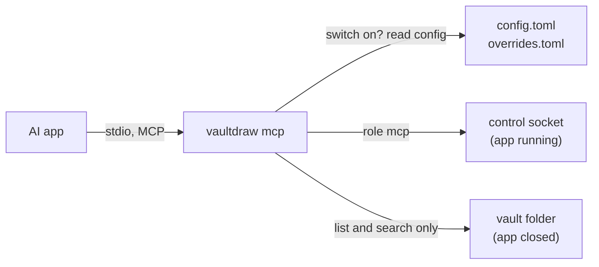

# AI tools (MCP)

`vaultdraw mcp` lets an AI app (Claude Desktop, Claude Code, Cursor and others) read and edit your drawings through the [Model Context Protocol](https://modelcontextprotocol.io). It is off until you turn AI on, runs only while the AI app runs it, and uses no network.

## Turn it on

1. In Vaultdraw: Settings → Control, switch on AI (or run **External AI tools: Toggle AI access**). Read the warning: what an AI app reads from your drawings goes to its provider.
2. Keep the sub-switch **AI tools interface** on (`ai.mcp_enabled`, default on). Both keys are in [configuration.md](configuration.md#ai).
3. Add the server to the AI app. For most of them:

```json
{ "mcpServers": { "vaultdraw": { "command": "vaultdraw", "args": ["mcp"] } } }
```

Claude Code: `claude mcp add vaultdraw -- vaultdraw mcp`. The palette command **External AI tools: Copy the AI app setup** puts the JSON above on the clipboard. Use the full path of `vaultdraw` if the AI app does not see your shell's `PATH`.

## The tools

| Tool | Does | Needs Vaultdraw running |
| --- | --- | --- |
| `vaultdraw_status` | Running or not, open vault and drawing, and whether AI tools are on (answers while off) | no |
| `list_drawings` | Drawings and folders of the vault | no (reads the folder) |
| `search_vault` | Search names, text and tags | no (reads the folder) |
| `read_drawing` | Elements of the drawing on screen, or of another drawing with `path` or `file` (`scope`, `types`, `ids`, `limit`, `offset`) | only for the drawing on screen (a named drawing is read from disk) |
| `get_selection` | The elements you have selected | yes |
| `edit_drawing` | 1 to 500 scene operations, all or nothing (`ifVersion`, `dryRun`). On screen: one undo step. Another drawing (`path` or `file`): saved like a save, with history | yes |
| `create_drawing` | A new drawing from 1 to 500 operations; nothing is created if one is invalid; refuses an existing name | yes |

Plugins can add tools. A plugin that declares a method with `mcp = true` (and the `control` permission) shows up as a tool named `<plugin>__<method>`, listed only while AI is on and Vaultdraw is running, and runs inside the app like any plugin command. Plugin tools need Vaultdraw running; a tool that writes says so in its annotations. The rest of the list never changes. See [plugin methods](../sdk/docs/reference.md#methods-other-programs-can-call-since-0220).

The scene methods behind the live tools are experimental, like `vaultdraw scene`. `vaultdraw mcp` never starts Vaultdraw; a live tool with the app closed answers `NOT_RUNNING`.



## While AI is off

`tools/list` always shows the same seven tools, because AI apps keep that list until they restart. While AI is off every tool except `vaultdraw_status` answers with an error, code `DISABLED`, that says how to turn it on. Turning AI on or off applies to the next call, with no restart. A config file that cannot be read counts as off.

## Protocol details

- JSON-RPC batches (a JSON array on one line) get one array back.
- Tool calls run one at a time, in the order sent, on a worker; `ping` and `tools/list` answer while a call is still running.
- A line that is not valid UTF-8 gets a parse error; the session goes on.
- A modern client names itself in each request (`_meta` `io.modelcontextprotocol/clientInfo`); older ones in `initialize`. The name is only for the app's notice and logs.

## Trust model

- Drawing text is your content. The tool descriptions tell the model not to follow instructions found in it, but a model may still be misled: every edit is one undo step (Cmd+Z) and shows a notice (`control.notify_edits`).
- Editing another drawing writes its file the way a save does (revision checked, previous version kept in history, refused while it is open with unsaved changes). There is no tool to delete, move or overwrite files, change settings or run commands.
- `vaultdraw mcp` talks only over standard input and output and your user-only control socket. It makes no network calls. The AI app's own network use is outside Vaultdraw.
- The `mcp` role is declared by the connecting program. An AI app that can run shell commands as you can use the `vaultdraw` command like any program you run.
- An AI connection is limited to 20 requests a second and one edit in the app at a time.

## Protocol details

Both eras are served: the 2026-07-28 revision (`server/discover`, no handshake) and `initialize` clients (2025-11-25, 2025-06-18, 2025-03-26, 2024-11-05). Only JSON lines go to standard output; the server exits when its input closes. Each tool call opens its own socket connection and declares the `mcp` role with the client's name, so an app restart needs no reconnect. Results carry the JSON as text and as `structuredContent`; refusals are results with `isError: true`.

Not included yet: edits to drawings that are not on screen, creating drawings, exporting, and reading a drawing's elements with the app closed.
