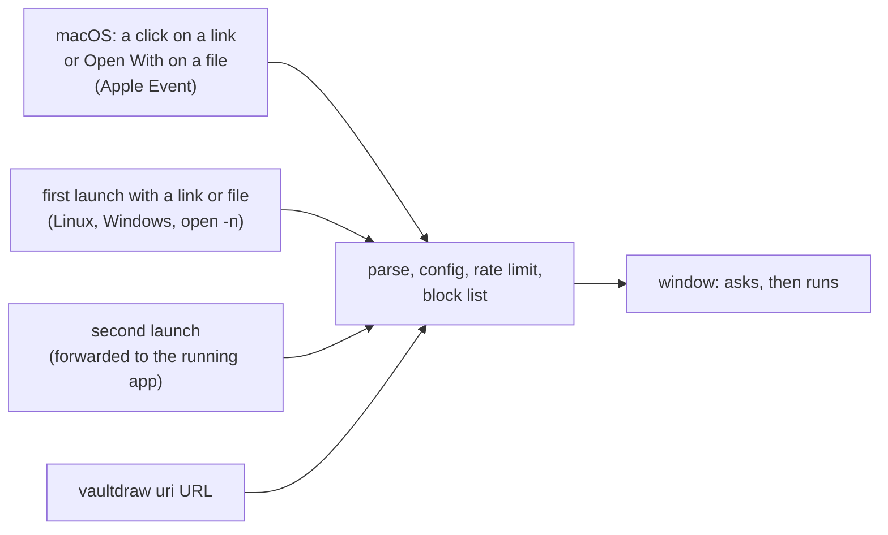

# Links and files from outside

A `vaultdraw://` link opens a drawing, a search, a new drawing or a command in your running Vaultdraw. Use it from a note, a web page, a launcher or a script. Files you open from Finder or a file manager follow the same rules (see [Files](#files)). Back to the [README](../README.md).

Nothing happens behind your back: opening and searching only change what you see, and anything that writes or runs a command asks you first. Invisible characters (zero-width spaces, direction overrides) in a link are refused.

## Links

| Link | What it does | Asks first? |
| --- | --- | --- |
| `vaultdraw://` or `vaultdraw://focus` | Brings the window to the front. | No |
| `vaultdraw://open?file=Graphs/BFS` | Opens the drawing (`.excalidraw` is optional). Add `&newTab=1` for a new tab. | No |
| `vaultdraw://open?vault=DSA&file=Graphs/BFS` | Opens it in the vault named `DSA`. | Only if `DSA` is not the open vault |
| `vaultdraw://open?vault=DSA` | Switches to the vault. | Yes |
| `vaultdraw://search?query=dijkstra` | Opens the search with the text filled in. Nothing is run on a result. | No |
| `vaultdraw://new?path=Inbox/Idea` | Creates the drawing and opens it. If it exists, it is just opened. It never overwrites. | Yes |
| `vaultdraw://cmd?id=appearance.toggleMode` | Runs one command from the palette. | Yes |

`path=` works like `file=` for `open`. Values are percent-encoded (a space is `%20`; `+` is a plus). Unknown parameters are ignored. A link is at most 8,192 bytes.

## Rules that keep it safe

1. **Names, never paths.** `vault=` is the vault's folder name, matched against the open vault and your recent vaults. A vault you have never opened cannot be opened by a link.
2. **Inside the vault only.** A drawing path is relative to the vault: no leading `/`, no drive letter, no `..`, no empty parts, no control characters.
3. **No overwrite, no callbacks, no network.** A link never replaces a file, never calls back a URL (`x-success` is ignored) and never fetches anything.
4. **One window asks about everything.** If a link wants to switch vault and create a drawing, one dialog lists both. The text is shown as plain text.
5. **Built-in commands only, and not the destructive ones.** A link can run only Vaultdraw's own commands, never a plugin's, unless you list that exact command id in `control.uri_allow`. Even after you click Run, it cannot run delete, move, rename, import, export, install or quit commands, or any command whose id starts with `control.` or `ai.` (listing the id in `uri_allow` overrides this too).
6. **Rate limit.** 5 links per 10 seconds, counted separately for links from the system, from scripts (`vaultdraw uri` and forwarded launches) and from the palette. At most 3 questions wait at once; identical ones merge and the rest are dropped with one notice.
7. **No accidental clicks.** A link's dialog starts with Cancel focused and ignores Confirm for the first 0.6 seconds, so a key you are still holding cannot confirm it. A link that asks does not bring the window to the front.
8. **Off switch.** `control.uri_enabled = false` in [config.toml](configuration.md#control-and-links) turns all of it off. `control.uri_allow` removes the question for what you trust.

## How a link gets to the app



If the window is still starting, links and files from the system wait in a small queue (16 at most) and run when it is ready.

## From a terminal

```sh
vaultdraw uri 'vaultdraw://open?file=Graphs/BFS'
```

The command checks the link itself first (a bad link exits with code 2 before it connects), then hands it to the running app. It prints `done`, or `asking` when the app is waiting for you to confirm. It never waits for your answer. Exit codes are the same as the other commands (3 when Vaultdraw is not running).

**Links: Open a vaultdraw:// link…** in the command palette does the same from inside the app. It goes through the same checks as any other link: it still asks before it creates a drawing, runs a command or switches vault, and it obeys the off switch and the rate limit.

## Files

`.excalidraw` drawings and `.excalidrawlib` libraries can be opened with Vaultdraw from Finder (**Open With**), `open -a Vaultdraw file.excalidraw`, or a second launch with a file path. Vaultdraw is registered as an *alternate* app for both types: it shows in **Open With**, and your double-click default is not changed. To make it the default, use Finder's **Get Info, Open with, Change All**.

| The file is... | What happens |
| --- | --- |
| In the open vault | It opens at once. |
| In another vault you have used | A dialog asks to switch to that vault, then it opens. |
| In no vault you use | A dialog with three choices: **Copy into vault** (a copy goes to the vault's top folder; a taken name gets a number, so nothing is replaced), **Open its folder as a vault**, or **Cancel**. |
| A `.excalidrawlib` | A dialog "Add N items to the library?": **Add to my library** (all vaults, the default), **Add to this vault's library**, or **Cancel**. The editor's merge adds the new items and removes none. |

Vaultdraw works on files inside a vault, so a file from outside is never edited in place or opened read-only. Copying and importing happen only after you click, and the dialog starts on Cancel and ignores Confirm for 0.6 seconds, like the link dialogs.

The same safety rules apply to files:

- **Same switch and limit.** `control.uri_enabled = false` turns file opens from outside off too (a notice says so), and the limit of 5 per 10 seconds applies.
- **Only what the system handed over.** The app reads an outside file once, through a grant created when the system passed that exact path. A script in a page cannot read other files this way.
- **Checked before use.** The path must be absolute and have no control or invisible characters. The file must be a regular file (a symbolic link is refused: open the file it points to), within 32 MiB for a drawing and 64 MiB for a library, valid UTF-8, and a real drawing or library.
- **No network, no overwrite.**

### Linux

Packages should install the two files in `src-tauri/linux/` (`vaultdraw.desktop` and `vaultdraw-mime.xml`). For an AppImage or a binary you copied somewhere, run **Links: Register Vaultdraw for links and files (Linux)** in the command palette. It shows exactly what it will do and waits for **Register**:

1. Writes `~/.local/share/applications/vaultdraw.desktop` and `~/.local/share/mime/packages/vaultdraw.xml` (or under `$XDG_DATA_HOME`). Never system-wide, never over a file Vaultdraw did not create.
2. Runs `update-desktop-database`, `update-mime-database` and `xdg-mime default vaultdraw.desktop x-scheme-handler/vaultdraw`. Only the `vaultdraw://` scheme gets a default; the file types appear in **Open With**.

To undo it, delete those two files and run the two `update-*` commands. This has been checked by unit tests only; a Linux desktop check is part of the Linux step.

## Not yet

A link cannot yet carry a template or content for `new`, point at an element, or open a folder as a vault. A file from outside cannot be opened without copying it or opening its folder as a vault. If you open a library file before any drawing is open, Vaultdraw asks you to open a drawing first (the library merges in the editor). Windows file types are not registered.
