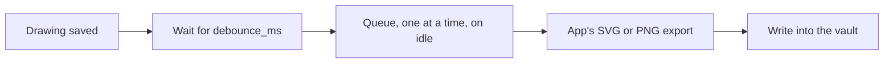

# Auto-export

SVG and PNG copies of your drawings, written when you save. Official, bundled. **Off until you turn it on:** the plugin is installed, but `[plugin.auto-export] enabled = false` makes it do nothing, and the app does not even load it.

| You want | Setting (`[plugin.auto-export]`, Settings, Plugins) |
| --- | --- |
| Turn it on | `enabled = true` |
| Which files | `formats = "svg"`, `"png"` or `"both"` |
| PNG size, background, theme | `scale` (1 to 3), `background`, `theme = "light"` or `"dark"` |
| Where | `folder = ""` writes next to each drawing; `folder = "exports"` mirrors your folders inside `exports/` |
| Leave things out | `exclude = "Private, Scratch"` (folders), a text `#no-export` in a drawing (`skip_tag`) |
| Rename and delete | `on_rename = "move"` or `"leave"`, `on_delete = "remove"` or `"keep"` |
| Timing | `debounce_ms` (default 2000): exports start that long after the last save |

Commands in the palette: **Auto-export: Export all drawings now** and **Auto-export: Export this drawing now** (they work while `enabled` is false; the second ignores the skip tag and folders).

- Exports never go into folders that start with a dot, and only `.svg` and `.png` files are written, moved or deleted.
- Rendering uses the editor's exporter on the main thread, so it waits for idle time and never runs inside the save.
- A rename moves the export with the drawing; a delete removes it. A folder of exports is only touched when it holds nothing but exports.
