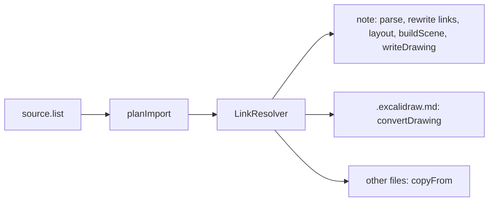

# Markdown import

Turns a Markdown note into a page-mode drawing, and an Obsidian vault into a Vaultdraw vault. Official, bundled, on by default, and it loads only when you use it.

## Use it

| Do this | Result |
| --- | --- |
| Import file… (canvas menu or palette), pick a `.md` | `Note (imported).excalidraw` opens in page mode |
| Drop a `.md` on the canvas | the same; it never replaces the open drawing |
| Import: Markdown from clipboard | the clipboard text, as `Clipboard (imported).excalidraw` |
| Import Obsidian vault… | pick a vault folder; its notes become drawings in a folder of this vault |
| Import Obsidian vault into a new vault… | the same, into a new vault |

### Tables and pictures

| In the note | In the drawing |
| --- | --- |
| A pipe table | a grid of ordinary shapes: shaded header row, outline, grid lines, one text per cell. Cells wrap, columns are as wide as their content (shrunk to the page, never cut), column alignment is kept. A long table breaks between rows. No row or column limit (a big table makes a longer drawing) |
| `![[pic.png]]`, `![[pic.png\|300]]`, ``, ``, `` | the picture. A file is found like Obsidian does: path from the note, then from the vault root, then the nearest file with that name, case-insensitive, `%20` decoded |
| A picture the import cannot place | a box that says why: `Web image, not downloaded`, `Web image refused (not a public web address)`, `Image not found`, `Image over 4 MB`, `Image type a drawing cannot hold`, `Not a picture a drawing can hold`. Web pictures are downloaded during the import (below) |

The type of a picture comes from the file's bytes, not its name. A link to a folder outside the vault (an attachments folder kept elsewhere) is followed, read only; links to files, links into the vault itself and links into hidden folders are not.

**Web pictures.** Like Obsidian, they just show: `http` and `https` pictures are downloaded during the import, with no question (at most 10 MiB, checked by their bytes, never from a private or local address), and embedded in the drawing, so they work offline; a link to a web page that is not a picture stays a box. Notes imported before fill their picture boxes when they open. `network.allow_images = false` turns this off. **Markdown: Download web images in this drawing** retries the open drawing. **Markdown: Attach missing images from a folder…** fills "Image not found" boxes (a single imported file cannot see the folder around it) from a folder you pick.

### Obsidian vault import

| Source file | Result |
| --- | --- |
| `Note.md` | `Note.excalidraw`, page-mode; parts when long |
| `Sketch.excalidraw.md` | `Sketch.excalidraw` (decoded natively, plain or compressed) |
| `Sketch.excalidraw` and other files | copied natively (attachments only when `obsidian_attachments` is on) |
| `.obsidian/`, `.trash/`, `.git/`, any dot entry | skipped |

`[[Note]]`, `[[folder/Note|alias]]` and `[[Note#Heading]]` resolve the Obsidian way (exact path, then the shortest path with that name, case-insensitive) and are rewritten to `[[path|label]]`; links that match nothing stay as text. `![[image.png]]` embeds the image from the vault (up to 4 MB, else a placeholder). The source is only read, every write is create-only (a second import of the same vault goes into `<Vault> (import 2)`; any other taken name becomes `Name 2`), one failing file is reported and the rest go on. Code: `src/obsidian/` (`plan.ts`, `links.ts`, `importVault.ts`); tests: `test/obsidian/` with a fixture vault.

Long notes are split into parts of about 1,000 elements: `Note (imported, part 2).excalidraw`. Import: Cancel stops either import.

## Commands

Every command is in the palette (Cmd+P) and has no default key; bind them in `[hotkeys]`.

`Import: Markdown…`, `Import: Markdown from clipboard`, `Import: Markdown with the Document font`, `Markdown: Next heading`, `Markdown: Previous heading`, `Import: Show timings`, `Markdown: Download web images in this drawing`, `Markdown: Attach missing images from a folder…`, `Import Obsidian vault…`, `Import Obsidian vault into a new vault…`.

## Settings

`[plugin.markdown-import]` in `config.toml`, or Settings, Plugins. Changes apply to the next import.

| Key | Default | Meaning |
| --- | --- | --- |
| `font` | `default` | `default` (follow your drawing font), `document`, or `excalifont`, `nunito`, `comic-shanns`, `virgil`, `helvetica`, `cascadia` |
| `font_size` | `16` | body text size |
| `page_size` | `a4` | page size of the drawing |
| `part_elements` | `1000` | elements per drawing before a long note splits |
| `obsidian_attachments` | `true` | copy the images and files notes use |
| `obsidian_links` | `drawing` | `drawing` keeps `[[links]]` as links, `text` leaves plain text |
| `obsidian_excalidraw` | `true` | convert `.excalidraw.md` drawings |
| `strict_line_breaks` | `false` | like Obsidian's setting: `false` keeps a single line break as a line break, `true` joins the lines of a paragraph with a space |
| `obsidian_report` | `true` | write `Import report` (failed files, images left as boxes) when something went wrong |
| `offer_update` | `true` | opening a note imported by an older version offers to give every imported note your theme and font (command **Markdown: Update imported notes to my theme and font**) |

## Turn it off

Remove `markdown-import` from `plugins.enabled` (Settings, Plugins), or set `enabled = []`. Setting `md = ""` under `plugins.importers` keeps the plugin but stops it claiming `.md` files.

## Build

`node build.mjs` writes `dist/` (the app build and the end-to-end build run it). The worker is bundled to a string and injected into `main.js`, because the app's content security policy allows a worker only from a `blob:` URL.
