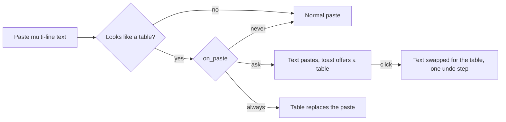

# Table

Paste spreadsheet cells, CSV or a Markdown table and get a table of ordinary Excalidraw shapes. Official, bundled. It loads on the first paste of multi-line text or when you run the command, never at launch.

| You want | How |
| --- | --- |
| A table from the clipboard | Palette: **Insert table from clipboard** |
| A table when you paste | Paste text that looks like a table; the toast offers **Insert as table** |
| No toast, or no asking | `[plugin.table] on_paste = "never"` or `"always"` (default `"ask"`) |
| Narrower or wider columns | `max_col_width` (pixels, default 260; longer text wraps) |

- Recognised: tab-separated (spreadsheets), CSV with quotes (comma or semicolon), Markdown pipe tables (`|---|`).
- The table is one group of a rectangle, a shaded header row, grid lines and one text per cell, in your current stroke colour, font and size. Excalidraw text has no bold, so the header is shaded with a heavier rule under it.
- At most 200 rows and 30 columns, and about 400 filled cells per paste (the app's limit of 500 operations per drawing step).
- The plugin sees only the text of a paste of plain text (permission `clipboard`); copied shapes and images never reach it.
