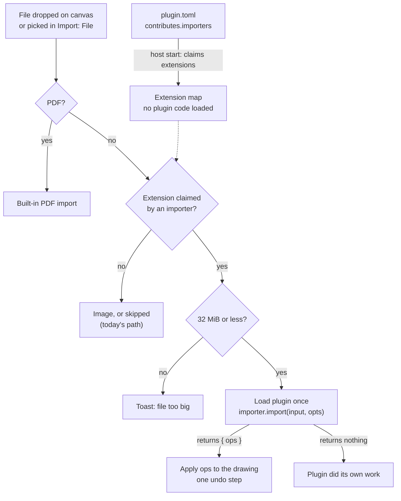

# Importers

An importer turns one file type into drawing content. A plugin declares the file types in `plugin.toml`. The app loads the plugin only when you drop or pick a file of that type. Added in API 0.6.0.

## 1. Declare the file type

In `plugin.toml`:

```toml
[[contributes.importers]]
id = "txt"                  # short id, unique in the plugin
title = "Plain text"        # shown in Settings and messages
extensions = ["txt"]        # lower case, no dot; 1 to 8 per importer
```

| Field | Rule |
| --- | --- |
| `id` | Short id, unique among the plugin's importers. The same rule as a command id. |
| `title` | Shown on the Plugins page and in messages. |
| `extensions` | 1 to 8 per importer, unique in the plugin. Lower case letters and digits, dots between parts (`tar.gz`, `excalidraw.md`), at most 32 bytes each. |

A plugin has at most 8 importers. The schema is [plugin.schema.json](../api/plugin.schema.json); the generated [manifest reference](manifest.md) lists every key.

**Reserved extensions.** The app handles these itself, so no plugin may claim them: `excalidraw`, `excalidrawlib`, `json`, `pdf`, `jpeg`, `svg`, `png`, `jpg`, `gif`, `webp`, `bmp`, `ico`, `avif`, `jfif`, `excalidraw.png` and `excalidraw.svg`. A manifest that claims one is refused.

## 2. Register the handler

In `activate(ctx)`, bind the code to the declared id:

```js
ctx.importers.register("txt", {
  async import(input, opts) {
    const text = (await input.text()).trimEnd();
    if (!text) return;
    return {
      ops: [
        {
          op: "add",
          element: { type: "text", x: opts.at.x, y: opts.at.y, text },
        },
      ],
    };
  },
});
```

`register` refuses an id the manifest does not declare. It returns a `Disposable`, so the registration ends when the plugin is disabled.

## 3. Input and result

| Type | Field | Meaning |
| --- | --- | --- |
| `ImportInput` | `name` | The file name only, never a path. |
|  | `size` | Size in bytes. |
|  | `bytes()` | The file's bytes, read when you call it. |
|  | `text()` | The file as UTF-8 text. Invalid bytes become U+FFFD. |
| `ImportOptions` | `signal` | An `AbortSignal`. See [when it aborts](#when-an-import-stops). |
|  | `at` | A scene point: the drop point, or the viewport centre for **Import: File…**. |
|  | `path` | The vault-relative path of the drawing the result goes into. |
| `ImportResult` | `{ ops }` | Ops to add to that drawing. The app applies them as **one undo step**. |
|  | nothing | The importer did its own work, for example with `ctx.vault.createDrawing` or `ctx.workspace.open`. |

The ops are the same ops as `ctx.scene.batch`. The same [batch rules](reference.md#batch-rules) apply.

## 4. What happens to a file



Notes on the flow:

- The PDF import keeps its place first. Plugins never see a PDF.
- A plugin loads only when a matching file arrives. Until then it costs nothing.
- The file size limit is checked before the plugin loads: 32 MiB.

## Rules

### Limits

| Rule | Value |
| --- | --- |
| File size | 32 MiB or less (checked before the plugin loads). |
| Imports at a time | One. A second drop while one runs shows "busy" and is not queued. |
| Files in one drop | Run one after another. |
| Ops per result | The batch limit: 500. |
| Plugin code | Runs on the main thread, with full access. There is no progress view yet. |

### Undo

A `{ ops }` result is one undo step, like `ctx.scene.batch`. Undo removes the whole import.

### When an import stops

The `signal` aborts in three cases:

| Cause | What the importer sees | What happens to the result |
| --- | --- | --- |
| You switch to another drawing | `signal.reason` is `"switch"` | Nothing is applied. If the importer had already returned ops, a message says the drawing changed. |
| The plugin is stopped or disabled | `"stop"` | Nothing is applied. |
| You run **Import: Cancel** | `"cancel"` | Nothing is applied. A message says the import was cancelled. |

Check `opts.signal` in long work. The app does not stop the code for you. A plugin that ignores the signal still runs to its end, but its result is dropped.

Other outcomes:

- **Read-only drawing:** nothing is applied, and a message says so.
- **Importer throws:** the error goes to Settings → Plugins, and a message names the file.

### Commands

| Command        | Id                     | Default shortcut |
| -------------- | ---------------------- | ---------------- |
| Import: Cancel | `plugins.cancelImport` | none             |
| Import: File…  | `file.importFile`      | none             |

**Import: File…** opens a file picker. It accepts the PDF and image types, plus every extension a plugin imports. Both commands are in the palette and can be rebound in `[hotkeys]`.

## Clashes: two plugins claim one extension

Two plugins can declare the same extension. Only one handles it.

1. The `plugins.importers` key in `config.toml` picks the owner:

   ```toml
   [plugins.importers]
   txt = "text-import"       # this plugin imports .txt
   md = ""                   # no plugin imports .md; the app's own behaviour returns
   ```

2. Without a key for the extension, the plugin whose id comes first in plain text order wins.
3. A name that does not claim the extension is ignored, and the default owner is used.
4. `""` turns plugin handling off for that extension. The app's own behaviour returns, and for an extension the app does not handle the file is listed as not imported.

Settings → Plugins lists each clash and names the winner. The key reloads live: an edit applies at once. See [configuration.md](../../docs/configuration.md#plugins-experimental).

## Example: text-import

[sdk/examples/text-import](../examples/text-import) imports a `.txt` file as one text element at the drop point. Its `main.js` is short, and its test checks the manifest, the one-batch write and the empty-file message.

```toml
id = "text-import"
api = 0
main = "main.js"

[[contributes.importers]]
id = "txt"
title = "Plain text"
extensions = ["txt"]
```

To try it, copy the folder into your `plugins/` folder, enable it in `config.toml`, and drop a `.txt` file on a drawing.

## Not in this version

- Drops on the navigator and on the empty state (no drawing open) do not reach importers.
- No `onFile:` activation. Only `onDrop:<ext>`, and only for an extension an importer declares.
- No progress reporting and no streaming.
- Importers cannot write plain files. They create drawings only.
