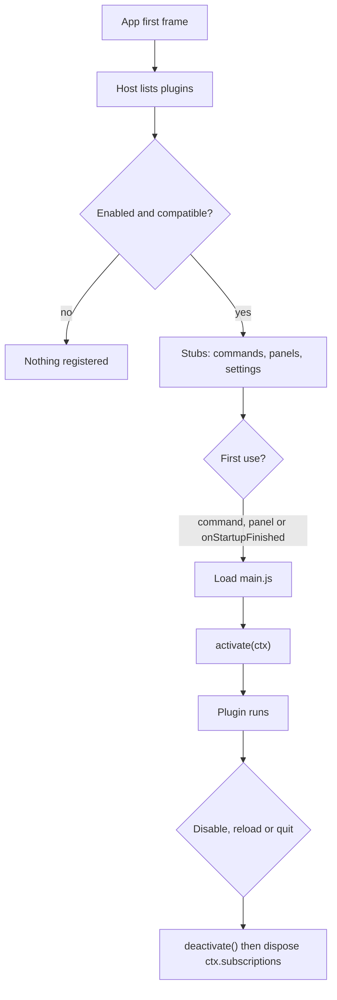

# Plugin API reference

What a Vaultdraw plugin is, what it can call, and what the app does for it. The API is experimental (level 0).

## A plugin on disk

A plugin is a folder with two files:

```
~/.config/vaultdraw/plugins/hello-command/
  plugin.toml
  main.js        # one ESM bundle; default export = definePlugin({...})
```

The config folder is `~/.config/vaultdraw/`. Bundled plugins live in the app's `Resources/plugins/`. Install a plugin by copying its folder into `plugins/`, or with **Install from folder…** in Settings → Plugins.

## plugin.toml

```toml
id = "hello-command"        # ^[a-z0-9][a-z0-9-]{1,38}$, unique
name = "Hello"
version = "0.1.0"           # semver
api = 0                     # API level this plugin targets
min_app = "0.1.0"           # optional; semver; refused on older apps
main = "main.js"            # relative path inside the folder
description = "Says hello"  # optional
author = "you"              # optional
activation = []             # optional; only "onStartupFinished" exists
dev = false                 # optional; true = the app reloads the plugin when its files change

[[contributes.commands]]
id = "hello"                # short id; the full id is "hello-command.hello"
title = "Hello: say hello"
keys = ["Mod+Alt+H"]        # optional default chords (config notation); [] = none
when = ["vaultOpen"]        # optional; built-in or namespaced context keys
palette = true              # optional, default true

[[contributes.panels]]
id = "notes"                # full id "hello-command.notes"
title = "Notes"
icon = "note"               # optional; a built-in icon name
group = "top"               # optional: "top" | "bottom" (activity bar)

[[contributes.settings]]
key = "greeting"
type = "string"             # bool | int | number | string | select | color
title = "Greeting"
default = "Hello"
```

| Rule | Value |
| --- | --- |
| `plugin.toml` size | at most 64 KB |
| Contributions | at most 200 commands, 20 panels, 100 settings |
| Titles | 1 to 200 characters |
| `name`, command and panel titles | not blank |
| `description`, `author` | at most 1000 characters |
| Command and panel ids | `^[A-Za-z][A-Za-z0-9_-]{0,63}$`, unique within the plugin |
| `main` | relative path inside the folder: no `..`, no leading `/`, no `\` or `:` |
| Unknown top-level keys | errors, except tables named `x-*` (reserved for forward-compatible extras) |
| Unknown activation event | error |

The settings entries have the shape of `SettingDecl` in `@vaultdraw/api`. The Rust side only checks that each has a `key` and a `type`. The app's settings registry validates the rest and reports problems on the Plugins page.

## Lifecycle



1. After the app's first frame, the host asks Rust for the plugin list. The scan runs off the main thread and is cached by modification time.
2. For every **enabled**, compatible plugin the host registers stubs: commands (with keys and `when`) in the palette and keymap, panels in the activity bar, and declared settings. **No plugin code loads.** Disabled plugins register nothing.
3. **Activation** happens on first use: running one of its commands, opening one of its panels, or, if declared, `onStartupFinished` on an idle callback after startup. The first trigger waits for activation, then runs. A plugin activates once per session.
4. `activate(ctx)` binds handlers and components. Anything registered through `ctx` is disposed on disable, reload and quit, in reverse order. `deactivate()` has a 2 s timeout.
5. Errors are attributed to the plugin that caused them. 3 attributed errors in a session, or a failed activation, disable it. The disable is saved ("Disabled by Vaultdraw: reason") until the user re-enables it. A `dev = true` plugin is stopped for the session only: the disable is not saved, and the next reload (a file save) starts it again with a fresh error count.

Enabled plugins are listed in `config.toml`:

```toml
[plugins]
enabled = ["hello-command"]
```

Plugin settings values live in `[plugin.<id>]` tables: in `config.toml`, or in the vault's `settings.toml` for vault scope.

## main.js

```js
import { definePlugin } from "@vaultdraw/api"; // or export the object literal directly

export default definePlugin({
  activate(ctx) {
    ctx.commands.register("hello", () => {
      ctx.ui.toast(`${ctx.settings.get("greeting")} from a plugin`);
    });
  },
});
```

These bare imports resolve inside the app, to one shared copy (through an import map): `react`, `react/jsx-runtime`, `react-dom`, `react-dom/client`, `@vaultdraw/api`. Everything else must be bundled into `main.js`, or loaded with a relative import from the plugin folder.

## API

The types below are shortened. The full, commented source is `sdk/api/src/`, and `sdk/api/etc/api-surface.d.ts` is the snapshot of every public declaration.

```ts
interface Disposable {
  dispose(): void;
}

interface Plugin {
  activate(ctx: PluginContext): void | Promise<void>;
  deactivate?(): void | Promise<void>; // 2 s timeout
}
function definePlugin(plugin: Plugin): Plugin; // identity

interface PluginContext {
  readonly manifest: { id: string; version: string; dir: string };
  readonly commands: {
    /** Bind the handler of a command declared in plugin.toml (short id). */
    register(id: string, run: () => void | Promise<void>): Disposable;
    /** Run any command by full id (built-in or plugin). */
    execute(fullId: string): Promise<void>;
  };
  readonly panels: {
    /** Provide the React component of a panel declared in plugin.toml (short id). */
    register(id: string, component: React.ComponentType): Disposable;
    open(id: string): void;
    close(id: string): void;
  };
  readonly settings: {
    get<T = unknown>(key: string): T; // effective value (vault > global > default)
    set(key: string, value: unknown): Promise<void>;
    onChange(key: string, cb: (value: unknown) => void): Disposable;
  };
  readonly ui: { toast(message: string): void };
  readonly scene: {
    elements(): readonly SceneElement[]; // frozen snapshot; [] when no drawing is open
    onChange(
      cb: (e: { reason: "edit" | "switch"; path: string | null }) => void,
    ): Disposable; // at most once per frame; pan, zoom and selection don't fire
    useScene<T>(
      select: (els: readonly SceneElement[]) => T,
      isEqual?: (a: T, b: T) => boolean,
    ): T; // React hook for panels
    batch(ops: readonly SceneOp[]): Promise<{ ids: string[] }>; // all or nothing, ONE undo step
    viewportCenter(): { x: number; y: number };
  };
  readonly events: {
    on<K extends keyof AppEventMap>(
      name: K,
      cb: (payload: Readonly<AppEventMap[K]>) => void,
    ): Disposable;
  };
  readonly log: {
    debug(...a: unknown[]): void;
    info(...a: unknown[]): void;
    warn(...a: unknown[]): void;
    error(...a: unknown[]): void;
  };
  /** Push anything disposable; disposed in reverse order on disable, reload and quit. */
  readonly subscriptions: Disposable[];
  setTimeout(fn: () => void, ms: number): Disposable;
  setInterval(fn: () => void, ms: number): Disposable;
}
```

Notes:

- `ctx.ui.toast(m)` shows "<plugin name>: m". Don't add your name yourself. The same message while it is still showing refreshes that toast instead of stacking a second one.
- A stored setting value outside a declared `min` / `max`, or of the wrong type, reads as the default and is reported as a settings problem. `ctx.settings.set` rejects such a value.
- `ctx.scene.batch` rejects when no drawing is open, when the drawing is read-only, or when an op is invalid. The error carries the problems in `issues` (`SceneOpIssue[]`: op index, key, message).
- Events are delivered in order, on a microtask. Paths are vault-relative.

### Scene and event types

```ts
type SceneElementType =
  | "rectangle"
  | "ellipse"
  | "diamond"
  | "text"
  | "arrow"
  | "line"
  | "freedraw"
  | "image"
  | "frame"
  | "other";

interface SceneElement {
  // all readonly
  id: string;
  type: SceneElementType;
  x: number;
  y: number;
  width: number;
  height: number;
  angle: number;
  text?: string;
  strokeColor?: string;
  backgroundColor?: string;
}

interface NewElement {
  type: "rectangle" | "ellipse" | "diamond" | "text" | "arrow" | "line";
  x?: number;
  y?: number;
  width?: number;
  height?: number;
  text?: string;
  fontSize?: number;
  strokeColor?: string;
  backgroundColor?: string;
  strokeWidth?: number;
  opacity?: number;
  points?: [number, number][];
}

type SceneOp =
  | { op: "add"; element: NewElement }
  | { op: "update"; id: string; props: Partial<Omit<NewElement, "type">> }
  | { op: "delete"; id: string };

type AppEventMap = {
  "vault.opened": { name: string };
  "drawing.opened": { path: string };
  "drawing.saved": { path: string };
  "drawing.renamed": { from: string; to: string };
  "drawing.deleted": { path: string };
};
```

`SceneElement` is a plain copy, never a live Excalidraw element. It leaves out version, nonce, index, seed, bindings and bound elements.

### Batch rules

| Rule              | Limit                                                 |
| ----------------- | ----------------------------------------------------- |
| Ops per batch     | at most 500                                           |
| Numbers           | finite, within ±1e7                                   |
| `width`, `height` | 1 to 1e6                                              |
| `text`            | at most 10 000 characters; required for text adds     |
| `fontSize`        | 1 to 1000                                             |
| `strokeWidth`     | 0 to 100                                              |
| `opacity`         | 0 to 100                                              |
| Colours           | hex (3, 4, 6 or 8 digits), CSS names or `transparent` |

- `text` on a shape becomes its bound label.
- Adds without `x` / `y` are centred as a group on the viewport.
- Ids come back in op order (labels excluded). The app always generates ids.
- A `delete` wins over updates of the same id.
- Any unknown property rejects the whole batch.

## Rules for plugin code

1. Use `ctx.setTimeout`, `ctx.setInterval` and `ctx.subscriptions` instead of raw timers and listeners. Then disabling a plugin leaves nothing running.
2. Never block. A command handler whose synchronous part takes over 50 ms is recorded as slow. Keep work async or chunked.
3. `console.*` is not attributed to your plugin. Use `ctx.log`.
4. Keep `main.js` small. The host loads it only on first use, so unused plugins cost nothing, and a small bundle activates faster.

## What the host adds for you

- **Panels.** Every declared panel gets a palette command `<pluginId>.panel.<panelId>` ("Toggle <title> panel") and an activity-bar button `<pluginId>.<panelId>`. Panels open in a right-hand column. The panel's code loads, and the plugin activates, the first time it opens. A render error shows "This plugin panel crashed." and counts as a plugin error. Only the first 6 plugin panel buttons show in the activity bar by default.
- **Timing.** Command handlers are timed (the synchronous part). Over 50 ms is "slow". The `performance` marks `vaultdraw:plugin:<id>:load` and `:activate` are emitted for the perf harness. Settings → Plugins shows activation time, with a "slow" badge for slow activations.
- **Missing handler.** A command declared in `plugin.toml` but not bound in `activate()` fails with an attributed error and a toast. The same holds for a declared panel that is never registered.

## Installing, enabling, safe mode

- **Settings → Plugins** lists installed plugins. Each row has an enable switch (a plugin that isn't bundled asks for consent first, because it runs with full access), an Unverified badge, "Needs app ≥ X", "Disabled by Vaultdraw: reason" with Re-enable, Active / Not loaded, the activation time, a memory estimate, Open folder, Reload (active or dev plugins) and Uninstall (user plugins). **Install from folder…** copies a folder into `~/.config/vaultdraw/plugins/`. It does not enable it.
- **Palette commands:**

  | Command                       | Id                        |
  | ----------------------------- | ------------------------- |
  | Plugins: Open plugin settings | `plugins.openSettings`    |
  | Plugins: Install from folder… | `plugins.installFolder`   |
  | Plugins: Reload plugin list   | `plugins.reloadList`      |
  | Plugins: Open plugins folder  | `plugins.openFolder`      |
  | Plugins: Restart in safe mode | `plugins.restartSafeMode` |
  | Plugins: Restart normally     | `plugins.restartNormally` |

- **Safe mode** loads no plugins at all. The Plugins page still lists them. Start it by holding Option at launch (macOS) or with **Restart in safe mode**. It also starts by itself after 2 launches in a row that crashed with plugins enabled. A launch counts as OK 10 s after the host starts, or on a clean quit.
- **Dev loop:** put `dev = true` in `plugin.toml`, install the folder and enable it. Saving `main.js` or `plugin.toml` reloads the plugin: dispose, import again with a fresh `?t=` URL, then activate if it was active. Symlinked and temp folders work (watched paths are canonicalised). Each reload keeps the old module in memory (about 6 times its size) until the app restarts, and a hint is logged every 20 reloads. `vaultdraw-plugin dev` wraps this loop (see below).

## Testing a plugin without the app

The test kit boots a plugin in memory under vitest, with a fake scene, event bus and settings. It lives in `excalidraw-desktop/src/plugins/testing` and is not yet a package. The examples in `sdk/examples/*/main.test.ts` show it in use.

```ts
const p = await boot(
  { id: "word-count", contributes: { panels: [{ id: "stats" }] } },
  plugin,
);
p.scene.setElements([
  {
    id: "a",
    type: "text",
    text: "hello world",
    x: 0,
    y: 0,
    width: 50,
    height: 20,
  },
]);
const view = await p.openPanel("stats"); // testing-library RenderResult
p.scene.emitChange();
await p.flush();
p.events.emit("drawing.saved", { path: "a.excalidraw" });
await p.run("say");
p.toasts();
p.timers();
p.log();
await p.setSetting("greeting", "Hi");
p.scene.batches; // one entry per undo step
await p.dispose();
```

- A plugin with no command or panel to trigger activation needs `activation = ["onStartupFinished"]` to be active after `boot`.
- `flush()` works with and without fake timers.

## Versioning

1. **Two numbers.** The **API level** is `api = 0` in the manifest. The host refuses a plugin that names another level. The **API revision** is the version of the `@vaultdraw/api` package, `0.N.P`. Its `package.json` has `vaultdraw.minApp`, the first app version that shipped that revision.
2. **v0 is experimental.** Additions are optional members, tagged `@since` with the revision that added them.
3. **Changes and removals** happen only in a minor revision. They are listed under "Plugin API" in the [CHANGELOG](../../CHANGELOG.md), they show as a diff of `sdk/api/etc/api-surface.d.ts`, and they keep the old form for one release when that is cheap.
4. **`min_app` is the author's choice.** `vaultdraw-plugin check` warns when it is lower than what the code uses.
5. **Real guarantees** (deprecation windows, an N-1 shim) begin at 1.0.

## The `vaultdraw-plugin` tool

`vaultdraw-plugin` is the developer command line tool: `check` validates a plugin folder, `init` creates one from a template, and `dev` runs the reload loop. Usage and examples are in [getting-started.md](getting-started.md).

### `check` codes

`vaultdraw-plugin check <dir>` prints each finding with its code. `--json` prints them as JSON. It exits 1 when there is any error. Warnings do not change the exit code.

| Code | Kind | Meaning |
| --- | --- | --- |
| `plugin-toml-missing` | error | No `plugin.toml` in the folder |
| `manifest-too-large` | error | `plugin.toml` is over 64 KB |
| `toml-parse` | error | Not valid TOML |
| `unknown-key` | error | A key the manifest doesn't have (top level, `contributes`, a command, a panel) |
| `missing-key` | error | A required key is missing |
| `id-invalid` | error | Plugin id breaks `^[a-z0-9][a-z0-9-]{1,38}$` |
| `name-invalid` | error | `name` is not 1 to 200 characters |
| `version-invalid` | error | `version` is not semver |
| `min-app-invalid` | error | `min_app` is not semver |
| `main-path-invalid` | error | `main` is not a relative path inside the folder |
| `api-unsupported` | error | `api` is not a level the app implements (0) |
| `text-invalid` | error | `description` or `author` is too long or not text, or `dev` is not true or false |
| `activation-unknown` | error | `activation` is not a list, or names an event other than `onStartupFinished` |
| `dev-true` | error | `dev = true` in a plugin you ship; `vaultdraw-plugin dev` adds it to the installed copy |
| `contribution-invalid` | error | A `contributes` entry has the wrong shape or type |
| `contribution-id-invalid` | error | A command or panel id breaks the id rule |
| `contribution-duplicate` | error | Two commands or two panels share an id |
| `title-invalid` | error | A command or panel title is not 1 to 200 characters |
| `setting-invalid` | error | A setting has no string `key` and `type` |
| `too-many` | error | More than 200 commands, 20 panels or 100 settings |
| `main-missing` | error | The file named by `main` doesn't exist |
| `imports-unshared` | error | `main.js` (or a file it imports) imports a bare module the app doesn't provide; bundle it |
| `import-missing` | warning | A relative import points to a file that isn't in the plugin folder |
| `bundle-large` | warning | `main` is over 100 KB |
| `min-app-low` | warning | `min_app` is lower than the first app version with the API the code uses (best effort: it looks for `ctx.<area>` in the code) |
| `readme-missing` | warning | No `README.md` |
