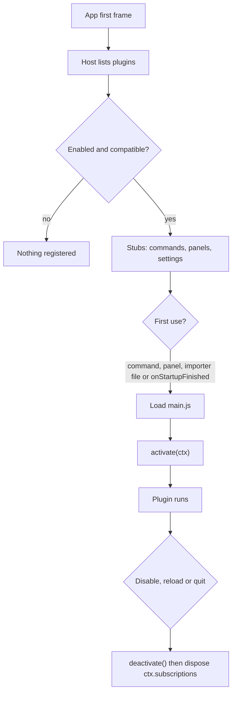

# Plugin API reference

What a Vaultdraw plugin is, what it can call, and what the app does for it. The API is experimental (level 0).

## A plugin on disk

A plugin is a folder with two files:

```
~/.config/vaultdraw/plugins/hello-command/
  plugin.toml
  main.js        # one ESM bundle; default export = definePlugin({...})
```

The config folder is `~/.config/vaultdraw/`. Bundled plugins live in the app's `Resources/plugins/`. Install a plugin by copying its folder into `plugins/`, or with **Install from folder…** in Settings → Plugins.

## plugin.toml

The manifest sits next to `main.js`. It names the plugin and declares its commands, panels and settings, so the app can register them without loading any code.

```toml
id = "hello-command"        # 2 to 39 characters: a-z, 0-9, -
name = "Hello"
version = "0.1.0"           # semver
api = 0                     # API level this plugin targets
main = "main.js"            # relative path inside the folder

[[contributes.commands]]
id = "hello"                # the full id is "hello-command.hello"
title = "Hello: say hello"
keys = ["Mod+Alt+H"]        # optional default chords; [] = none
```

Every key, type and limit is in the generated [manifest reference](manifest.md). It comes from `sdk/api/plugin.schema.json`, which editors can use for completion. In short:

- Required: `id`, `name`, `version`, `api`, `main`. Optional: `min_app`, `description`, `author`, `activation`, `permissions`, `dev`.
- `plugin.toml` is at most 64 KB. A manifest has at most 200 commands, 20 panels and 100 settings.
- Unknown keys are errors, except tables named `x-*`, which are reserved for tools.
- `permissions` is a declaration of what the plugin does to your files, not a sandbox. See [permissions.md](permissions.md).
- Activation events: `onStartupFinished`, and since 0.6.0 `onDrop:<ext>` for an extension one of its importers declares. `dev = true` makes the app reload the plugin when its files change; a packaged plugin must not set it.
- The settings entries have the shape of `SettingDecl` in `@vaultdraw/api`. The Rust side only checks that each has a `key` and a `type`. The app's settings registry validates the rest and reports problems on the Plugins page.

## Lifecycle



1. After the app's first frame, the host asks Rust for the plugin list. The scan runs off the main thread and is cached by modification time.
2. For every **enabled**, compatible plugin the host registers stubs: commands (with keys and `when`) in the palette and keymap, panels in the activity bar, and declared settings. **No plugin code loads.** Disabled plugins register nothing.
3. **Activation** happens on first use: running one of its commands, opening one of its panels, or, if declared, `onStartupFinished` on an idle callback after startup. The first trigger waits for activation, then runs. A plugin activates once per session.
4. `activate(ctx)` binds handlers and components. Anything registered through `ctx` is disposed on disable, reload and quit, in reverse order. `deactivate()` has a 2 s timeout.
5. Errors are attributed to the plugin that caused them. 3 attributed errors in a session, or a failed activation, disable it. The disable is saved ("Disabled by Vaultdraw: reason") until the user re-enables it. A `dev = true` plugin is stopped for the session only: the disable is not saved, and the next reload (a file save) starts it again with a fresh error count.

Enabled plugins are listed in `config.toml`:

```toml
[plugins]
enabled = ["hello-command"]
```

Plugin settings values live in `[plugin.<id>]` tables: in `config.toml`, or in the vault's `settings.toml` for vault scope.

## main.js

```js
import { definePlugin } from "@vaultdraw/api"; // or export the object literal directly

export default definePlugin({
  activate(ctx) {
    ctx.commands.register("hello", () => {
      ctx.ui.toast(`${ctx.settings.get("greeting")} from a plugin`);
    });
  },
});
```

These bare imports resolve inside the app, to one shared copy (through an import map): `react`, `react/jsx-runtime`, `react-dom`, `react-dom/client`, `@vaultdraw/api`, and CodeMirror: `@codemirror/state`, `@codemirror/view`, `@codemirror/language`, `@codemirror/commands`, `@lezer/common`, `@lezer/highlight`. The CodeMirror modules load on first import, so they cost nothing until a plugin uses them. Everything else must be bundled into `main.js`, or loaded with a relative import from the plugin folder.

## API

The types below are shortened. The full, commented source is `sdk/api/src/`, and `sdk/api/etc/api-surface.d.ts` is the snapshot of every public declaration.

```ts
interface Disposable {
  dispose(): void;
}

interface Plugin {
  activate(ctx: PluginContext): void | Promise<void>;
  deactivate?(): void | Promise<void>; // 2 s timeout
}
function definePlugin(plugin: Plugin): Plugin; // identity

interface PluginContext {
  readonly manifest: {
    id: string;
    version: string;
    dir: string;
    permissions: readonly ("vault.read" | "vault.write")[]; // since 0.2.0
  };
  readonly commands: {
    /** Bind the handler of a command declared in plugin.toml (short id). */
    register(id: string, run: () => void | Promise<void>): Disposable;
    /** Run any command by full id (built-in or plugin). */
    execute(fullId: string): Promise<void>;
  };
  readonly panels: {
    /** Provide the React component of a panel declared in plugin.toml (short id). */
    register(id: string, component: React.ComponentType): Disposable;
    open(id: string): void;
    close(id: string): void;
  };
  readonly settings: {
    get<T = unknown>(key: string): T; // effective value (vault > global > default)
    set(key: string, value: unknown): Promise<void>;
    onChange(key: string, cb: (value: unknown) => void): Disposable;
  };
  readonly ui: { toast(message: string): void };
  readonly scene: {
    elements(): readonly SceneElement[]; // frozen snapshot; [] when no drawing is open
    onChange(
      cb: (e: { reason: "edit" | "switch"; path: string | null }) => void,
    ): Disposable; // at most once per frame; pan, zoom and selection don't fire
    useScene<T>(
      select: (els: readonly SceneElement[]) => T,
      isEqual?: (a: T, b: T) => boolean,
    ): T; // React hook for panels
    batch(
      ops: readonly SceneOp[],
      options?: { path?: string },
    ): Promise<{ ids: string[]; refs: Record<string, string> }>; // all or nothing, ONE undo step; since 0.4.0 also refs
    viewportCenter(): { x: number; y: number };
    get(
      ids: readonly string[],
      options?: { points?: boolean; data?: boolean },
    ): readonly SceneElementDetail[]; // since 0.4.0; missing ids are left out
    dataOf(id: string): Json | undefined; // since 0.4.0; this plugin's data on an element
    path(): string | null; // since 0.4.0; the active drawing's vault-relative path, null when none
  };
  readonly events: {
    on<K extends keyof AppEventMap>(
      name: K,
      cb: (payload: Readonly<AppEventMap[K]>) => void,
    ): Disposable;
  };
  readonly vault: VaultApi; // since 0.6.0, see below
  readonly workspace: WorkspaceApi; // since 0.6.0
  readonly importers: ImportersApi; // since 0.6.0
  readonly host: {
    // since 0.2.0
    readonly app: string; // the app version
    readonly api: { level: 0; revision: string }; // for example { level: 0, revision: "0.2.0" }
    has(feature: string): boolean; // "theme.tokens", "scene.batch", "drawing.saved"
  };
  readonly theme: {
    // since 0.2.0, read only
    mode(): "light" | "dark";
    tokens(): Readonly<Record<ThemeTokenName, string>>; // CSS strings, see theme-tokens.md
    onChange(
      cb: (e: { mode: "light" | "dark"; themeId: string }) => void,
    ): Disposable;
  };
  readonly storage: {
    // since 0.3.0: JSON values, saved on this computer
    readonly global: {
      get<T extends Json = Json>(key: string): Promise<T | undefined>;
      set(key: string, value: Json): Promise<void>;
      delete(key: string): Promise<void>;
      keys(): Promise<string[]>;
    };
  };
  readonly log: {
    debug(...a: unknown[]): void;
    info(...a: unknown[]): void;
    warn(...a: unknown[]): void;
    error(...a: unknown[]): void;
  };
  /** Push anything disposable; disposed in reverse order on disable, reload and quit. */
  readonly subscriptions: Disposable[];
  setTimeout(fn: () => void, ms: number): Disposable;
  setInterval(fn: () => void, ms: number): Disposable;
}
```

Notes:

- `ctx.ui.toast(m)` shows "<plugin name>: m". Don't add your name yourself. The same message while it is still showing refreshes that toast instead of stacking a second one.
- A stored setting value outside a declared `min` / `max`, or of the wrong type, reads as the default and is reported as a settings problem. `ctx.settings.set` rejects such a value.
- `ctx.scene.batch` rejects with a `code`:

  | Code | When |
  | --- | --- |
  | `NOT_FOUND` | No drawing is open. |
  | `READ_ONLY` | The drawing is read-only. |
  | `DRAWING_CHANGED` | `options.path` is set and is not the active drawing (the user switched). |
  | `TOO_LARGE` | Since 0.7.0: the images would push the drawing past 90% of its 32 MiB size cap. Nothing is written. |
  | `INVALID_ARGUMENT` | An op is invalid. `issues` (`SceneOpIssue[]`: op index, key, message) lists every problem. Nothing is written. |

- Events are delivered in order, on a microtask. Paths are vault-relative.
- `ctx.host.has(name)` asks for a feature, not a version (like `has('nvim-0.9')` in Neovim). Names are a `ctx` member (`"theme"`), a member of one (`"theme.tokens"`) or an app event (`"drawing.saved"`). Unknown names give `false`. The list is generated from the `@since` tags (`sdk/api/shared/features.ts`).
- `ctx.theme.tokens()` returns what the document shows now, as CSS strings: some are `rgba(...)` colours or shadows, not only `#rrggbb`. The table is frozen and is as of the last theme change (a CSS snippet that edits `--vault-*` by itself is not seen); read it again after `onChange`. The 41 names are API; each is described in [theme-tokens.md](theme-tokens.md).
- `ctx.host` and `ctx.theme` are built on first read, and nothing listens to theme changes until you call `onChange`. A plugin that never touches them pays nothing.
- `ctx.storage.global` keeps data between runs, like Obsidian's `loadData`/`saveData` with VS Code's `globalState` interface. It is one JSON object per plugin in the app's state folder (`plugin-data/<id>/data.json`), the same in every vault, never inside a vault and not part of your config files.
  - Values are JSON (`null`, booleans, finite numbers, strings, arrays, plain objects); `get` returns a fresh copy. A key is 1 to 256 characters.
  - The whole object is limited to `plugins.storage_limit_kb` (1024 KiB by default, 64 to 16384). A `set` past it rejects with `code: "QUOTA"` and changes nothing; a bad key or value rejects with `code: "INVALID_ARGUMENT"`.
  - Nothing is read until the first call. Writes reach the disk 600 ms after the last change (at most 2 s), are skipped when nothing changed, and are flushed when the plugin is disabled or reloaded and before the app quits.
  - An unreadable file is renamed `data.json.bad`; the plugin starts empty and the user sees one notice.
  - Uninstalling keeps the data. Settings → Plugins shows its size with a **Delete data** button, and **Plugins: Delete data of a plugin…** (`plugins.deleteData`) goes there.

### Scene and event types

```ts
type SceneElementType =
  | "rectangle"
  | "ellipse"
  | "diamond"
  | "text"
  | "arrow"
  | "line"
  | "freedraw"
  | "image"
  | "frame"
  | "other";

interface SceneElement {
  // all readonly
  id: string;
  type: SceneElementType;
  x: number;
  y: number;
  width: number;
  height: number;
  angle: number;
  text?: string;
  strokeColor?: string;
  backgroundColor?: string;
}

interface NewElement {
  type: "rectangle" | "ellipse" | "diamond" | "text" | "arrow" | "line" | "image"; // "image" since 0.7.0
  x?: number;
  y?: number;
  width?: number;
  height?: number;
  text?: string;
  fontSize?: number;
  strokeColor?: string;
  backgroundColor?: string;
  strokeWidth?: number;
  opacity?: number;
  points?: [number, number][];
  angle?: number; // since 0.4.0: radians, -2π to 2π
  strokeStyle?: "solid" | "dashed" | "dotted"; // since 0.4.0
  fillStyle?: "hachure" | "cross-hatch" | "solid" | "zigzag"; // since 0.4.0
  roundness?: "sharp" | "round"; // since 0.4.0; not on text
  fontFamily?: FontFamilyName; // since 0.4.0
  link?: string | null; // since 0.4.0; null removes it
  locked?: boolean; // since 0.4.0
  data?: Json | null; // since 0.4.0; this plugin's data, at most 4 KiB as JSON
  image?: { mime: "image/png" | "image/jpeg" | "image/gif" | "image/webp" | "image/svg+xml"; bytes: Uint8Array }; // since 0.7.0; images only
  start?: { ref: string } | { id: string }; // since 0.4.0; arrows only; { id } since 0.9.0
  end?: { ref: string } | { id: string }; // since 0.4.0; arrows only; { id } since 0.9.0
}

type FontFamilyName =
  | "Excalifont"
  | "Nunito"
  | "Lilita One"
  | "Comic Shanns"
  | "Virgil"
  | "Helvetica"
  | "Cascadia"
  | "Liberation Sans";

type SceneOp =
  | { op: "add"; element: NewElement; ref?: string } // since 0.4.0: ref names the new element in this batch
  | { op: "update"; id: string; props: Partial<Omit<NewElement, "type" | "start" | "end">> }
  | { op: "delete"; id: string }
  | { op: "group"; ids: (string | { ref: string })[] }; // since 0.4.0; at least 2 members

interface BatchResult {
  ids: string[]; // added elements, in op order
  refs: Record<string, string>; // since 0.4.0: each ref mapped to its new id
}

interface SceneElementDetail extends SceneElement {
  // since 0.4.0; returned by scene.get()
  groupIds: string[]; // innermost group first
  frameId: string | null;
  containerId: string | null; // the shape a label belongs to
  locked: boolean;
  link: string | null;
  opacity: number;
  strokeWidth: number;
  strokeStyle: string;
  fillStyle: string;
  roundness: "sharp" | "round";
  fontSize?: number; // text only
  fontFamily?: string; // text only
  fileId?: string | null; // images only
  points?: [number, number][]; // lines and arrows, with { points: true }
  data?: Json; // with { data: true }
}

type AppEventMap = {
  "vault.opened": { name: string };
  "drawing.opened": { path: string };
  "drawing.saved": { path: string };
  "drawing.renamed": { from: string; to: string };
  "drawing.deleted": { path: string };
};
```

`SceneElement` is a plain copy, never a live Excalidraw element. It leaves out version, nonce, index, seed, bindings and bound elements.

### Batch rules

| Rule              | Limit                                                 |
| ----------------- | ----------------------------------------------------- |
| Ops per batch     | at most 500 by default; `plugins.scene_max_ops` sets 1 to 1000 (since 0.4.0) |
| Numbers           | finite, within ±1e7                                   |
| `width`, `height` | 1 to 1e6                                              |
| `text`            | at most 10 000 characters; required for text adds     |
| `fontSize`        | 1 to 1000                                             |
| `strokeWidth`     | 0 to 100                                              |
| `opacity`         | 0 to 100                                              |
| `angle`           | -2π to 2π radians (since 0.4.0)                       |
| `roundness`       | not on text (since 0.4.0)                             |
| `link`            | at most 2048 characters; `javascript:`, `data:`, `vbscript:` and `file:` refused (since 0.4.0) |
| `data`            | JSON, at most 4096 bytes as UTF-8; needs a data key (since 0.4.0) |
| Colours           | hex (3, 4, 6 or 8 digits), CSS names or `transparent` |

- `text` on a shape becomes its bound label.
- Adds without `x` / `y` are centred as a group on the viewport.
- Ids come back in op order (labels excluded). The app always generates ids.
- A `delete` wins over updates of the same id.
- Any unknown property rejects the whole batch.

**Since 0.4.0:**

- **Refs.** An `add` may carry `ref` (1 to 64 letters, digits, `_`, `-`, `.` or `:`, unique in the batch). Use `{ ref }` where an id is needed (`start`, `end`, `group`). A plain string is always a real element id. The result's `refs` maps each ref to its new id.
- **Bound arrows.** `start` and `end` take `{ ref }` (an element added in the batch) or, since 0.9.0, `{ id }` (one already on the canvas). The arrow sits on the outline of the shape and is bound to it, so moving the shape moves the arrow. See [Arrows to elements on the canvas](#arrows-to-elements-on-the-canvas-since-090).
- **Groups.** `group` lists two or more members: ids, or `{ ref }`. A label cannot be listed; list its container, which groups the label with it.
- **Plugin data.** `data` is stored under the plugin's data key: `data_key` in `plugin.toml`, else `plugins.<id>`. Read it with `scene.dataOf(id)`, or with `scene.get(ids, { data: true })`. Set `data: null` to remove it. Keys under `plugins.` belong to the plugin of that id: a plugin may declare `plugins.<its own id>` or any other key, never another plugin's.
- **Path guard.** `scene.batch(ops, { path })` applies only if `path` is still the active drawing. Otherwise it rejects with `DRAWING_CHANGED`.
- **Errors.** Refusals carry `code`: `NOT_FOUND`, `READ_ONLY`, `DRAWING_CHANGED` or `INVALID_ARGUMENT`. The table under "Notes" above lists them.

### Images (since 0.7.0)

`{ op: "add", element: { type: "image", width, height, image: { mime, bytes } } }` adds a picture.

- `width` and `height` are required: the size it is shown at. `x` and `y` work as for any element.
- `mime` is PNG, JPEG, GIF, WebP or SVG; `bytes` is a `Uint8Array` of at most 10 MiB whose first bytes must look like that type.
- The bytes are hashed (SHA-1, as the editor does). The same picture added twice, or already in the drawing, is stored once; each add is still its own element.
- The size cap counts the picture's base64 data URL plus the element. A batch that would take the drawing past 90% of 32 MiB is refused with `TOO_LARGE`, nothing written.
- New images cannot be bound with `{ ref }`; an image already on the canvas can, with `{ id }` (since 0.9.0). `image` is refused in an `update` (add a new image) and in `createDrawing` and the control API for now.
- An importer's `{ ops }` may contain image ops too.
- The hashing is asynchronous, then the checks and the write happen in one synchronous step. If the user switched drawings meanwhile, `options.path` rejects with `DRAWING_CHANGED`.
- Check `ctx.host.api.revision` (0.7.0 or later) before relying on images.

### Connected diagrams (since 0.4.0)

One `batch` call can add boxes, bind arrows to them and group the result. It is one undo step.

```ts
const path = ctx.scene.path();
if (path === null) {
  return; // no drawing is open
}
const { refs } = await ctx.scene.batch(
  [
    {
      op: "add",
      ref: "start",
      element: { type: "rectangle", x: 0, y: 0, width: 160, height: 70, text: "Start", roundness: "round", data: { role: "start" } },
    },
    {
      op: "add",
      ref: "finish",
      element: { type: "rectangle", x: 260, y: 0, width: 160, height: 70, text: "Finish", roundness: "round" },
    },
    {
      op: "add",
      ref: "link",
      element: { type: "arrow", start: { ref: "start" }, end: { ref: "finish" } },
    },
    { op: "group", ids: [{ ref: "start" }, { ref: "finish" }, { ref: "link" }] },
  ],
  { path }, // refuses with DRAWING_CHANGED if the user switched drawings
);

const startId = refs.start; // real element id, usable in later batches
const role = ctx.scene.dataOf(startId); // { role: "start" }
```

- `refs` is valid only for the batch that made it. Later batches use the real ids.
- Each arrow's `start` and `end` name an add in the same batch (`{ ref }`) or an element on the canvas (`{ id }`, since 0.9.0), and two different elements. An arrow with only one bound end and no `x`/`y` becomes a short stub beside its shape.
- With `{ ref }`, only rectangle, ellipse, diamond and text can be bound.
- The example plugin `sdk/examples/flow-diagram` does this with a panel button and a command.

### Arrows to elements on the canvas (since 0.9.0)

`start` and `end` take `{ id }` to bind to an element that is already in the drawing. Mix it freely with `{ ref }`.

```ts
const [a, b] = ctx.scene.selection(); // two shapes the user picked
await ctx.scene.batch([
  { op: "add", element: { type: "arrow", start: { id: a.id }, end: { id: b.id }, text: "uses" } },
]);
```

- The element must exist, not be deleted (also not by a later op of the same batch) and be a rectangle, ellipse, diamond, image or free text. A shape's label is refused: bind to the shape.
- The arrow is drawn on the straight line between the two outlines and bound with Excalidraw's own binding: the element lists the arrow in its bound elements, its other arrows and its label are kept, and moving it later moves the arrow.
- An `update` earlier in the batch (say, moving the shape) is applied first; the arrow is drawn to the new place.
- An arrow bound only to elements on the canvas is not centred with the rest of the batch: it is drawn from them.
- One undo removes the arrow and its bindings. Only the named elements are touched, so the cost follows the batch, not the drawing.
- Check `ctx.host.api.revision` (0.9.0 or later) before relying on it. Older hosts refuse `{ id }` with `INVALID_ARGUMENT`.
- `vault.createDrawing` makes a new drawing, so `{ id }` there always fails with "no such element".

## Vault, workspace and importers (since 0.6.0)

Three parts of `ctx` and one event. Drawings are the only files they touch: other files (plain text, for example) are not in this API level.

### ctx.vault

Paths are vault-relative and use `/`. Permissions are listed in [permissions.md](permissions.md#which-calls-need-which-permission).

```ts
interface VaultEntry {
  path: string; // vault-relative, "/"-separated
  name: string;
  kind: "drawing" | "folder";
  modifiedAt: number; // ms since the epoch
  size: number; // bytes; 0 for folders
}

interface VaultApi {
  info(): { name: string; readOnly: boolean } | null; // free; never the path on disk
  list(dir?: string): Promise<VaultEntry[]>; // needs vault.read
  readDrawing(
    path: string,
  ): Promise<{ elements: readonly SceneElement[]; revision: string }>; // needs vault.read
  createDrawing(
    path: string,
    ops: readonly SceneOp[],
  ): Promise<{ path: string; revision: string; ids: string[]; refs: Record<string, string> }>; // needs vault.write; refs since 0.4.0
}
```

| Call | What it does |
| --- | --- |
| `info()` | The vault's name and whether it is read-only, or `null` when no vault is open. |
| `list(dir)` | One folder (`""` is the root), folders first, then by name. Dot entries and symlinks are left out. |
| `readDrawing(path)` | The drawing's elements as plain copies, and its revision. Files over 32 MiB are refused. |
| `createDrawing(path, ops)` | A new drawing built from `add` and `group` ops. The path must not exist. Returns the ids of the new elements, in op order, and `refs` (since 0.4.0). |

- `createDrawing` only creates. Plugins cannot overwrite, rename, move or delete a drawing, and cannot write any other file type.
- `createDrawing` takes the ops of `ctx.scene.batch` that can work on a new drawing: `add` and, since 0.4.0, `group`, with refs and `data`. `update` and `delete` are refused, because nothing exists yet to change. The same batch rules apply.
- Errors carry a `code`: `PERMISSION`, `INVALID_PATH`, `INVALID_ARGUMENT`, `NOT_FOUND`, `NAME_COLLISION`, `READ_ONLY`, `NO_VAULT`, `INVALID_FILE`, `IO_ERROR`.

**Path rules** (checked before the call reaches the disk, the same rules in the app and the test host):

| Rule | Limit |
| --- | --- | --- |
| Separator | `/` only. No `\` and no NUL. |
| Length | At most 1024 bytes in UTF-8. |
| Dot segments | No segment starts with a dot, so no `.`, `..` or hidden folders. |
| Drawing paths | `list` takes a folder. `readDrawing` and `createDrawing` take a file that ends in `.excalidraw`. |
| Segments | 1 to 255 bytes each. No control characters, `<>:" | ?\*`, no trailing dot or space, and no Windows device names (`CON`, `COM1`, …). |
| Vault metadata | The `.excalidraw-vault` folder is never accepted. |
| Create only | `createDrawing` refuses an existing path (`NAME_COLLISION`), also when it differs only by case. |

### ctx.workspace

```ts
interface WorkspaceApi {
  open(path: string, opts?: { newTab?: boolean }): Promise<void>; // free
  activePath(): string | null; // free
}
```

- `open` shows a drawing, in a new tab with `newTab: true`. It fails with `NOT_FOUND` when the drawing does not exist, and with `NO_VAULT` when no vault is open.
- `activePath` gives the open drawing's vault-relative path, or `null`.

### ctx.importers

`register(id, importer)` gives the code for one importer declared in `plugin.toml`. An id that is not declared is refused. Full details, limits and the drop path are in [importers.md](importers.md).

```ts
interface Importer {
  import(
    input: ImportInput,
    opts: ImportOptions,
  ): Promise<ImportResult> | ImportResult;
}
type ImportResult = { ops: readonly SceneOp[] } | void;
```

- Return `{ ops }` to add content to the drawing. The app applies it as **one undo step** at the drop point.
- Return nothing when the importer did its own work with `ctx.vault.createDrawing` or `ctx.workspace.open`.

### The vault.changed event

```ts
"vault.changed": { paths: string[]; rescan: boolean }
```

- Sent when files in the vault change on disk, including the plugin's own writes and autosaves. Compare revisions if a change matters.
- `paths` are vault-relative drawings and folders. Other files and paths with a segment that starts with a dot are left out; a batch with nothing left is not sent. `rescan: true` means the file watcher lost track, so every path may have changed.
- Needs `vault.read`. Without it, `on` records a `PERMISSION` error on the plugin (Settings → Plugins shows it) and returns a subscription that never fires. If an update removes `vault.read`, existing subscriptions stop receiving events.

## Status bar, views, menus (since 0.10.0)

`ctx.statusBar` fills items declared with `[[contributes.status_bar]]`, and (since 0.11.0) `ctx.views` provides the component of a note view declared with `[[contributes.views]]`, and (since 0.12.0) `ctx.menus.target()` tells a command started from a context menu item where it was chosen. Details, limits and examples are in [surfaces.md](surfaces.md).

## Markdown, text and pages (since 0.8.0)

Four parts of `ctx`: the Markdown parser, text measuring, font loading and page layout. None of them needs a permission. Only `markdown.parse` makes a native call; `text`, `fonts` and `pages` run in the plugin's own code, with the editor's rules.

### ctx.markdown

```ts
interface MarkdownApi {
  parse(text: string, options?: MarkdownParseOptions): Promise<NoteDoc>; // free
}
interface MarkdownParseOptions {
  softBreakNewline?: boolean; // a soft line break in a paragraph becomes "\n", not a space
}
```

`parse` reads Markdown as the app does: CommonMark, GFM and the Obsidian dialect. It returns a `NoteDoc`:

| Field | What it holds |
| --- | --- |
| `schemaVersion` | `1` today. It rises when a field changes meaning. |
| `frontmatter` | The YAML between the `---` fences, when the note has one: `range`, `raw`, `tags`, `aliases` and `properties` (every top-level key as a string; lists joined with ", "). |
| `blocks` | Top-level blocks in order. Kinds: `heading`, `paragraph`, `listItem`, `code`, `blockquote`, `callout`, `thematicBreak`, `table`, `image`, `embed`, `math`, `footnoteDef` and `html`. Containers (`blockquote`, `callout`, `footnoteDef`) hold their children in `blocks`. |
| `links` | Every wikilink, embed and Markdown link: `kind`, `target`, and optionally `alias`, `heading` and `blockRef`, plus `range`. |
| `tags` | Frontmatter tags, then inline `#tags`, without `#`. Tags never come from code. |
| `stats` | `words`, `blocks` (nested ones included), `droppedEmphasis` and `droppedHtml` (the count of removed markers and HTML comments). |

Each block has a `range`, and a `blockId` when the block ends with `^block-id`. Block text is plain: emphasis markers are removed, and links and tags are marked in `inline`.

- **Two kinds of offsets.** A `range` is `[start, end]` in UTF-8 bytes of the text you passed (a leading byte order mark is skipped but counted). An `inline` span's `start` and `end` are UTF-16 indexes into that block's `text`, the same as `String.slice` takes. Do not mix them.
- **Limit:** 16 MiB of UTF-8 text per call. A larger text is refused with `INVALID_ARGUMENT`.
- **Speed:** one native call; the parser takes about 1 ms for 50,000 words.

### ctx.text

```ts
interface TextApi {
  measure(font: TextFont, strings: readonly string[]): Float64Array; // free
  lineHeight(family: FontFamilyName): number; // free
}
interface TextFont {
  family: FontFamilyName;
  size: number; // scene pixels, 1 to 1000
}
```

| Call | What it does |
| --- | --- |
| `measure(font, strings)` | The width of each string on one line, in scene pixels, in the same order as `strings`. It uses the editor's own measure. |
| `lineHeight(family)` | The editor's line height for the family, as a multiple of the font size. A line is `size * lineHeight` pixels tall. |

- Load the font first with `ctx.fonts.ensure`. Without it, the widths come from the fallback font.
- Each `measure` call takes at most 100,000 strings and 4,000,000 characters in all. A size outside 1 to 1000 or an unknown family is refused with `INVALID_ARGUMENT`.

### ctx.fonts

```ts
interface FontsApi {
  ensure(families: readonly FontFamilyName[], text?: string): Promise<void>; // free
}
```

- Resolves when the families are ready. A font split by script loads only the parts that cover `text`. With no `text`, that is printable ASCII.
- Fails with `FONT_UNAVAILABLE` after 10 seconds.

### ctx.pages

```ts
interface PagesApi {
  geometry(request?: PageRequest): PageGeometry; // free
  flow(items: readonly FlowItem[], options: FlowOptions): FlowPlacement[]; // free
}
interface PageRequest {
  size?: PageSizeName | { width: number; height: number }; // default "a4"; custom sides 100 to 5000 px
  orientation?: "portrait" | "landscape"; // default "portrait"; ignored for a custom size
  layout?: "separate" | "continuous"; // default "separate"
}
interface PageGeometry {
  width: number;
  height: number;
  gap: number; // 40 px between separate pages, 0 for a continuous roll
  pitch: number; // height + gap; page i starts at (0, i * pitch)
}
```

`PageSizeName` is `a3`, `a4`, `a5`, `b5`, `letter`, `legal`, `tablet`, `tabletLarge` or `phone`, the sizes the editor offers.

`flow` paginates items. Each item is `{ height, spaceBefore?, breakBefore?, keepWithNext? }`, and `options` is `{ contentHeight }`, the height free on each page (page height minus margins).

- **Greedy.** An item goes on the current page if it fits, otherwise on the next page.
- **`spaceBefore`** is dropped at the top of a page.
- **`breakBefore`** starts a new page with that item, unless the page is still empty.
- **`keepWithNext`** chains (a heading and its first line, say) move together when the chain fits on one page. A chain taller than a page breaks inside, once its first item fits.
- **Oversized items.** An item taller than `contentHeight` gets a page of its own and overflows it. Split such items before you flow them.
- **Result.** One `{ page, y }` per item: the page index and the offset from the top of that page's content area.
- **Limits:** at most 1,000,000 items per call. The time is linear: about 3 ms for 50,000 words of lines.

**Example: a width table for a worker.** Measure each character once, then send the widths to the worker. The transfer list moves the buffer, so nothing is copied.

```ts
const font = { family: "Excalifont" as const, size: 20 };
await ctx.fonts.ensure([font.family]); // printable ASCII by default
const chars = Array.from({ length: 95 }, (_, i) => String.fromCharCode(32 + i));
const widths = ctx.text.measure(font, chars); // one width per character
worker.postMessage({ chars, widths }, [widths.buffer]); // transfer, no copy
```

The worker sums widths from the table to wrap lines, and never calls the canvas itself.

## Page documents, scrolling and folders (since 0.9.0)

Three additions for plugins that turn other files into drawings: a page-mode drawing filled while the user watches (`ctx.pages.createDocument`), the same drawing as JSON for writing elsewhere (`ctx.pages.buildScene`), a scroll to an element (`ctx.scene.scrollTo`), and folders outside the vault (`ctx.folders`, permission `folders.import`).

### Page items

The plugin lays the content out (wrapped lines, boxes, rules, pictures) and hands the host **page items**: scene pixels relative to the page's top-left corner, with the page index. The host never measures or re-wraps text: a text item arrives wrapped (lines joined by `"\n"`) and sized, and becomes a text element with `autoResize: false`. Colours follow the theme: `tone` and `fill` map to the editor's default palette.

```ts
type PageItem =
  | { type: "text"; page; x; y; width; height; text: string; fontSize: number; fontFamily: FontFamilyName;
      lineHeight: number; align?: "left" | "center" | "right"; tone?: "normal" | "muted" | "code" | "link";
      link?: string; data?: Record<string, unknown> }      // data at most 4 KiB as JSON, under the plugin's data key
  | { type: "rect"; page; x; y; width; height; fill: "code" | "quote" | "callout" | "table" | "none"; stroke?: "none" | "thin" }
  | { type: "line"; page; x; y; width; height }            // from (x, y) to (x + width, y + height)
  | { type: "image"; page; x; y; width; height; mimeType: string; bytes?: Uint8Array; alt?: string; target: string };
```

| Rule | Limit |
| --- | --- |
| Items per `append` or `buildScene` call | 100,000 |
| `page` | a whole number, 0 to 499; `pageCount` 1 to 500 |
| `text` | at most 10,000 characters; `fontSize` 1 to 1000; `lineHeight` as `ctx.text.lineHeight` gives it |
| `link` and `target` | at most 2,048 characters; `javascript:`, `data:`, `vbscript:` and `file:` are refused |
| `image.bytes` | at most 10 MiB, PNG, JPEG, GIF, WebP or SVG, and the bytes must look like `mimeType`. Without bytes the item becomes a box with the `alt` text, linked to `target` |

A bad item fails the whole call with `INVALID_ARGUMENT` (naming the item), and nothing of that call is applied.

### ctx.pages.createDocument

```ts
createDocument(options: { name: string; parent?: string; setup?: PageRequest; open?: boolean }): Promise<PageDocument>;
interface PageDocument {
  readonly path: string;                                      // "Note (imported) 2.excalidraw": the name is de-duplicated
  append(items: readonly PageItem[], pageCount: number): void; // queued; one updateScene per frame
  finish(): Promise<{ path: string; revision: string }>;      // applies the rest, saves once
  abort(): Promise<void>;                                     // drops what is queued, keeps and saves what was applied
}
```

- `name` is the drawing's name without `.excalidraw`; a taken name gets ` 2`, ` 3`, … `parent` is a vault folder (`""` the root); by default the drawing goes where "New drawing" puts one. `setup` is a `PageRequest` (A4 portrait, separate pages by default).
- The drawing opens at once as a tiny page-mode stub (no elements), so **append page 1 first**: it is on screen in the next frame while the rest is still coming.
- `append` queues; **one frame applies everything queued with one scene update**, with no undo entries (an import is not an edit to undo step by step). `pageCount` is the number of pages the items reach; the drawing grows to it and never shrinks.
- The app saves in the background as it does for typing, and `finish()` saves once more and resolves to the saved revision. Autosave may run between frames: that is fine, nothing is lost.
- If the user closes or switches the drawing while items are still coming, what was applied is saved by that switch and the rest is dropped; `finish()` still resolves with the path. Disabling the plugin aborts the document.
- `open: false` collects the items in memory and writes the file once on `finish()`; nothing opens. Use it for background conversions.
- Errors: `NO_VAULT`, `READ_ONLY`, `INVALID_ARGUMENT` (name, parent, setup, items, page count). After `finish()` or `abort()`, `append` throws.

```ts
const doc = await ctx.pages.createDocument({ name: `${note} (imported)`, setup: { size: "a4" } });
doc.append(firstPage, 1);           // on screen next frame
for (const part of rest) {
  doc.append(part.items, part.pages); // the worker keeps producing
}
const { path } = await doc.finish();
```

### ctx.pages.buildScene

```ts
buildScene(items: readonly PageItem[], options: { setup?: PageRequest; pageCount: number }): Promise<object>;
```

The whole drawing as `.excalidraw` JSON: `elements`, `appState.pageSetup` (page mode on, `pageCount` pages) and `files` with a data URL per distinct picture. Nothing opens and no native call is made. Write it with `TargetFolder.writeDrawing` or keep it. Rejects with `INVALID_ARGUMENT`.

### ctx.scene.scrollTo

```ts
scrollTo(id: string): void; // free
```

Selects the element and brings it into view, as opening a search result does (a bound label focuses its container). Nothing happens for an unknown id or when no drawing is open. Use it for "next heading" commands: keep the heading ids from `scene.elements()` or the plugin's `data`.

### ctx.folders

Needs the permission `folders.import` (bundled plugins need no consent). Every call fails with `PERMISSION` without it.

```ts
interface FoldersApi {
  pickSource(options?: { title?: string }): Promise<SourceFolder | null>;  // native folder dialog; null = cancelled
  pickTarget(options: { kind: "newVault"; title?: string } | { kind: "vaultFolder"; path: string }): Promise<TargetFolder | null>;
}
interface SourceFolder {            // read-only; the source is never written
  readonly name: string;
  list(): Promise<{ path: string; size: number; modifiedAt: number }[]>; // recursive, at most 100,000; dot entries and symlinks skipped
  readText(path: string): Promise<string>;                               // UTF-8 (lossy), at most 64 MiB
  readBytes(path: string): Promise<Uint8Array>;                          // at most 64 MiB
}
interface TargetFolder {
  readonly name: string;
  readonly kind: "newVault" | "vaultFolder";
  writeDrawing(path: string, scene: object): Promise<void>;              // create-only (NAME_COLLISION); path ends in .excalidraw
  copyFrom(source: SourceFolder, from: string, to: string): Promise<void>; // create-only, copied natively
  convertDrawing(source: SourceFolder, from: string, to: string): Promise<void>; // an Obsidian .excalidraw.md file → a .excalidraw drawing, create-only
  open(): Promise<void>;                                                 // newVault: the app opens it; vaultFolder: reveals it in the tree
}
```

| Target | What it is | `open()` |
| --- | --- | --- |
| `newVault` | A save dialog; the folder must not exist or be empty, and is created | Opens that folder as the vault |
| `vaultFolder` | A folder of the open vault (`path`, created when missing); `NO_VAULT` when none is open, `READ_ONLY` when it is | Expands the file tree to it |

- Handles live for the session and never leave the plugin as paths: `name` is all a plugin sees of where a folder is.
- Paths inside a folder are relative, "/"-separated, with no `..` and no segment that starts with a dot (`INVALID_PATH`); a missing file is `NOT_FOUND`.
- `copyFrom` takes only a `SourceFolder` from `pickSource` (`INVALID_ARGUMENT` otherwise). The bytes never pass through the plugin.

```ts
const src = await ctx.folders.pickSource({ title: "Obsidian vault" });
const target = src && (await ctx.folders.pickTarget({ kind: "newVault" }));
if (!src || !target) return;
for (const file of await src.list()) {
  if (file.path.endsWith(".md")) {
    const items = layout(await ctx.markdown.parse(await src.readText(file.path)));
    await target.writeDrawing(file.path.replace(/\.md$/, ".excalidraw"), await ctx.pages.buildScene(items.list, { pageCount: items.pages }));
  } else {
    await target.copyFrom(src, file.path, file.path);
  }
}
await target.open();
```

## Rules for plugin code

1. Use `ctx.setTimeout`, `ctx.setInterval` and `ctx.subscriptions` instead of raw timers and listeners. Then disabling a plugin leaves nothing running.
2. Never block. A command handler whose synchronous part takes over 50 ms is recorded as slow. Keep work async or chunked.
3. `console.*` is not attributed to your plugin. Use `ctx.log` (see [Logging](#logging)).
4. Keep `main.js` small. The host loads it only on first use, so unused plugins cost nothing, and a small bundle activates faster.

## Official plugins use the same API

Official plugins and the built-in extensions get no private door: they are built with the API third parties get (decision D7). ESLint enforces it in `test:fast` and `test:merge`.

| Folder | Rule |
| --- | --- |
| `plugins/official/**`, `excalidraw-desktop/src/extensions/**`, `sdk/examples/*/**`, plugin fixtures | May not import `@excalidraw/*`, `excalidraw-desktop/**` or `packages/*/src/**`, by bare or relative path, `import` or `require`. |
| `*.test.*`, `sdk/examples/testing/**` | Exempt: tests may reach the test harness. |

If a plugin needs something the API lacks, grow the API; don't import around it. `sdk/api/test/publicApiLint.test.ts` proves the rule fails on an internal import.

## What the host adds for you

- **Panels.** Every declared panel gets a palette command `<pluginId>.panel.<panelId>` ("Toggle <title> panel") and an activity-bar button `<pluginId>.<panelId>`. Panels open in a right-hand column. The panel's code loads, and the plugin activates, the first time it opens. A render error shows "This plugin panel crashed." and counts as a plugin error. Only the first 6 plugin panel buttons show in the activity bar by default.
- **Timing.** Command handlers are timed (the synchronous part). Over 50 ms is "slow". The `performance` marks `vaultdraw:plugin:<id>:load` and `:activate` are emitted for the perf harness. Settings → Plugins shows activation time, with a "slow" badge for slow activations.
- **Missing handler.** A command declared in `plugin.toml` but not bound in `activate()` fails with an attributed error and a toast. The same holds for a declared panel that is never registered.

## Installing, enabling, safe mode

- **Settings → Plugins** lists installed plugins. Each row has an enable switch (a plugin that isn't bundled asks for consent first, because it runs with full access), an Unverified badge, "Needs app ≥ X", "Disabled by Vaultdraw: reason" with Re-enable, Active / Not loaded, the activation time, a memory estimate, Open folder, Reload (active or dev plugins) and Uninstall (user plugins). **Install from folder…** copies a folder into `~/.config/vaultdraw/plugins/`. It does not enable it.
- **Palette commands:**

  | Command                       | Id                        |
  | ----------------------------- | ------------------------- |
  | Plugins: Open plugin settings | `plugins.openSettings`    |
  | Plugins: Install from folder… | `plugins.installFolder`   |
  | Plugins: Reload plugin list   | `plugins.reloadList`      |
  | Plugins: Open plugins folder  | `plugins.openFolder`      |
  | Plugins: Restart in safe mode | `plugins.restartSafeMode` |
  | Plugins: Restart normally     | `plugins.restartNormally` |

- **Safe mode** loads no plugins at all. The Plugins page still lists them. Start it by holding Option at launch (macOS) or with **Restart in safe mode**. It also starts by itself after 2 launches in a row that crashed with plugins enabled. A launch counts as OK 10 s after the host starts, or on a clean quit.
- **Dev loop:** put `dev = true` in `plugin.toml`, install the folder and enable it. Saving `main.js` or `plugin.toml` reloads the plugin: dispose, import again with a fresh `?t=` URL, then activate if it was active. Symlinked and temp folders work (watched paths are canonicalised). Each reload keeps the old module in memory (about 6 times its size) until the app restarts, and a hint is logged every 20 reloads. `vaultdraw-plugin dev` wraps this loop (see below).

## Logging

`ctx.log.debug`, `info`, `warn` and `error` record a line for your plugin. The host also records every error attributed to the plugin and every declared-setting problem, as `warn` or `error` lines.

| Plugin | What happens to a line |
| --- | --- |
| `dev = true` | Appended to `<state dir>/plugin-logs/<id>.log` |
| other | Kept in memory only (the last 100 lines); no file, and the app has no log view |

Dev log details:

- Each line is `<ISO time> [<level>] <text>`, for example `2026-10-24T04:00:00.000Z [info] text`. Text is cut at 4000 characters.
- The app sends lines in batches, about every 250 ms.
- The file is capped at 1 MB. When an append would pass the cap, only the newest 256 KB are kept (from a line start), then the append goes on.
- The state folder is `$VAULTDRAW_STATE_DIR`, else `$XDG_STATE_HOME/vaultdraw`, else `~/.local/state/vaultdraw` (on Windows `%LOCALAPPDATA%\Vaultdraw`). A relative override is an error.
- `vaultdraw-plugin dev` prints the log path and new lines of the dev log, prefixed with `log |`.

## Testing a plugin without the app

`boot` from `@vaultdraw/api/testing` runs a plugin in memory under vitest, with a fake scene, event bus and settings. In this repo, `vitest.config.mts` maps that import to the in-repo host kit by default and to the mock (`sdk/api/testing`) when `VAULTDRAW_TEST_HOST=mock`. See [testing.md](testing.md) for the members, fake timers, what the mock does and does not do, and the conformance run against the real host. The examples in `sdk/examples/*/main.test.ts` show it in use.

- A plugin with no command or panel to trigger activation needs `activation = ["onStartupFinished"]` to be active after `boot`.
- `flush()` works with and without fake timers.

## Versioning

1. **Two numbers.** The **API level** is `api = 0` in the manifest. The host refuses a plugin that names another level. The **API revision** is the version of the `@vaultdraw/api` package, `0.N.P`. Its `package.json` has `vaultdraw.minApp`, the first app version that shipped that revision.
2. **v0 is experimental.** Additions are optional members, tagged `@since` with the revision that added them.
3. **Changes and removals** happen only in a minor revision. They are listed under "Plugin API" in the [CHANGELOG](../../CHANGELOG.md), they show as a diff of `sdk/api/etc/api-surface.d.ts`, and they keep the old form for one release when that is cheap.
4. **`min_app` is the author's choice.** `vaultdraw-plugin check` warns when it is lower than what the code uses.
5. **Ask, don't compare versions:** `ctx.host.api.revision` is there to show, and `ctx.host.has(feature)` is how a plugin decides what to use.
6. **Real guarantees** (deprecation windows, an N-1 shim) begin at 1.0.

## The `vaultdraw-plugin` tool

`vaultdraw-plugin` is the developer command line tool. Exit codes: 0 ok, 1 findings or refusal, 2 usage or environment error.

| Command | What it does | Docs |
| --- | --- | --- |
| `check <dir\|file.zip> [--json] [--activate [--timeout <ms>]]` | Static checks of a folder or a zip; `--activate` also runs `activate()` once in a dry host (folder only) | below |
| `init <id> [--example <name> \| --template command\|panel\|scene] [--dir <parent>]` | A JavaScript plugin from an example, or a TypeScript project from a template | [getting-started.md](getting-started.md), [testing.md](testing.md#typescript-projects) |
| `build [dir] [--watch]` | Bundle a TypeScript project into `dist/` | [packaging.md](packaging.md) |
| `package <dir> [--out <dir>] [--json]` | Check, then write a reproducible zip and its `.sha256` file | [packaging.md](packaging.md) |
| `dev <dir> [--config-dir <dir>] [--once] [--print-env]` | Copy the plugin into the plugins folder on each save; show the dev log | [getting-started.md](getting-started.md) |
| `dev <dir> --sandbox [--app <path>]` | Start the app on a throwaway config, state and vault, with the plugin enabled; remove them on exit | [getting-started.md](getting-started.md#the-sandbox) |

The templates are `.tpl` files in `sdk/cli/templates/`; `init` strips the suffix and replaces `__ID__` and `__NAME__`. A manifest can name its build entry in an `x-build` table (`entry = "src/main.ts"`).

### `check` codes

`vaultdraw-plugin check <dir|file.zip>` prints each finding with its code. `--json` prints them as JSON. It exits 1 when there is any error. Warnings do not change the exit code.

| Code | Kind | Meaning |
| --- | --- | --- |
| `plugin-toml-missing` | error | No `plugin.toml` in the folder |
| `manifest-too-large` | error | `plugin.toml` is over 64 KB |
| `toml-parse` | error | Not valid TOML |
| `unknown-key` | error | A key the manifest doesn't have (top level, `contributes`, a command, a panel) |
| `missing-key` | error | A required key is missing |
| `id-invalid` | error | Plugin id breaks `^[a-z0-9][a-z0-9-]{1,38}$` |
| `name-invalid` | error | `name` is not 1 to 200 characters |
| `version-invalid` | error | `version` is not semver |
| `min-app-invalid` | error | `min_app` is not semver |
| `main-path-invalid` | error | `main` is not a relative path inside the folder |
| `api-unsupported` | error | `api` is not a level the app implements (0) |
| `text-invalid` | error | `description` or `author` is too long or not text, or `dev` is not true or false |
| `activation-unknown` | error | `activation` is not a list, or names an event other than `onStartupFinished` |
| `permission-invalid` | error | `permissions` is not a list of strings |
| `permission-unknown` | error | A permission name that does not exist |
| `permission-reserved` | error | `net`, `secret` or `control`: reserved for later |
| `permission-duplicate` | error | The same permission twice |
| `permission-too-many` | error | More than 8 permissions |
| `dev-true` | error | `dev = true` in a plugin you ship; `vaultdraw-plugin dev` adds it to the installed copy |
| `contribution-invalid` | error | A `contributes` entry has the wrong shape or type |
| `contribution-id-invalid` | error | A command or panel id breaks the id rule |
| `contribution-duplicate` | error | Two commands or two panels share an id |
| `title-invalid` | error | A command or panel title is not 1 to 200 characters |
| `setting-invalid` | error | A setting has no string `key` and `type` |
| `too-many` | error | More than 200 commands, 20 panels or 100 settings |
| `main-missing` | error | The file named by `main` doesn't exist. When the folder has `src/main.ts`, `src/main.tsx` or `dist/plugin.toml`, the hint says to run `vaultdraw-plugin build` first (or check `dist/`) |
| `imports-unshared` | error | `main.js` (or a file it imports) imports a bare module the app doesn't provide; bundle it |
| `import-missing` | warning | A relative import points to a file that isn't in the plugin folder |
| `bundle-large` | warning | `main` is over 100 KB |
| `min-app-low` | warning | `min_app` is lower than the first app version with the API the code uses (best effort: it looks for `ctx.<area>` in the code) |
| `readme-missing` | warning | No `README.md` |
| `zip-checksum` | error | Zip only: the file does not match its `.sha256` file, or that file holds no checksum |
| `zip-invalid` | error | Zip only: the archive breaks the strict reader's rules (see [packaging.md](packaging.md#check-a-zip)) |
| `zip-layout` | error | Zip only: `plugin.toml` is inside a single top folder instead of at the zip root |

With `--activate`, the codes below are added (only when the static checks found no errors). `activate-unsupported`, `activate-threw-after-skip`, `activate-timer-error`, `deactivate-threw` and `dispose-threw` are warnings.

| Code | Kind | Meaning |
| --- | --- | --- |
| `activate-load-failed` | error | `main` could not be loaded (a syntax error, or an error at the top level) |
| `activate-no-default` | error | `main` has no default export with an `activate(ctx)` function |
| `activate-threw` | error | `activate()` threw or rejected |
| `activate-timeout` | error | `activate()` did not finish in time (default 5000 ms; `--timeout <ms>`, 100 to 60000) |
| `activate-crashed` | error | The dry run ended without a result |
| `activate-unbound-command` | error | A declared command is never bound with `ctx.commands.register` |
| `activate-unbound-panel` | error | A declared panel is never registered with `ctx.panels.register` |
| `activate-undeclared-command` | error | `activate()` binds a command `plugin.toml` does not declare (the app refuses it) |
| `activate-undeclared-panel` | error | The same for a panel |
| `activate-unknown-event` | error | `ctx.events.on` names an event the app does not have |
| `activate-bad-call` | error | `register` was called without an id and a function or component |
| `activate-unsupported` | warning | The plugin used something that needs the running app (`ctx.scene`, `ctx.host`, `ctx.theme`, `ctx.commands.execute`, `ctx.panels.open`, `ctx.settings.set`); it was skipped |
| `activate-threw-after-skip` | warning | `activate()` threw after a skipped call; the dry run cannot tell whether the plugin is wrong, so declared commands are not compared |
| `activate-timer-error`, `deactivate-threw`, `dispose-threw` | warning | A timer callback, `deactivate()` or a `dispose()` threw |

`--activate` runs your plugin's code in a child process with your rights (the app does the same), so use it only on plugins you trust. The CLI prints a note before it runs. The child gets a minimal environment (no tokens), and the timeout (which covers loading and `activate()`, not `deactivate()`) stops loops. It needs Node 22.15 or newer. The shared modules (`react`, `@vaultdraw/api` and the others the app provides) are stubs in this run, so panel components are not rendered; use the [mock host](testing.md) for behaviour tests.
